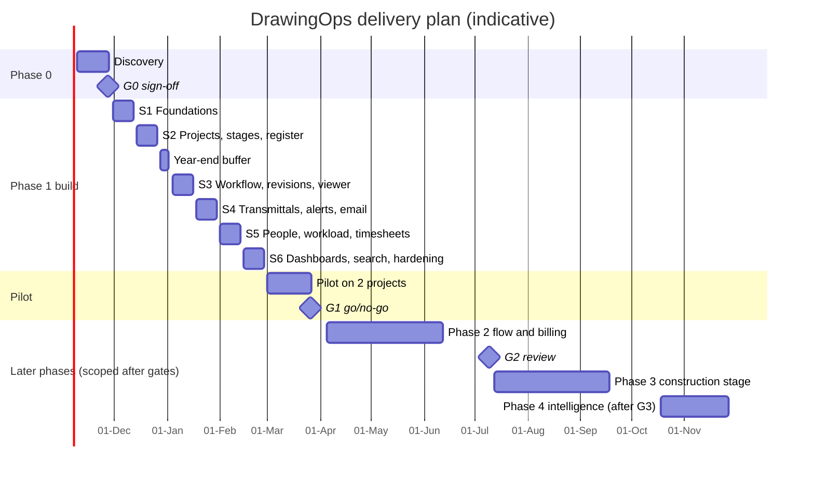

# 01 · Implementation plan

Deliver DrawingOps in gated phases: a paid 3-week discovery, then a 12-week Phase 1 build (H1–H4: register, review states, transmittals, workload, alerts, dashboards) and a 4-week pilot on two live projects. Later phases are scoped and priced only after the gate before them. Everything below is a plan built on stated assumptions; dates and effort are estimates. [UNVERIFIED]

---

## 1. Outcome we are selling

The owner sees, without phone calls, which projects are at which stage, which sheets are late or about to be late, who is overloaded and what is waiting for review; site never works from a superseded drawing. [HYPOTHESIS H1–H4]

Measured by the baseline metrics (D-05), captured in discovery and tracked monthly:

| Metric | Definition | Baseline | Target after pilot |
|---|---|---|---|
| Late issue rate | % of sheets issued after their planned date | measured in Phase 0 | agreed at G0 |
| Review wait | average working days a sheet sits in `ready_for_check` + `in_check` | measured in Phase 0 | agreed at G0 |
| Hours vs plan | logged hours ÷ planned hours per project-stage | often unknown today | visible for 100% of pilot stages |
| Stage-to-invoice delay (P2) | working days from `deliverables_issued` to invoice sent | measured in Phase 0 | agreed at G1 |

## 2. Scope by phase

Full item list with IDs: `TRACKER.md`. Behaviour: `03-features-and-functionality.md`.

| Phase | Scope | Gate at the end |
|---|---|---|
| P0 Discovery (3 weeks) | Interviews, current-process map, baseline metrics, tool and data inventory, pilot selection, fixed-scope P1 agreement | **G0** |
| P1 Visibility (12 weeks build + 4 weeks pilot) | 35 features, A-01 to A-06, D-01 to D-05, I-01, I-11, I-12, N-01 to N-10 | **G1** |
| P2 Flow and billing (~10 weeks) | Review queue and delegation, checklists, client comments and approvals, billing signal and accounting export, CAD plugins, title-block import, site view, recipient acknowledgement, A-07 to A-09 | **G2** |
| P3 Construction stage (~10 weeks) | RFIs, submittals, site reports, change orders, clash import, knowledge search, A-10 | – |
| P4 Intelligence (after ≥ 6 months of clean data) | Late-risk prediction, workload forecast, exploratory AI drawing checks | **G3** before it starts |
| Out of scope | Drawing authoring, accounting/GST/ledger, AI drawing checks before P4 | – |

## 3. Assumptions register

Each assumption has an owner question in the research document (Section 14) or below. If one proves false, the listed item changes.

| ID | Assumption | Affects | How we confirm |
|---|---|---|---|
| AS-01 | The firm drafts in AutoCAD and Revit; versions unknown | I-03, I-04, F-41 | Discovery: tools inventory |
| AS-02 | Structural design is done by outside consultants | F-43 contacts, disciplines | Discovery interview |
| AS-03 | Firm is in India (Bengaluru); English UI, INR, IST | N-08 | Given lead context; confirm |
| AS-04 | 200–250 staff users, 40–60 concurrent projects, 300–1,000 sheets per hospital project | N-01, N-09, sizing | Discovery: project list, one live register |
| AS-05 | Default stage template follows CoA staging; percentages are placeholders | F-02 | Copy of a typical appointment letter |
| AS-06 | Work week may be Mon–Fri or Mon–Sat | Working-day maths in all automations | Discovery; configurable either way |
| AS-07 | A document controller exists, or the PL issues drawings | Roles, F-14 | Discovery interview |
| AS-08 | Weekly capacity default 45 hours | A-05, F-19 | HR policy |
| AS-09 | Data volume: 100,000 sheets, 500,000 revisions, ~2 TB PDFs over 5 years | N-09, storage cost | Estimate from current file server |
| AS-10 | Office broadband good enough to view 20 MB PDFs in < 3 s | F-47 | Speed test at office |
| AS-11 | Office-hours availability (99.5% IST working hours) is enough | N-02, hosting cost | Owner decision |
| AS-12 | Staff sign in with Google Workspace or Microsoft 365 | F-40, I-11 | IT inventory |
| AS-13 | The owner will run a weekly review from the portfolio dashboard | Adoption, G1 | Owner commitment at G0 |
| AS-14 | An Indian cloud region or an on-premise server is acceptable for hospital drawings | Hosting | Owner + hospital client contracts |
| AS-15 | LatentIQ team: 1 tech lead (full-stack), 1 backend, 1 frontend, 0.5 QA, 0.25 designer; founder as product owner; a .NET developer for P2 plugins | Timeline, effort | Internal staffing |

## 4. Team and responsibilities

| Role | Who | Responsible for |
|---|---|---|
| Product owner | LatentIQ founder | Scope, priorities, acceptance, client relationship |
| Client sponsor | Firm owner | Decisions, adoption push, G0/G1 sign-off |
| Client champion | One senior architect (named at G0) | Day-to-day answers, pilot coordination, UAT |
| Discipline champions | One per discipline in pilot projects | Feedback, peer support |
| Tech lead | LatentIQ | Architecture, code review, deployments, security |
| Backend engineer | LatentIQ | Django apps, automations, integrations |
| Frontend engineer | LatentIQ | React app per DESIGN.md |
| QA (part-time) | LatentIQ | Test plans, e2e, UAT support |
| Designer (part-time) | LatentIQ | Screen specs, usability tests in pilot |
| Client IT | Firm | SSO setup, hosting/server, email relay, network access to file server |

RACI for key decisions:

| Decision | Founder | Owner | Champion | Tech lead | Client IT |
|---|---|---|---|---|---|
| P1 scope and acceptance | A | C | C | R | I |
| Hosting and data residency | C | A | I | R | R |
| SSO provider | I | A | I | R | R |
| Stage template and naming rules | R | A | C | I | – |
| Go-live after pilot (G1) | R | A | C | C | I |

(R responsible · A accountable · C consulted · I informed)

## 5. Timeline

Placeholder start date 9-Nov-2026; dates move with the signed start. The year-end week is a buffer.

Sprint-level content is in `05-build-phases.md`.

## 6. Ways of working

| Topic | Practice |
|---|---|
| Cadence | 2-week sprints; sprint review with the client champion every 2 weeks (demo on staging); owner demo at S3 and S6 |
| Backlog | `TRACKER.md` is the master list; each item moves Not started → In progress → In review → Done |
| Definition of Ready | Item has acceptance criteria in `03-…`, a screen in `DESIGN.md` if it has UI, and no open decision blocking it |
| Definition of Done | Code merged with review; unit + permission tests pass; acceptance criteria demonstrated on staging; axe check clean for UI; API schema updated; `TRACKER.md` status and notes updated; no new high/critical security findings |
| Branching | Trunk-based: short-lived branches, pull requests to `main`, CI must pass; releases tagged `v0.<sprint>.<n>` |
| Environments | dev (each engineer, Docker Compose) · staging (auto-deploy from `main`) · prod (manual promote of a tag) |
| Code ownership | All code written by LatentIQ in a new repository; nothing copied from AGPL/GPL projects (`BUILD_PROMPT.md` guardrails) |

## 7. Data migration and onboarding

1. **Template workbook** (S2): one sheet each for projects, stages, team, sheets; validated by the importer (F-05, F-54).
2. **Pilot projects** (pilot week 1): client champion fills the workbook with LatentIQ help; PDFs of past issues bulk-loaded as historic revisions; no notifications fire during import.
3. **Users** come from SSO on first sign-in; Admin adds discipline, capacity and project roles (or a bulk staff import).
4. **Wave rollout** after G1: all hospital projects, then all live projects, one discipline group per week.

## 8. Rollout and adoption

Adoption is the main risk (research §13), so it has its own plan.

| Step | When | What |
|---|---|---|
| Owner commitment | G0 | Owner agrees to run the Monday meeting from the portfolio dashboard |
| Champion training | Pilot week 1 | 90-minute session; champions get admin-lite rights for their project |
| Role training | Pilot week 1 | 45-minute sessions per role (designer, lead, reviewer, DC); one-page quick-reference cards |
| Office hours | Pilot weeks 1–4 | 30 minutes daily on video; issues logged in the tracker |
| Usage review | Weekly in pilot | % sheets with owner and date; % transitions within 1 working day of the real event (sampled); weekly active users; dashboard views by owner |
| Feedback fixes | Pilot weeks 2–4 | Small UX fixes shipped weekly |

## 9. Gates

| Gate | Pass criteria (proposed; agree with owner) |
|---|---|
| G0 | Owner confirms the top 3 problems; baseline metrics measured on at least 2 past projects; pilot projects and champions named; hosting and SSO decided; P1 fixed scope and price signed |
| G1 | ≥ 90% of pilot sheets have an owner and a planned date; ≥ 80% of sampled state changes recorded within 1 working day; owner used the dashboard in ≥ 3 of 4 weekly meetings; A-01 raised "At risk" before the due date for ≥ 70% of pilot sheets that went late; no open severity-1 defects |
| G2 | Review wait and stage-to-invoice delay improved against baseline by the targets set at G1; client comments logged for ≥ 80% of client feedback on pilot projects |
| G3 | ≥ 6 months of clean history and ≥ 2,000 completed sheet cycles before any model is trained |

## 10. Effort estimate

Person-weeks, LatentIQ side, with the team in AS-15. [UNVERIFIED estimates; refine after G0]

| Phase | Effort | Notes |
|---|---|---|
| P0 Discovery | ~4–5 | Founder + analyst; includes baseline measurement |
| P1 Build (6 sprints) | ~45 | 3.75 FTE × 12 weeks |
| P1 Pilot support | ~8 | 2 FTE × 4 weeks |
| P2 | ~35–40 | Includes .NET plugin developer for I-03/I-04 |
| P3 | ~30–35 | |
| P4 | ~15–20 | Needs data-science skills |

Commercial note for the founder: price P0 as a fixed fee, P1 as a fixed price against the signed scope (change requests separate), then a monthly support and hosting retainer. Keep ownership of the reusable core (stages, sheet states, rules) so it can be sold to other design firms. [UNVERIFIED: recommendation]

## 11. Support after go-live

| Item | Proposal |
|---|---|
| Support hours | IST working days, 09:30–18:30 |
| Severity 1 (system down, cannot issue) | Response 1 hour, workaround 4 hours |
| Severity 2 (feature broken, workaround exists) | Response 4 hours, fix next release |
| Releases | Every 2 weeks, staging first, change note emailed |
| Backups | Verified by monthly restore drill (N-02) |

## 12. Risks

| Risk | Mitigation in this plan |
|---|---|
| Statuses not kept current | One-click actions; owner-led weekly review; champions; usage review in pilot (§8) |
| Leads don't plan sheet dates | Packages (F-49) with dates first; Excel import |
| Problems smaller than hypothesised | G0 baseline before build |
| Scope creep | Fixed P1 scope; tracker-based change requests |
| CAD integration effort | P1 uses import and PDF upload only; plugins in P2 after versions are known |
| Licence contamination | Clean-room rule; dependency licence scan in CI |
| Data residency for hospital drawings | Decide hosting at G0 |
| Holiday season slows S2–S3 | Year-end buffer week |

## 13. Decisions needed from the owner

| ID | Decision | Needed by |
|---|---|---|
| DEC-01 | Hosting: Indian cloud region or on-premise | G0 |
| DEC-02 | SSO provider: Google Workspace or Microsoft 365 | G0 |
| DEC-03 | Timesheets: use DrawingOps or import from an existing tool | S5 start |
| DEC-04 | Work week and holiday calendar | S1 |
| DEC-05 | Stage template and fee percentages | S2 |
| DEC-06 | Sheet numbering and file-naming rules | S2 |
| DEC-07 | Who issues drawings (document controller or PL) | S4 |
| DEC-08 | Milestones that need senior QC | S3 |
| DEC-09 | WhatsApp capture: allowed or not (I-10) | G1 |
| DEC-10 | Paperless-ngx sidecar for scanned paperwork (I-13) | P2 start |

## 14. Next 3 actions

1. Send the owner the research questions and DEC-01, DEC-02, DEC-05, DEC-06; book discovery. Owner: founder. Metric: call booked.
2. Collect one appointment letter, one live sheet register and a file-server folder listing. Owner: founder. Metric: all three received.
3. Create the repository and run Sprint S1 kickoff with `BUILD_PROMPT.md` once G0 is signed. Owner: tech lead. Metric: S1 started on date.
