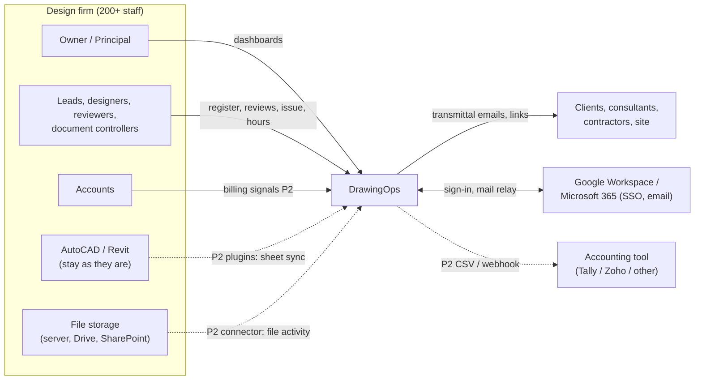
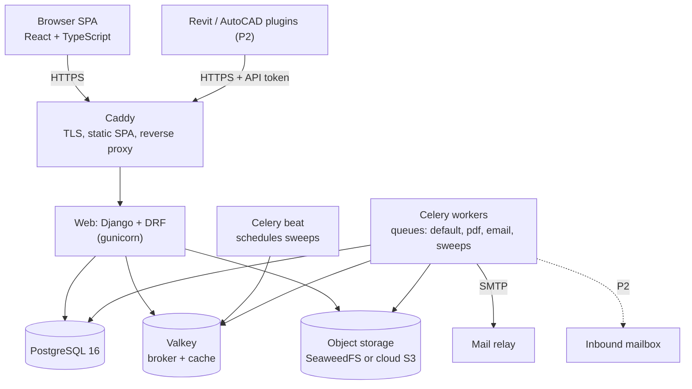
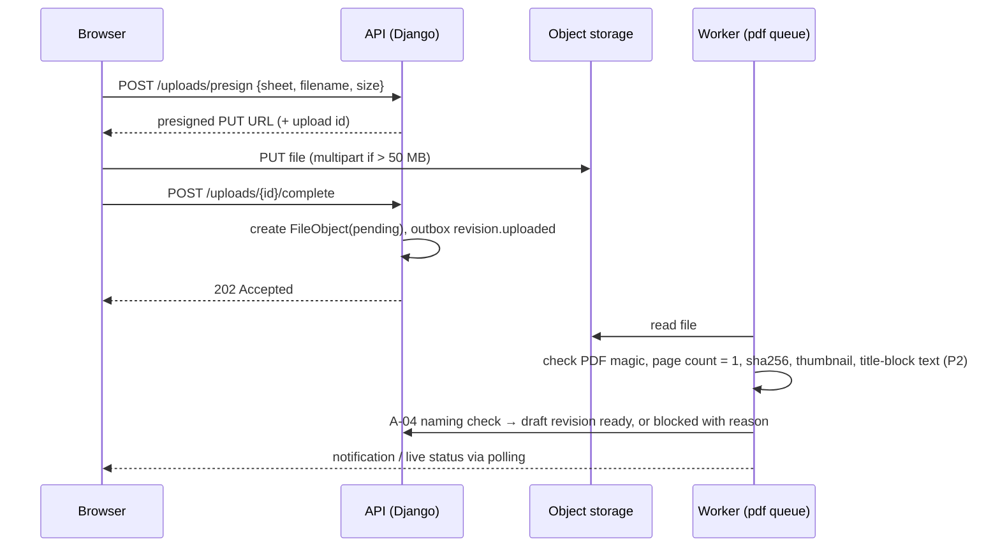

# 02 · Architecture

DrawingOps is a **modular monolith**: one Django application split into domain apps, a React single-page app, Celery workers for background jobs and daily sweeps, PostgreSQL, Redis and S3-compatible object storage, all deployed with Docker Compose on one server. That is the simplest design that meets 200–300 users and leaves room to grow; microservices and Kubernetes would add cost without benefit at this size. [UNVERIFIED: design judgement]

Feature IDs refer to `03-features-and-functionality.md`; decisions are recorded as ADRs in §15.

---

## 1. System context



## 2. Containers



| Container | Responsibility |
|---|---|
| Caddy | HTTPS certificates, serves the built SPA, proxies `/api`, `/_allauth`, `/django-admin` (support admin, DD-009), `/t/` (external transmittal links) to Django, and `/<bucket>/*` to object storage on the same origin (DD-006) |
| Web | REST API, auth, permissions, business services, Django admin for support staff |
| Celery workers | PDF processing (hash, page check, thumbnail, watermark, cover sheet), email, exports, outbox dispatch, sweeps |
| Celery beat | Schedules A-01, A-02, A-05, A-06 (P1) and A-07, A-08, A-10 (later), dashboard refresh, digests |
| PostgreSQL | All data, full-text search, materialised views for dashboards |
| Valkey | Celery broker, cache, rate limits (Valkey, not Redis ≥ 7.4, for licence reasons; DD-006) |
| Object storage | Issued PDFs, redlines, cover sheets, exports, watermarked copies (cache) |

## 3. Technology choices

Versions are those seen on PyPI and npm on 23 Oct 2026; pin exact versions when scaffolding.

| Layer | Choice | Licence | Why |
|---|---|---|---|
| Language | Python 3.12 | PSF | Mature, same as both reference projects |
| Web framework | Django 5.2.x (LTS line; Paperless-ngx also pins 5.2) | BSD-3-Clause | Auth, ORM, migrations and admin out of the box; fastest path for a CRUD-heavy, permission-heavy system |
| API | Django REST Framework 3.16+ (3.18.3 current), drf-spectacular 0.30 | BSD-3-Clause | OpenAPI schema → generated TypeScript client |
| Jobs | Celery 5.6, django-celery-beat 2.9 | BSD | Sweeps, PDF work, email; schedules editable by admin |
| Database | PostgreSQL 16 (with `pg_trgm`) | PostgreSQL | Full-text search, JSONB, materialised views, row-level reliability |
| Driver | psycopg 3.3 | LGPL-3.0 | Standard driver; used unmodified as a library |
| Broker/cache | Valkey 8 | BSD-3-Clause | Celery broker and cache. Redis ≥ 7.4 is RSAL/SSPL and Redis 8 adds AGPL, so it is not used (DD-006) |
| Object storage | SeaweedFS (on-prem/dev, Apache-2.0) or AWS S3 / Azure Blob (cloud) via the S3 API (boto3). MinIO was dropped: AGPL-3.0 and archived upstream (DD-006, docs/06 R-01) | django-storages BSD-3-Clause | S3 API keeps hosting options open |
| PDF | pikepdf 10 (MPL-2.0), pypdfium2 5 (BSD-3/Apache-2.0), WeasyPrint (BSD) | as listed | Page checks, thumbnails, watermark overlay, HTML-to-PDF cover sheets |
| OCR (P2) | OCRmyPDF 17 | MPL-2.0 | Text for scanned PDFs and title-block reading (F-50) |
| Excel | openpyxl 3.1 | MIT | Register import (F-05) and exports (F-52) |
| Auth | django-allauth 65 (OIDC for Google/Microsoft, MFA) | MIT | SSO + TOTP for local admins |
| Frontend | React 19, TypeScript, Vite 8, React Router, TanStack Query 5, TanStack Table + Virtual, react-hook-form + zod, Radix primitives styled with Tailwind CSS 4 (shadcn/ui pattern), Recharts 3, PDF.js 6, i18next | MIT / Apache-2.0 | Common, well-documented stack; virtualised grids for 1,000+ sheets |
| Monitoring | sentry-sdk (MIT) to Sentry or self-hosted GlitchTip; django-prometheus (Apache-2.0) | as listed | Errors, metrics |
| App server | gunicorn 26 | MIT | Standard WSGI server |
| Tests | pytest, factory-boy, Playwright (Apache-2.0), Vitest (MIT), k6 or Locust for load | permissive | See §13 |
| CAD plugins (P2) | C#/.NET against the Revit API and AutoCAD .NET API for the firm's versions | Autodesk SDK terms | Read sheet lists and title blocks inside the CAD tool; target framework depends on the Revit/AutoCAD year [UNVERIFIED: confirm versions in discovery] |

**Alternative considered:** FastAPI + SQLAlchemy (OpenConstructionERP's stack). Rejected for this team size because auth, admin, permissions and migrations would be hand-built. [UNVERIFIED]

## 4. Code layout

```text
drawingops/
  backend/
    config/                  settings (base/dev/prod), urls, celery.py, asgi/wsgi
    apps/
      core/                  Organisation, OrgSettings, Discipline, Holiday, WorkWeek, base model, IDs
      accounts/              User, OrgRole, ApiToken, SSO adapters
      contacts/              ExternalOrg, Contact                         (F-43)
      projects/              Project, Stage, StageTemplate, Package, ProjectMembership  (F-01..03, F-49)
      files/                 Upload, FileObject (verified, deduplicated; DD-004, DD-024)
      register/              Sheet, SheetRevision, NamingRule, imports, title blocks    (F-04..08, F-35, F-41, F-46..48, F-54)
      workflow/              state machine, StatusTransition, Review, Checklist (P2)     (F-10..13)
      transmittals/          Transmittal, TransmittalItem, TransmittalRecipient          (F-14, F-15)
      people/                StaffProfile, Leave, Allocation, TimeEntry, Timesheet       (F-16..19)
      automation/            AutomationRule, AutomationRun, Flag, sweeps                 (F-20, A-01..A-10)
      notifications/         Notification, Preference, DigestQueue, email templates     (F-21)
      dashboards/            read models, materialised views, metrics                   (F-22, F-23, F-53)
      search/                search views and indexes                                   (F-44)
      exports/               export jobs                                                (F-52)
      audit/                 AuditEvent, middleware                                     (F-39)
      outbox/                OutboxEvent, OutboxDelivery, @handles dispatch             (§7)
      comments/        (P2)  ClientComment, ClientApproval, InboundEmail                (F-24..26)
      billing/         (P2)  BillingSignal                                              (F-27, F-28)
      ca/              (P3)  RFI, Submittal, SiteReport, ChangeOrder                    (F-30..33)
      coordination/    (P3)  ClashIssue, BCF import                                     (F-34)
      knowledge/       (P3)  Decision log, cross-project knowledge search               (F-58)
      cadsync/         (P2)  SyncSource, SyncBatch, SyncProposal, CadFileEvent (plugins, storage connector)
      intelligence/    (P4)  FeatureSnapshot, ModelRun, Prediction, WorkloadForecast, Finding (F-55..57)
    tests/
  frontend/
    src/app/                 shell, routing, auth guard, layout
    src/features/<module>/   pages, components, hooks per module
    src/components/ui/       design-system components (DESIGN.md)
    src/lib/api/             generated OpenAPI client + TanStack Query hooks
  plugins/             (P2)
    src/DrawingOps.Sync.Core/   netstandard2.0: sheet collection, API client (tested in CI)
    src/DrawingOps.Revit/       Revit add-in shell (firm's Revit API assemblies; DD-033)
    src/DrawingOps.AutoCAD/     AutoCAD plugin shell (firm's AutoCAD .NET assemblies; DD-033)
    tests/DrawingOps.Sync.Core.Tests/
  deploy/
    docker-compose.yml, caddy/, backup/, env.example        self-hosted stack
    railway/env.example, aws/ (S3 CORS, IAM, bucket policy)  managed stack (DD-025)
  backend/bin/, backend/railway/  web, worker, beat, tick entry points and Railway configs
  frontend/vercel.json, frontend/scripts/vercel-*.mjs   Vercel build and backend proxy
  docs/                      this document set
```

**Inside each app:** `models.py` (data), `services.py` (all writes and business rules, inside transactions, emitting events), `selectors.py` (read queries), `api/` (DRF serializers and views, thin), `tasks.py` (Celery), `events.py` (event handlers), `permissions.py`, `tests/`. Views never write to models directly; they call services. [UNVERIFIED: convention]

## 5. Data model

All tables carry `id` (UUID), `organisation_id`, `created_at`, `updated_at`, `created_by`. Deployment is single-tenant, but every query is scoped by organisation so the same code can later run as multi-tenant SaaS (ADR-010).

```mermaid
erDiagram
  ORGANISATION ||--o{ PROJECT : has
  ORGANISATION ||--o{ USER : employs
  PROJECT ||--o{ STAGE : "fee stages"
  PROJECT ||--o{ PACKAGE : groups
  PROJECT ||--o{ PROJECT_MEMBERSHIP : team
  USER ||--o{ PROJECT_MEMBERSHIP : "has role"
  PROJECT ||--o{ SHEET : owes
  STAGE ||--o{ SHEET : "deliverable of"
  PACKAGE ||--o{ SHEET : contains
  SHEET ||--o{ SHEET_REVISION : versions
  SHEET ||--o{ STATUS_TRANSITION : history
  SHEET ||--o{ REVIEW : checked_by
  SHEET_REVISION }o--|| FILE_OBJECT : pdf
  PROJECT ||--o{ TRANSMITTAL : issues
  TRANSMITTAL ||--o{ TRANSMITTAL_ITEM : lists
  TRANSMITTAL_ITEM }o--|| SHEET_REVISION : sends
  TRANSMITTAL ||--o{ TRANSMITTAL_RECIPIENT : to
  TRANSMITTAL_RECIPIENT }o--|| CONTACT : is
  USER ||--o| STAFF_PROFILE : has
  USER ||--o{ ALLOCATION : planned
  USER ||--o{ TIME_ENTRY : logged
  STAGE ||--o{ ALLOCATION : "for stage"
  STAGE ||--o{ TIME_ENTRY : "for stage"
  FLAG }o--|| SHEET : "or person-week"
  STAGE ||--o{ CLIENT_APPROVAL : "P2"
  STAGE ||--o{ BILLING_SIGNAL : "P2"
  PROJECT ||--o{ CLIENT_COMMENT : "P2"
  PROJECT ||--o{ RFI : "P3"
```

### Key tables (Phase 1)

| Table | Key columns | Notes |
|---|---|---|
| `organisation` | name, timezone (default Asia/Kolkata), currency (INR), work_week (Mon–Fri or Mon–Sat) | Work week is a setting because many Indian offices work Saturdays [ASSUMPTION AS-06] |
| `org_settings` | revision_scheme, purpose_codes[], thresholds (JSON per rule), digest_time | Edited in F-42 |
| `discipline` | code (A, S, C, M, E, P, F, X…), name, sheet_prefix_regex | Drives numbering checks (F-35) |
| `holiday` | date, name | Working-day calendar |
| `user` | email, name, org_role, is_active | Django auth user |
| `staff_profile` | user, discipline, team, weekly_capacity_h, cost_rate (optional, hidden) | F-16 |
| `leave` | user, start, end, type | Reduces capacity |
| `external_org`, `contact` | name, type (client/consultant/contractor/authority), email, phone | F-43 |
| `project` | code (unique per org), name, client (external_org), type, location, status, start, end, cad_versions[] | F-01 |
| `project_membership` | project, user, role (PL, DL, DESIGNER, SENIOR_REVIEWER, DC, VIEWER), discipline | F-38 |
| `stage_template`, `stage_template_item` | name, items (seq, name, fee_pct, required_purposes[]) | F-02 |
| `stage` | project, seq, name, fee_pct, fee_amount (optional), planned_start/end, actual_start/end, state, requires_senior_qc, required_purposes[] | F-03 |
| `package` | project, name, discipline, planned_date | F-49 |
| `sheet` | project, stage, package, discipline, number, title, aliases[], owner (user), checker (user), planned_issue_date, state, state_before_hold, current_revision, replaced_by, cad_link, search_vector | F-04, F-10; unique (project, number) |
| `sheet_revision` | sheet, code, seq, state (draft/issued/superseded), purpose, suitability, file, issued_at, issued_by, transmittal, superseded_at, change_summary | F-06..08; unique (sheet, code); partial unique index: one `issued` per sheet |
| `file_object` | storage_key, sha256, size, mime, original_name, page_count, thumbnail_key | F-41; unique (organisation, sha256) |
| `status_transition` | sheet, from_state, to_state, actor, role, reason, at, request_id | F-10, F-39 |
| `review` | sheet, revision, kind (check / senior_qc), reviewer, state (open/returned/approved), opened_at, closed_at, comment, redline_files[] | F-11 |
| `transmittal` | project, number (unique per project), purpose, sent_at, sent_by, cover_file, note, supersedes_transmittal | F-14 |
| `transmittal_item` | transmittal, revision | |
| `transmittal_recipient` | transmittal, contact, delivery (email/hand), link_token_hash, link_expires_at, delivered_at, bounced_at, acknowledged_at (P2) | |
| `allocation` | user, project, stage, iso_week (date of Monday), planned_h | F-17; unique (user, stage, week) |
| `timesheet` | user, iso_week, state (draft/submitted/approved), submitted_at, approved_by | F-18 |
| `time_entry` | timesheet, project, stage, date, hours, note | |
| `automation_rule` | key (A-01…), enabled, params JSON | F-42 thresholds |
| `automation_run` | rule, started_at, finished_at, raised, cleared, notified, error | Dead-man alert if missing (N-05) |
| `flag` | entity_type, entity_id, kind, raised_at, cleared_at, rule, data JSON | One open flag per (entity, kind) via partial unique index |
| `notification` | user, event, entity, payload, channel, created_at, read_at, delivered_at | F-21 |
| `notification_preference` | user, event, mode (instant/digest/off) | |
| `outbox_event` | name, payload, created_at, dispatched_at, attempts, last_error | §7 |
| `audit_event` | actor, verb, entity_type, entity_id, before JSON, after JSON, ip, request_id, at | F-39; insert-only (DB trigger blocks UPDATE/DELETE) |
| `naming_rule` | scope (org/project), target (sheet_number/file_name), regex, example, message | F-35 |
| `import_job` | project, kind, file, mapping JSON, state, report JSON, undo_until | F-05, F-54 |
| `export_job` | user, kind, filters JSON, state, file | F-52 |

Phase 2–4 tables (`client_comment`, `client_approval`, `inbound_email`, `billing_signal`, `checklist`, `delegation`, `rfi`, `submittal`, `site_report`, `change_order`, `clash_issue`, `prediction`) are added in their phase with the same conventions.

## 6. Sheet state machine

Implemented as one table of allowed transitions in `workflow/state_machine.py`, not scattered `if` statements.

```text
TRANSITIONS = {
  ("planned", "start")            -> "in_progress"         roles: DL, PL, owner-of-sheet
  ("in_progress", "submit")       -> "ready_for_check"     roles: owner-of-sheet, DL, PL     guard: checker assigned
  ("ready_for_check", "withdraw") -> "in_progress"         roles: owner-of-sheet
  ("ready_for_check", "start_check") -> "in_check"         roles: checker, PL                guard: actor != owner
  ("in_check", "return")          -> "changes_requested"   roles: checker, senior, PL        guard: comment or redline
  ("in_check", "approve")         -> "approved_for_issue"  roles: checker, senior, PL        guard: senior QC done if stage requires
  ("changes_requested", "resume") -> "in_progress"         roles: owner-of-sheet, DL, PL
  ("approved_for_issue", "reopen")-> "in_progress"         roles: owner-of-sheet, DL, PL
  ("approved_for_issue", "issue") -> "issued"              roles: DC, PL                     guard: draft revision with PDF, purpose; via transmittal service only
  ("issued", "next_revision")     -> "in_progress"         roles: owner-of-sheet, DL, PL     effect: new draft revision code
  ("issued", "supersede_sheet")   -> "superseded"          roles: PL                         guard: reason, replaced_by optional
  (any active, "hold")            -> "on_hold"             roles: PL                         effect: remember state_before_hold
  ("on_hold", "resume_hold")      -> state_before_hold     roles: PL
  (any non-terminal, "cancel")    -> "cancelled"           roles: PL                         guard: reason
}
```

`workflow.services.transition(sheet, action, actor, reason)` locks the sheet row (`SELECT … FOR UPDATE`), checks role and guard, writes the new state, a `status_transition` row and an audit event, and emits `sheet.state_changed` to the outbox, all in one transaction. The API exposes one endpoint, `POST /sheets/{id}/transitions {action, reason}`, and returns `409` with the allowed actions when a move is not allowed.

## 7. Events and the outbox

Services never call notifications or automations directly. They write an `outbox_event` row in the same transaction as the business change; a dispatcher (Celery task triggered `on_commit`, plus a 30-second safety sweep) sends each event to its registered handlers. Handlers are idempotent, keyed by `(event_id, handler_name)`.

| Event | Emitted by | Handlers |
|---|---|---|
| `sheet.state_changed` | workflow | notifications (§18 of spec), stage roll-up (F-03), dashboard cache invalidation |
| `revision.issued` | transmittals | A-03 supersede + notify previous recipients, stage roll-up, A-09 check (P2) |
| `revision.uploaded` | register | A-04 naming check, PDF pipeline (hash, pages, thumbnail) |
| `transmittal.sent` | transmittals | email delivery, audit |
| `stage.state_changed` | projects | notifications, A-09 (P2) |
| `allocation.changed`, `timesheet.submitted` | people | flag recompute for that person-week |
| `client_approval.recorded` (P2) | comments | A-09 |
| `comment.created` (P2) | comments | assignment notifications |

Pattern note: OpenConstructionERP has an in-process `EventBus` (`backend/app/core/events.py`) with `Event(name, data, id, timestamp, source_module)`. We keep the idea of named domain events but make them durable through the outbox so no notification is lost if a worker restarts. Clean-room: no code copied (ADR-008).

## 8. Automation engine

- Each rule A-01…A-10 is a Python class with `key`, `schedule` or `event`, `evaluate()` (returns entities that should be flagged) and `act()`.
- Thresholds come from `automation_rule.params`, edited in org settings (F-42).
- Sweeps run in the `sweeps` queue; each run writes an `automation_run` row. If a scheduled run is missing by 09:00, an alert fires (N-05).
- Flags: raising an already-open flag is a no-op; when the condition ends, the flag is cleared with `cleared_at`. This keeps history for metrics (D-05) and makes reruns safe.
- Working days are computed from `organisation.work_week` and `holiday`.
- Escalation (A-02) uses the flag's `raised_at`: if open ≥ 3 working days and not yet escalated (`data.escalated_at`), notify PL and set it.

Pattern note: OpenConstructionERP's `deadlines` module sweeps RFIs, submittals and punch items with a `classify(due, status, today, terminal_states, approaching_days)` approach. Ours applies the same idea to sheets and person-weeks.

## 9. Files and PDFs



- Maximum upload 200 MB (N-03). One sheet per PDF in P1.
- Issued files are immutable; deletes are soft and Admin-only for drafts.
- **Watermark (F-48):** on first download of a superseded revision, a worker overlays a "SUPERSEDED dd-Mon-yyyy" stamp (pikepdf over a WeasyPrint-generated stamp page) and caches the result under a derived key.
- **Cover sheet (F-14):** HTML template rendered by WeasyPrint with firm logo, transmittal number, purpose, recipients and the sheet table.
- **External links (`/t/<token>`):** token is random 32 bytes, stored hashed, expires per settings; downloads are logged per recipient.
- **CAD files (F-41):** stored as links only in P1; P2 connector (I-02) records file-changed activity, never copies DWG/RVT.

## 10. Search

- Postgres full-text: `search_vector` on sheet (number, title, aliases), project (code, name), transmittal (number), contact (name, email); GIN indexes.
- `pg_trgm` index on sheet number for partial matches like "101" or "A-1".
- Every search query joins through `project_membership` so results respect access (F-38).
- P2: extracted PDF text (vector PDFs via pypdfium2; scanned via OCRmyPDF) and client comments added to the index. A dedicated search engine (OpenSearch) only if Postgres search measurably fails N-01 (ADR-004).

## 11. Identity and access

- **Sign-in:** django-allauth with OIDC providers for Google Workspace and Microsoft 365 (whichever the firm uses), plus local accounts with TOTP for admins and break-glass access (F-40).
- **Sessions:** SPA and API share one origin behind Caddy; secure, HTTP-only, SameSite=Lax session cookie plus CSRF token.
- **API tokens:** for CAD plugins and integrations; hashed at rest, scoped (`cad_sync:write`, `accounting:read`), expiring, revocable.
- **Authorisation:** one permission map (`accounts/permissions.py`) from action to allowed org and project roles, mirroring the matrix in spec §17. Enforced in services (the source of truth) and in DRF permission classes; list querysets are always filtered by membership. A generated test runs every endpoint × role pair. Ids in request bodies resolve only inside the caller's organisation (`OrgPrimaryKeyRelatedField`, DD-030), and uploads can only be attached by the person who uploaded them.
- **Outbound calls:** Admin-configured URLs (billing webhook) go through `core/net.py`: public addresses only, pinned connection, no redirects (DD-029).
- **Generated PDFs:** `core/pdf.render_pdf` loads only `data:` URIs, so rendering never fetches a URL or reads a local file (DD-037).
- **Sign-in limits:** by the real client IP (`TRUSTED_PROXY_COUNT`), never the proxy's: 5 failures per account per 5 min, 20 failures and 120 sign-ins per IP per minute (DD-038).
- **External recipients:** no accounts in P1; tokenised links only. P2 site view (F-51) uses magic-link sessions limited to one project's current issued set.

## 12. API

REST under `/api/v1`, JSON, cursor pagination, filter and sort query parameters, OpenAPI 3 from drf-spectacular, TypeScript client generated with `openapi-typescript`. Mutating endpoints accept an `Idempotency-Key` header (required for plugins).

| Area | Endpoints (P1 unless marked) |
|---|---|
| Me and org | `GET /me` · `GET/PATCH /org/settings` · `/disciplines` · `/holidays` · `/stage-templates` · `/naming-rules` · `/users` · `/staff-profiles` · `/leave` |
| Contacts | `/external-orgs` · `/contacts` |
| Projects | `/projects` · `/projects/{id}` · `/projects/{id}/stages` · `/projects/{id}/packages` · `/projects/{id}/members` |
| Register | `/projects/{id}/sheets` (GET list with filters, POST, `POST /bulk`) · `/sheets/{id}` · `POST /sheets/{id}/transitions` · `/sheets/{id}/revisions` · `GET /revisions/{id}/download` · `POST /uploads/presign` · `POST /uploads/{id}/complete` |
| Import | `POST /projects/{id}/imports` (upload) · `GET /imports/{id}` (preview) · `POST /imports/{id}/commit` · `POST /imports/{id}/undo` |
| Reviews | `GET /reviews?assigned_to=me` · `POST /reviews/{id}/return` · `POST /reviews/{id}/approve` · `POST /reviews/{id}/redlines` |
| Transmittals | `/projects/{id}/transmittals` · `POST /transmittals/{id}/send` · `GET /transmittals/{id}/cover.pdf` · `GET /t/{token}` (public) |
| People | `/allocations` (bulk upsert) · `/timesheets` · `POST /timesheets/{id}/submit` · `POST /timesheets/{id}/approve` · `GET /workload?from&to&discipline` |
| Alerts | `/flags` · `/notifications` · `POST /notifications/read` · `/notification-preferences` |
| Dashboards | `GET /dashboards/portfolio` · `/dashboards/projects/{id}` · `/dashboards/disciplines/{code}` · `/dashboards/me` · `/reports/baseline?from&to` |
| Search, export, audit | `GET /search?q=` · `POST /exports` · `GET /exports/{id}` · `GET /audit` (Admin, Owner) |
| P2 | `/comments` · `POST /inbound/email` (webhook) · `POST /stages/{id}/approval` · `/billing-signals` · `POST /integrations/cad-sync` · `/webhooks` · `/checklists` · `/delegations` |
| P3 | `/rfis` · `/submittals` · `/site-reports` · `/change-orders` · `POST /projects/{id}/clash-imports` · `/knowledge/search` |

## 13. Quality and testing

| Level | Tooling | Must cover |
|---|---|---|
| Unit | pytest, factory-boy | Every state-machine transition and guard; every automation rule including idempotency and working-day maths; stage roll-up |
| Permissions | generated pytest matrix | Every endpoint × role from spec §17 |
| API contract | schemathesis or OpenAPI snapshot | Schema changes are reviewed |
| Frontend | Vitest + Testing Library | Components with loading/empty/error states |
| End-to-end | Playwright against Docker Compose | Create project → import register → start → submit → return → approve → issue → transmittal email → supersede → dashboard counts |
| Accessibility | axe-core in Playwright | WCAG 2.2 AA on every P1 page (N-04) |
| Load | k6 or Locust | 200 concurrent users, N-01 targets |
| Security | pip-audit, npm audit, Trivy, gitleaks, Semgrep (`make sast`), ruff flake8-bandit, OWASP ZAP baseline on staging | N-03 |

Coverage target: ≥ 85% lines on `services.py` and `automation/`; no target for views. [UNVERIFIED]

## 14. Deployment and operations

| Topic | Decision |
|---|---|
| Hosting | Firm's choice: an Indian cloud region (AWS Mumbai/Hyderabad, Azure India, GCP Mumbai) or an on-premise server. Decide in Phase 0 (open question: data residency for hospital drawings). Managed option built: Railway (web, worker, beat) + Vercel (SPA and same-origin proxy) + Upstash Redis + Amazon S3 + SMTP (DD-025, DD-026; `docs/runbooks/deploy-railway-vercel.md`). |
| Topology | One VM with Docker Compose: caddy, web (6 gunicorn processes × 4 threads: N-01 measured 25-Oct-2026, 200 users at p95 220 ms; 2 processes gave 580 ms), worker ×2 (queues default/email/sweeps and pdf), beat, postgres, valkey, seaweedfs. Managed Postgres and S3 can replace containers in cloud. |
| Sizing (estimate) | 8 vCPU, 32 GB RAM, 200 GB SSD for OS/DB; object storage sized for ~2 TB over 5 years [UNVERIFIED: AS-09] |
| Environments | dev (local compose), staging (same compose, anonymised copy of prod), prod |
| CI/CD | GitHub Actions: lint, type-check, tests, e2e, scans → build images → push to registry → deploy staging on `main` → deploy prod on version tag with manual approval |
| Migrations | Django migrations, expand-then-contract for breaking changes; backup before every prod deploy |
| Backups | Postgres: nightly base backup + WAL archiving (7-day point-in-time recovery); object storage: bucket versioning (cloud) or nightly sync to a second location (on-prem); monthly restore drill (N-02) |
| Monitoring | Sentry/GlitchTip errors; Prometheus + Grafana (API latency, queue depth, sweep duration, email failures); uptime check on `/healthz`; alert on missing `automation_run` |
| Logs | JSON to stdout with request ID and user ID; 30-day retention |
| Secrets | Environment files outside the repo, or the cloud secret manager |

## 15. Architecture decision records

| ADR | Decision | Reason |
|---|---|---|
| 001 | Modular monolith, not microservices | Team of 3–4, 300 users; one deployable is cheaper to build, test and run |
| 002 | Django + DRF over FastAPI | Built-in auth, admin, ORM migrations; matches Paperless-ngx stack if option B is ever used |
| 003 | React SPA, generated API client | Rich grid and viewer interactions; typed contract with backend |
| 004 | PostgreSQL full-text search before a search engine | Enough for 100k sheets; one less system |
| 005 | S3-compatible object storage | Same code for on-prem SeaweedFS and cloud |
| 006 | Transactional outbox for domain events | No lost notifications or flags on worker restarts |
| 007 | Do not build on Paperless-ngx (see `00-paperless-ngx-assessment.md`) | Its file-first model cannot hold planned sheets; most of our core is absent |
| 008 | Clean-room implementation relative to OpenConstructionERP | It is AGPL-3.0; copying code would impose AGPL on our product |
| 009 | Link CAD files, store issued PDFs | Avoid DWG/RVT version and size problems; PDFs are the legal record |
| 010 | `organisation_id` on every table, single-tenant deployment | Enables later SaaS for other design firms without a rewrite |
| 011 | Celery beat for sweeps, rules in code with thresholds in data | Testable rules, admin-tunable thresholds |
| 012 | No AI in P1–P3 | Visibility first; AI needs clean history (G3) |

## 16. Patterns taken from the references (ideas only)

| Pattern | Seen in | How we use it |
|---|---|---|
| ISO 19650 container → revision → state transition with actor, role, reason, signature | OpenConstructionERP `modules/cde/models.py` | `sheet` → `sheet_revision` → `status_transition` |
| Sheet fields on documents (drawing number, sheet number/title, discipline, revision, is_current) | OpenConstructionERP `modules/documents/models.py` | `sheet` columns |
| Transmittal, recipient, item | OpenConstructionERP `modules/transmittals/models.py` | Same three tables |
| Approval route with steps, instances, step states, delegation | OpenConstructionERP `modules/approval_routes/models.py` | Review + senior QC; delegation in F-12 |
| Notification, preference, digest queue, webhook target | OpenConstructionERP `modules/notifications/models.py` | F-21 and P2 webhooks |
| Overdue sweeper with escalation | OpenConstructionERP `modules/deadlines/service.py` | A-01, A-02, A-07, A-08, A-10 |
| Module manifest with name, depends, category | OpenConstructionERP `module_loader` manifests | Django app config with explicit dependencies |
| Consume pipeline, mail rules, scheduled triggers with date offsets, file versions sharing metadata | Paperless-ngx `docs/usage.md` | Upload pipeline, F-25, A-01/A-02, revisions |

## 17. Phase 4 intelligence (design outline)

Defined per the AI-agent framework; built only after gate G3 (≥ 6 months of clean history).

| Item | F-55 Late-risk prediction | F-56 Workload forecast | F-57 AI drawing checks |
|---|---|---|---|
| Objective | Rank open sheets by chance of missing their date | Predict hours per discipline for 8 weeks | Flag missing title-block fields and broken references on issued PDFs |
| Inputs | Sheet history: discipline, stage, planned duration, revisions so far, time in each state, checker queue length, owner load | Planned sheets, historical hours per sheet type, allocations | Issued PDF text and images, title-block rules |
| Model | Gradient-boosted trees (scikit-learn or LightGBM); no LLM needed | Regression on history; seasonal baseline | Rule checks first; a vision LLM only for what rules cannot do |
| Actions | Show score and top reasons; never changes data | Show forecast beside allocations | Create advisory findings for a human |
| Human in the loop | Leads decide; overrides recorded | Leads allocate | Every finding accepted or rejected by a reviewer |
| Guardrails | Advisory only; no individual performance ranking | Discipline level only | Never blocks an issue; no client data sent to an outside model without written consent |
| Evaluation | Monthly back-test vs A-01 (precision in top 20%) | MAPE per discipline-week | Precision/recall on ≥ 200 labelled sheets before rollout |
