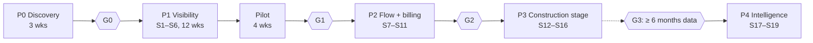

# 05 · Build phases

Nineteen 2-week sprints in four build phases, plus discovery and a pilot. Each sprint lists the tracker IDs it delivers, the work by layer, the demo, and the exit check. Sprint contents match `TRACKER.md` exactly; if you move an item, move it in both. Durations are estimates for the team in `01-implementation-plan.md` AS-15. [UNVERIFIED]

---

## Phase 0 · Discovery (3 weeks)

**Items:** P0-01 to P0-08, G0.

| Week | Work |
|---|---|
| 1 | P0-01 kickoff; P0-02 interviews start; P0-05 tools inventory; P0-06 artefacts requested |
| 2 | P0-02 interviews finish; P0-03 as-is process map; P0-04 baseline measured on ≥ 2 past projects |
| 3 | P0-07 owner decisions; P0-08 pilot projects and champions named; P1 scope and price signed → **G0** |

Output: discovery report (problems confirmed or rejected, baseline numbers, decisions DEC-01/02/04/05/06), updated assumptions register.

---

## Phase 1 · Visibility (S1–S6 + pilot)

### S1 · Foundations
**Items:** T-01, T-02, T-03, T-04, T-05, F-38, F-39, F-40, F-41, F-42, F-43, I-11, I-12, N-03, N-05, N-08.

| Layer | Work |
|---|---|
| Repo and infra | Monorepo layout (02 §4); Docker Compose (web, worker, beat, postgres, valkey, minio, caddy); GitHub Actions: lint, type-check, tests, scans; staging auto-deploy |
| Backend | `core` (organisation, settings, disciplines, holidays, work week), `accounts` (users, org roles, project roles, API tokens), allauth SSO + TOTP, permission map and membership-scoped querysets, `audit` (insert-only table + middleware), `contacts`, `outbox` + dispatcher, file storage (S3 API, presigned uploads), email sending with templates |
| Frontend | Vite + React + TS scaffold; tokens as CSS variables (DESIGN.md §2); app shell, left nav, top bar, auth guard; generated API client; StatusChip, FlagPill, EmptyState, Toast primitives |
| Quality | Permission-matrix test generator; Sentry/GlitchTip; JSON logs; `/healthz` |

**Demo:** sign in with SSO, admin sets disciplines, holidays and work week, adds contacts; audit shows each change.
**Exit:** CI green; staging live; every endpoint has role tests.

### S2 · Projects, stages, register
**Items:** F-01, F-02, F-04, F-05, F-49, I-01.

| Layer | Work |
|---|---|
| Backend | `projects` (project, membership, stage templates, stages with fee % validation, packages); `register` sheet model with unique number per project; import job (openpyxl): upload → mapping → preview with row errors → commit → undo within 24 h |
| Frontend | Project list and create; S-11 stage plan editor; S-05 register grid (virtualised, filters, saved views, inline edit of owner/checker/date/package); S-12 import wizard |
| Data | Template workbook for onboarding (F-54 starts here) |

**Demo:** create "HSR Block B", apply stage template, import a 400-row Excel register, fix 3 bad rows, filter by discipline.
**Exit:** 1,000-sheet register filters and sorts in < 1 s on staging.

### S3 · Workflow, revisions, viewer
**Items:** F-06, F-08, F-10, F-11, F-35, F-46, F-47, A-04.

| Layer | Work |
|---|---|
| Backend | State machine (02 §6) with guards and `allowed_actions`; `status_transition`; reviews (check, senior QC two-step); upload pipeline (magic bytes, one page, SHA-256 dedupe, thumbnail); draft revisions with code scheme; purpose codes; naming rules + A-04 |
| Frontend | S-06 sheet detail with PDF.js viewer, revisions list, activity; ActionBar; S-08 review queue (basic list) with approve/return + redline upload; bulk actions bar on S-05; naming-rule tester in admin |
| Quality | Unit tests for every transition and guard; e2e: start → submit → return → resume → approve |

**Demo:** a designer submits A-101, checker returns it with a redline, designer fixes, checker approves; an upload named `A101.pdf` is blocked with the rule.
**Exit:** disallowed transitions return 409 with allowed actions; all transitions audited.

### S4 · Transmittals, supersede, alerts
**Items:** F-03, F-07, F-14, F-20, F-21, F-48, A-01, A-02, A-03.

| Layer | Work |
|---|---|
| Backend | `transmittals` (number sequence, items, recipients, tokenised links, cover PDF via WeasyPrint, send via email queue); issue service (revision → issued, previous → superseded, outbox events); watermark worker (pikepdf); stage roll-up rules (§4 of spec); `automation` engine, flags, runs, working-day calendar; A-01, A-02 with escalation; A-03; `notifications` (in-app, email, digest, preferences); Celery beat schedules |
| Frontend | S-07 issue and transmittal composer with cover preview; S-15 external download page; notification bell + S-13 centre and preferences; flags in register and sheet detail |
| Quality | Idempotency tests for sweeps (run twice → no duplicates); working-day maths tests including holidays and Saturday setting; e2e issue → email → supersede → watermark |

**Demo:** issue 12 sheets to 3 recipients as GFC; earlier recipients get "new revision" emails; downloading the old revision shows the watermark; next morning's sweep flags 4 sheets at risk and 2 late.
**Exit:** sweeps logged in `automation_run`; missing-sweep alert tested.

### S5 · People, workload, timesheets
**Items:** F-16, F-17, F-18, F-19, A-05, A-06.

| Layer | Work |
|---|---|
| Backend | Staff profiles, leave, capacity per week; allocations bulk upsert; timesheets (draft/submitted/approved, lock); CSV import for existing timesheet tool (DEC-03); A-05, A-06; visibility rules for hours (spec §9) |
| Frontend | S-09 workload heat map with allocation drawer and copy-forward; S-10 timesheet week grid; DL approval list |

**Demo:** DL allocates two designers across three projects; one shows 132% next week; a designer submits a week; a missing timesheet triggers a reminder.
**Exit:** person-week flags recompute on allocation and timesheet events.

### S6 · Dashboards, search, hardening, UAT
**Items:** D-01, D-02, D-03, D-04, D-05, F-22, F-23, F-44, F-45, F-52, F-53, F-54, N-01, N-02, N-04, N-06, N-07, N-09, N-10, T-06, T-07.

| Layer | Work |
|---|---|
| Backend | Dashboard read models / materialised views refreshed every 5–15 min; baseline report; activity feed; Postgres full-text + trigram search; export jobs (Excel/PDF); onboarding importer for historic revisions (F-54) |
| Frontend | S-03 portfolio, S-04 project overview, discipline dashboard, S-02 my work; command palette search; Export on every list |
| Ops and quality | Production environment, backups, PITR, restore drill (N-02); load test at 200 users (N-01, N-09); axe audit on all P1 screens (N-04); browser matrix (N-07); privacy review with counsel (N-10); project export (N-06); UAT with champion (T-07) |

**Demo:** owner opens the portfolio, clicks "Late 27" and lands on the filtered register; search "OT duct" finds M-205.
**Exit:** all P1 acceptance criteria demonstrated; no open severity-1/2 defects; restore drill passed.

### Pilot (4 weeks)
**Items:** T-08, G1.
Load the two pilot projects (F-54), train roles, run daily office hours, weekly usage review, ship small fixes weekly. **G1** decision at the end (criteria in 01 §9).

---

## Phase 2 · Flow and billing (S7–S11)

### S7 · Review flow
**Items:** F-12, F-13, F-15, A-07.
Review queue with working-day ageing and delegation (pattern: approval route + delegation); checklist builder (S-19) and pre-check in the submit dialog; recipient acknowledgement on S-15; A-07 escalation.

### S8 · Client comments and approvals
**Items:** F-24, F-25, F-26, A-08, I-09.
Comment log (S-16) with links to sheets and stages; per-project inbound address (IMAP poller or forwarding webhook) creating `new` comments with attachments; unknown-sender review queue; stage approval with evidence; A-08 reminders.

### S9 · Billing signal and site view
**Items:** F-27, F-28, F-51, A-09, I-08.
A-09 moves stages to ready-to-invoice and notifies Accounts; S-17 billing signals with CSV export in the firm's agreed layout and "mark invoiced"; optional outgoing webhook; S-18 mobile site view with magic links.

### S10 · CAD plugins and storage connector
**Items:** F-09, I-02, I-03, I-04.
Revit add-in and AutoCAD plugin (C#/.NET for the firm's versions) that read sheet lists and title-block fields and post to `/integrations/cad-sync` with an API token; sync proposals screen for DL approval; file-storage connector recording CAD file activity per sheet (no copying).

### S11 · Title-block import, conditional integrations, G2
**Items:** F-50, I-05, I-13, G2.
Title-block text matching for bulk PDF upload (rules first, OCRmyPDF for scans); Autodesk Forma APIs only if the firm uses Forma; Paperless-ngx sidecar decision (DEC-10); measure G2 metrics against baseline.

---

## Phase 3 · Construction stage (S12–S16)

| Sprint | Items | Work |
|---|---|---|
| S12 | F-30, A-10 | RFI log with ball-in-court, due dates, linked sheets; answering can start a new revision; A-10 reminders |
| S13 | F-31 | Submittal log; stamped review PDF (pikepdf overlay); status set |
| S14 | F-32, F-33 | Mobile site reports with photos and PDF export; change-order log linked to RFIs and revisions |
| S15 | F-34, I-06, I-07 | BCF 2.1/3.0 import with update-on-reimport; Navisworks report import; Bluebeam markup status only if API access is confirmed |
| S16 | F-58 | Knowledge search across decisions, comments, RFIs, reviews; reusable checklist and template library; hardening |

---

## Phase 4 · Intelligence (S17–S19, after G3)

| Sprint | Items | Work |
|---|---|---|
| S17 | T-09, T-10, G3 | Confirm ≥ 6 months of clean history; build data pipeline and feature store from status transitions, reviews, allocations and time entries; build back-testing harness and labelled evaluation sets |
| S18 | F-55, F-56 | Train and back-test late-risk and workload models; advisory display (S-23) with reasons; monthly evaluation report |
| S19 | F-57 | Exploratory drawing checks: rules for title-block completeness first; evaluate any LLM-based check on ≥ 200 labelled sheets; findings advisory and human-approved; no client data to outside models without written consent |

---

## Not scheduled

F-29 (invoicing, GST, ledger), F-36 (AI drawing checks before P4), F-37 (drawing authoring): out of scope. I-10 (WhatsApp): decision at G1.
