# DrawingOps · Features and Architecture

This document describes what DrawingOps does, who uses it, how each feature works and how the system is built. It is derived from the source code in this repository (`backend/`, `frontend/`, `plugins/`, `deploy/`) and uses the feature identifiers of `docs/03-features-and-functionality.md` (F-nn features, A-nn automations, D-nn dashboards, I-nn integrations, N-nn non-functional requirements) so every statement can be traced to code and specification.

## Table of contents

1. [Project Overview](#1-project-overview)
   - [1.1 What DrawingOps does](#11-what-drawingops-does)
   - [1.2 Who it is for](#12-who-it-is-for)
   - [1.3 The business problem](#13-the-business-problem)
   - [1.4 Technology stack](#14-technology-stack)
   - [1.5 Repository layout](#15-repository-layout)
2. [User Roles and Permissions](#2-user-roles-and-permissions)
   - [2.1 Organisation roles](#21-organisation-roles)
   - [2.2 Project roles](#22-project-roles)
   - [2.3 Roles relative to a sheet](#23-roles-relative-to-a-sheet)
   - [2.4 Other principals](#24-other-principals)
   - [2.5 The permission map](#25-the-permission-map)
   - [2.6 Role-based access matrix](#26-role-based-access-matrix)
3. [Complete Feature List](#3-complete-feature-list)
4. [Role-Based Workflows](#4-role-based-workflows)
5. [Mermaid Diagrams](#5-mermaid-diagrams)
6. [Module-wise Technical Description](#6-module-wise-technical-description)
7. [Cross-Cutting Technical Details](#7-cross-cutting-technical-details)
8. [Technical Observations and Recommendations](#8-technical-observations-and-recommendations)
- [Appendix A · Front-end route map](#appendix-a--front-end-route-map)
- [Appendix B · Non-API HTTP routes](#appendix-b--non-api-http-routes)
- [Appendix C · Database table inventory](#appendix-c--database-table-inventory)

---

## 1. Project Overview

### 1.1 What DrawingOps does

DrawingOps is drawing and deliverable control software for an architecture and MEP (mechanical, electrical, plumbing) design firm. It sits on top of the CAD tools the firm already uses (AutoCAD and Revit) and gives everyone one live, trustworthy view of:

- **Every drawing sheet the firm owes** on every project, from the day the sheet is planned, with its owner, checker, due date, review state and current revision (the *drawing register*).
- **Where each sheet is in its life**: being drafted, waiting for a check, returned with redlines, approved, issued, superseded. Every move is one click, recorded with who, when and why.
- **What was sent to whom**: numbered transmittals with PDF cover sheets, secure download links, acknowledgements, and automatic superseding of older revisions so nobody builds from an old drawing.
- **Deadlines and risk**: daily checks flag sheets that are *at risk* or *late*, escalate when they stay late, and tell the right person.
- **People and hours**: weekly capacity, planned hours per person per project stage, timesheets, and a heat map of who is over- or under-loaded.
- **Fee stages and billing readiness**: stages of the appointment (Concept, Preliminary, Approvals, Working drawings, Tender, Construction, Closure) move automatically as their drawings are issued; once the client approves, Accounts receive a *ready to invoice* signal.
- **Construction-stage records**: RFIs, submittals with stamped reviews, site visit reports with photos, change orders, clash issues imported from BIM coordination tools, and a cross-project knowledge base of decisions.
- **Advisory intelligence**: late-risk forecasts, discipline workload forecasts and rule-based drawing checks, always labelled as advisory and reviewed by a person.

### 1.2 Who it is for

| Audience | What they get |
|---|---|
| Firm owner / principals | A portfolio dashboard across all projects, baseline metrics, billing readiness, everyone's hours |
| Project leads | Project set-up, fee-stage plans, team, register planning, issue control, client approvals |
| Discipline leads (Architecture, HVAC, Electrical, Plumbing, Fire, Civil, ELV, Medical gas…) | Sheet planning, checking, allocation of hours, timesheet approval, discipline dashboard |
| Designers | "My work": their sheets by due date, returned redlines, timesheet |
| Senior reviewers | Milestone QC (second-step approval), delegation while away |
| Document controllers | Upload of issued PDFs, issue composer, transmittals, client comments |
| Accounts | Ready-to-invoice stages, CSV export or webhook to the accounting tool, "mark invoiced" |
| System administrators | Organisation settings, users, integrations, automation thresholds, audit trail, onboarding |
| External parties (clients, consultants, contractors, site teams) | Secure transmittal pages and a phone-friendly site view, without an account |

### 1.3 The business problem

Design firms lose time and money because drawing status lives in people's heads and in scattered spreadsheets: nobody can say which sheets are late without phoning the lead, site teams may build from superseded drawings, senior reviewers become an invisible bottleneck, client comments go unanswered, and stages that are ready to bill sit unnoticed. DrawingOps replaces these with one register where status is updated as a side effect of the real work (start, submit, check, issue), automated daily checks, and dashboards that are computed rather than asked for.

### 1.4 Technology stack

| Layer | Technology | Evidence |
|---|---|---|
| Front end | React 19 single-page application in TypeScript, built with Vite 8; routing with React Router 7; server state with TanStack Query 5; virtualised tables with TanStack Table + Virtual; Radix UI primitives styled with Tailwind CSS 4; charts with Recharts; in-browser PDF rendering with PDF.js; Lucide icons | `frontend/package.json`, `frontend/vite.config.ts`, `frontend/src/app/router.tsx` |
| API client | Typed client generated from the OpenAPI schema (`openapi-typescript` + `openapi-fetch`) | `frontend/src/lib/api/schema.yaml`, `frontend/src/lib/api/client.ts` |
| Back end | Python 3.12, Django 5.2 modular monolith, Django REST Framework, drf-spectacular (OpenAPI 3) | `backend/config/settings/base.py`, `backend/pyproject.toml` |
| Background jobs | Celery workers (queues `default`, `pdf`, `email`, `sweeps`) and Celery beat with the database scheduler; an HTTP cron tick as an alternative to beat | `backend/config/settings/base.py` (`CELERY_*`), `backend/apps/core/scheduler.py`, `backend/apps/core/cron.py` |
| Database | PostgreSQL 16 with full-text search (`search_vector` + GIN), `pg_trgm` trigram indexes, a materialised view for dashboards, and triggers (insert-only audit, search vectors) | `backend/apps/search/migrations/0001_triggers.py`, `backend/apps/dashboards/migrations/0001_initial.py`, `backend/apps/audit/migrations/0002_insert_only_trigger.py` |
| Cache / broker | Valkey 8 (Redis-protocol); managed Redis over TLS (`rediss://`) in the managed deployment | `deploy/docker-compose.yml`, `CELERY_BROKER_USE_SSL` in `base.py` |
| Object storage | Any S3-compatible store through boto3: SeaweedFS self-hosted, Amazon S3 in the managed deployment; presigned PUT/GET URLs | `backend/apps/files/storage.py`, `deploy/aws/` |
| Authentication | django-allauth (headless browser API): local email + password, TOTP two-factor and recovery codes, OIDC single sign-on with Google Workspace or Microsoft 365; scoped bearer API tokens for plugins and integrations | `backend/apps/accounts/`, `frontend/src/lib/auth/allauth.ts` |
| PDF and documents | pikepdf (page checks, stamping), pypdfium2 (text layer, thumbnails), WeasyPrint (HTML→PDF for cover sheets, watermarks, stamps, reports), Tesseract OCR for scanned title blocks, openpyxl (Excel import/export), Pillow (photos) | `backend/apps/files/services.py`, `backend/apps/core/pdf.py`, `backend/apps/register/titleblock.py` |
| Machine learning | scikit-learn gradient boosting (late risk) and ridge regression (workload), trained and applied in one job, nothing persisted as a pickled model | `backend/apps/intelligence/late_risk.py`, `backend/apps/intelligence/workload.py` |
| CAD plugins | C#/.NET: a shared `netstandard2.0` sync core plus Revit and AutoCAD add-ins | `plugins/src/` |
| Edge / hosting | Self-hosted: Docker Compose with Caddy (TLS, SPA, reverse proxy, same-origin storage). Managed: Railway (web, worker, beat) + Vercel (SPA + same-origin proxy) + Upstash Redis + Amazon S3 + SMTP | `deploy/docker-compose.yml`, `deploy/docker-compose.prod.yml`, `deploy/caddy/Caddyfile`, `backend/railway/`, `frontend/vercel.json`, `docs/runbooks/deploy-railway-vercel.md` |
| Email | Django email over the firm's SMTP relay (production); Mailpit catcher in development | `backend/apps/notifications/email.py`, `deploy/docker-compose.yml` |
| Observability | JSON logs with request and user IDs, Sentry, Prometheus metrics (`django-prometheus`), `/healthz` with scheduler heartbeat and missing-sweep detection, Prometheus + Alertmanager in the production stack | `backend/apps/core/logging.py`, `backend/apps/core/health.py`, `deploy/monitoring/` |
| Quality gates | pytest, Vitest, Playwright + axe-core, Locust load test, ruff, mypy, ESLint, tsc, Semgrep, gitleaks, Trivy, pip-audit, npm audit, licence check (no GPL/AGPL) | `Makefile`, `.github/workflows/ci.yml`, `loadtest/locustfile.py`, `scripts/check_licences.py` |

### 1.5 Repository layout

| Path | Contents |
|---|---|
| `backend/config/` | Settings (`base`, `dev`, `prod`, `test`), URL map (`urls.py`), Celery app (`celery.py`) |
| `backend/apps/<domain>/` | One Django app per domain: `models.py` (data), `services.py` (all writes and business rules), `selectors.py` (reads), `api/` or `api.py` (thin DRF views), `events.py` (outbox handlers), `rules.py` (automation rules), `tasks.py` (Celery) |
| `backend/templates/` | Email, transmittal cover/public pages, site view, export and site-report PDF templates |
| `backend/tests/` | pytest suite including the permission matrix tests |
| `frontend/src/app/` | App shell, router, auth guard, navigation |
| `frontend/src/features/<module>/` | Screens and hooks per module |
| `frontend/src/components/ui/` | Design-system components (status chips, flags, tables, dialogs, PDF viewer, burn-up chart) |
| `frontend/src/lib/` | API client, auth, uploads, formatting, theme |
| `frontend/e2e/` | Playwright end-to-end and accessibility tests per sprint |
| `plugins/` | `DrawingOps.Sync.Core` (shared, tested), `DrawingOps.Revit`, `DrawingOps.AutoCAD`, tests |
| `deploy/` | Compose stacks, Caddy, backup job, monitoring, AWS policies, environment templates |
| `loadtest/` | Locust scenario for 200 concurrent users |
| `scripts/` | Licence check, SAST runner, restore drill |
| `docs/` | Specification, architecture, design, runbooks, privacy, decisions log |

---

## 2. User Roles and Permissions

DrawingOps combines **one organisation role per user** with **one project role per user per project**. Permissions are the union of both, plus a few relationships to individual records (for example "owner of this sheet"). All checks are made on the server.

### 2.1 Organisation roles

Defined in `backend/apps/accounts/roles.py` as `OrgRole` and stored on `user.org_role` (`backend/apps/accounts/models.py`, table `user`).

| Role | Value | Who | Typical rights |
|---|---|---|---|
| Owner / Principal | `owner` | Firm owner, directors | Sees every project, the portfolio and baseline reports, everyone's hours, billing signals; may create and edit projects and stage plans; exports the audit trail |
| Staff | `staff` | Everyone who works on projects | Rights come from project roles; logs own timesheet |
| Accounts | `accounts` | Finance team | Sees stage and billing data, marks stages invoiced, sees hour totals |
| System admin | `admin` | IT or support | Organisation settings, users, API tokens, integrations, automation, onboarding, audit trail; must use TOTP when signing in with a password |

The boolean `user.can_lead_projects` (migration `backend/apps/accounts/migrations/0003_user_can_lead_projects.py`) marks staff who may create projects ("PL-eligible staff"). `user.is_staff` opens the Django support console at `/django-admin/`.

### 2.2 Project roles

Defined as `ProjectRole` in `backend/apps/accounts/roles.py` and stored in `project_membership.role` (`backend/apps/projects/models.py`). A membership may also carry a `discipline` (a discipline lead leads that discipline; a DL membership with no discipline leads all).

| Role | Value | Main jobs |
|---|---|---|
| Project lead (PL) | `pl` | Owns the project: stages, team, approvals of the sheet plan, issue, hold/cancel/supersede, client approval, change-order decisions |
| Discipline lead (DL) | `dl` | Plans sheets, assigns designers and checkers, checks sheets, allocates hours, approves timesheets for their discipline |
| Designer | `designer` | Moves own sheets through drafting states, uploads check prints, logs hours |
| Senior reviewer | `senior_reviewer` | Second-step QC on stages that require it; reviews submittals and drawing-check findings |
| Document controller (DC) | `dc` | Uploads issued PDFs, composes and sends transmittals, manages site links, logs client comments and construction records |
| Viewer | `viewer` | Read-only member |

### 2.3 Roles relative to a sheet

The sheet state machine (`backend/apps/workflow/state_machine.py`) authorises transitions by **actor**, computed per sheet by `actors_for()` in `backend/apps/workflow/services.py`:

| Actor | Rule |
|---|---|
| `owner_of_sheet` | The user is `sheet.owner` and a member of the project |
| `checker` | The user is `sheet.checker`, **or** today's active delegate of the checker (F-12) while the sheet is waiting for or in check |
| `pl`, `dl`, `dc`, `senior_reviewer` | Derived from the user's project role |
| `admin` | Organisation role `admin` (used only to reopen terminal sheets) |

### 2.4 Other principals

| Principal | How it is defined | Reach |
|---|---|---|
| API token | `api_token` table (`ApiToken` in `backend/apps/accounts/models.py`): hashed secret, scopes, expiry, revocation; bearer format `dop_<key>_<secret>` | Only endpoints that declare `token_scopes` (`TokenScopePermission` in `backend/apps/accounts/drf_permissions.py`). Scopes: `cad_sync:write`, `accounting:read`, `accounting:write`, `file_events:write` |
| Transmittal recipient (external) | `external_link` row with a hashed token, per contact and transmittal (`backend/apps/transmittals/models.py`) | `/t/<token>/` page: the revisions in that transmittal, ZIP, cover sheet, acknowledgement |
| Site user (external) | `site_link` row with a hashed, expiring, revocable token (`SiteLink`) | `/site/<token>/`: the project's current issued set only |
| Mail provider | Shared secret header `X-Inbound-Secret` (`backend/apps/comments/webhook.py`) | `POST /integrations/inbound-email` |
| Scheduler | `Authorization: Bearer <CRON_SECRET>` (`backend/apps/core/cron.py`) | `GET/POST /integrations/cron/tick` |
| System | `actor=None` in services and audit rows ("system") | Automations, outbox handlers, roll-ups |

### 2.5 The permission map

`backend/apps/accounts/permissions.py` is the only place where roles are named. It maps each `Action` to a `Rule` with `org_roles`, `project_roles`, `own_roles` (only on the user's own items), `any_project_roles` (allowed if the user holds the role on any active project) and `user_flags`.

| Action | Allowed |
|---|---|
| `view_project` | Owner, Admin; any project role on that project |
| `view_stage_data` | Owner, Admin, Accounts; any project role |
| `create_project` | Owner, Admin; users with `can_lead_projects` |
| `edit_stages` (project, stages, team, project naming rules, appointment letter) | Owner, Admin; PL |
| `edit_sheets` | PL, DL; Designer on own sheets (working fields) |
| `start_submit_sheet` | PL, DL; Designer on own sheets |
| `review_sheet` | PL, DL, Senior reviewer |
| `issue_sheets` (transmittals, site links) | PL, DC |
| `hold_cancel_supersede` (and delete sheet) | PL |
| `allocate_hours` | PL, DL |
| `log_own_timesheet` | Owner, Staff, Accounts |
| `approve_timesheets` | PL, DL (approver rules in `people/services.py:can_approve`) |
| `log_client_comments` | PL, DL, DC |
| `record_client_approval` | PL |
| `mark_invoiced` | Accounts |
| `manage_org_settings` | Admin |
| `export_audit` | Owner, Admin |
| `view_org_reference` | Every organisation role |
| `manage_contacts` | Owner, Admin; PL, DL or DC on any active project |
| `upload_files` | Owner, Staff, Accounts, Admin |
| `upload_draft` | PL, DL, DC; Designer on own sheets |
| `reopen_terminal` | Admin |
| `manage_staff` | Admin; DL on any active project (for people in disciplines they lead) |
| `view_portfolio` | Owner; PL on any active project (their own projects) |
| `view_baseline` | Owner, Admin |
| `view_hours_report` | Owner, Accounts; PL or DL on any active project |
| `view_billing` | Owner, Accounts; PL on any active project |
| `manage_ca` (RFIs, submittals, change orders) | PL, DL, DC |
| `review_submittal` | PL, DL, Senior reviewer |
| `approve_change_order` | PL |
| `file_site_report` | PL, DL, Designer, Senior reviewer, DC |
| `manage_clashes` | PL, DL |
| `log_decisions` | PL, DL |
| `view_forecasts` | Owner; PL or DL |
| `review_findings` | PL, DL, Senior reviewer, DC |

Two guarantees sit underneath every rule: a user can never act on another organisation's project (checked first in `can()`), and lists of project data are always filtered through `visible_projects()` (`backend/apps/projects/selectors.py`), which returns all projects for Owner and Admin and member projects for everyone else.

### 2.6 Role-based access matrix

**Legend:** V = view · C = create · E = edit / act · D = delete / revoke · None = no access. "own" = only the user's own records. Columns PL…Viewer are project roles held on the project concerned; Owner, Admin and Accounts are organisation roles. External = recipients and site users with token links.

| Feature | Owner | Admin | Accounts | PL | DL | Designer | Senior reviewer | DC | Viewer | External |
|---|---|---|---|---|---|---|---|---|---|---|
| Projects list and record | V/C/E | V/C/E | V (stage data) | V/E (C if PL-eligible) | V | V | V | V | V | None |
| Fee stages, stage plan, stage transitions | V/C/E/D | V/C/E/D | V | V/C/E/D | V | V | V | V | V | None |
| Project team (memberships) | V/C/E/D | V/C/E/D | None | V/C/E/D | V | V | V | V | V | None |
| Packages | V | V | None | V/C/E/D | V/C/E/D | V | V | V | V | None |
| Sheets in the register | V | V | None | V/C/E/D | V/C/E | V, E own (notes, CAD link) | V | V | V | None |
| Register import (Excel/CSV) and undo | None | None | None | C/E/D | C/E/D | None | None | None | None | None |
| Bulk register actions | None | None | None | E | E | E own transitions | E (review transitions) | None | None | None |
| Start / submit / withdraw / resume sheet | None | None | None | E | E | E own | None | None | None | None |
| Start check / return / approve | None | None | None | E | E when assigned checker | None | E (senior QC) | None | None | None |
| Hold / cancel / supersede sheet | None | E (reopen terminal) | None | E | None | None | None | None | None | None |
| Draft PDF upload (revision) | None | None | None | C | C | C own | None | C | None | None |
| Redlines on a review | None | None | None | C | C (reviewer) | V | C (reviewer) | V | V | None |
| Pre-check checklists (templates) | V | V/C/E/D | V | V | V | V | V | V | V | None |
| Review delegation | V/C/D own | V/C/D all | V/C/D own | V/C/D own | V/C/D own + led people | V/C/D own | V/C/D own | V/C/D own | V/C/D own | None |
| Issue composer and transmittals | V | V | None | V/C/E (resend) | V | V | V | V/C/E (resend) | V | V own transmittals |
| Acknowledge receipt | None | None | None | None | None | None | None | None | None | E |
| Site view links | None | None | None | V/C/D | None | None | None | V/C/D | None | V current set |
| Contacts and external organisations | V/C/E/D | V/C/E/D | V | V/C/E/D | V/C/E/D | V | V | V/C/E/D | V | None |
| Staff directory, capacity, leave | V | V/E (incl. cost rate) | V | V | V/E (led disciplines) | V | V | V | V | None |
| Allocations (planned hours) | V | None | None | V/C/E/D | V/C/E/D | V own | V own | V own | V own | None |
| Workload heat map | V all | V own | V own | V project people | V discipline people | V own | V own | V own | V own | None |
| Own timesheet | C/E | None | C/E | C/E | C/E | C/E | C/E | C/E | C/E | None |
| Timesheet approve / return | None | None | None | E | E (led discipline) | None | None | None | None | None |
| Timesheet CSV import | None | C | None | None | None | None | None | None | None | None |
| Client comments | V | V | None | V/C/E | V/C/E | V, E if assignee | V, E if assignee | V/C/E | V | None |
| Inbound email triage | None | None | None | V/E | V/E | None | None | V/E | None | None |
| Client approval of a stage | V | V | V | V/C | V | V | V | V | V | None |
| Billing signals, CSV, mark invoiced | V | None | V/E | V (any PL) | None | None | None | None | None | None |
| RFIs | V | V | None | V/C/E | V/C/E | V, E if assignee | V | V/C/E | V | None |
| Submittals | V | V | None | V/C/E | V/C/E (review) | V | V/E (review) | V/C/E | V | None |
| Site visit reports | V | V | None | V/C/E | V/C/E | V/C/E | V/C/E | V/C/E | V | None |
| Change orders | V | V | None | V/C/E (decide) | V/C/E | V | V | V/C/E | V | None |
| Clash issues (BCF / Navisworks) | V | V | None | V/C/E | V/C/E | V | V | V | V | None |
| Decision log | V | V | None | V/C | V/C | V | V | V | V | None |
| Knowledge search | V | V | V (visible projects) | V | V | V | V | V | V | None |
| CAD sync proposals | V | V | None | V/E | V/E | None | None | None | None | None |
| My work (D-04) | V | V | V | V | V | V | V | V | V | None |
| Portfolio (D-01) | V all | None | None | V own projects | None | None | None | None | None | None |
| Project dashboard (D-02) | V | V | None | V | V | V | V | V | V | None |
| Discipline dashboard (D-03) | V | V | None | V (if DL) | V led disciplines | None | None | None | None | None |
| Baseline metrics report (D-05) | V | V | None | None | None | None | None | None | None | None |
| Hours report | V | None | V totals | V | V | None | None | None | None | None |
| Cross-project sheet list, global search | V | V | V (visible projects) | V | V | V | V | V | V | None |
| Exports (lists) | C | C | C | C | C | C | C | C | C | None |
| Full project archive (zip) | C | C | None | None | None | None | None | None | None | None |
| Project activity feed | V | V | None | V | V | V | V | V | V | None |
| Notifications and preferences | V/E own | V/E own | V/E own | V/E own | V/E own | V/E own | V/E own | V/E own | V/E own | None |
| Late-risk and workload forecasts | V | None | None | V | V | None | None | None | None | None |
| Drawing-check findings | None | V (evaluation) | None | V/E | V/E | None | V/E | V/E | None | None |
| Organisation settings, disciplines, calendar, templates, org naming rules, automation | V | V/C/E/D | V | V (E project naming rules) | V | V | V | V | V | None |
| Users and roles | None | V/C/E | None | None | None | None | None | None | None | None |
| API tokens and integrations | None | V/C/D | None | None | None | None | None | None | None | None |
| Onboarding of live projects | None | C/E | None | None | None | None | None | None | None | None |
| Audit trail and export | V | V | None | None | None | None | None | None | None | None |
| Intelligence status and drawing-check mode | V | V/E | V | V | V | V | V | V | V | None |

Notes: Owner and Admin see every project because `view_project` grants them by organisation role; Accounts see stage data through `view_stage_data` and billing through `view_billing`. "PL-eligible" is the `can_lead_projects` flag. The "Exports (lists)" row creates an export of whatever the user can already see; each export builder re-applies the list's permission (`backend/apps/exports/builders.py`).

---

## 3. Complete Feature List

Features are grouped by module. "Key files" lists the main back-end and front-end files; module internals are in [section 6](#6-module-wise-technical-description).

### 3.1 Platform: sign-in, accounts and access (M13)

| ID | Feature | Description | Roles | Inputs | Outputs | Key files |
|---|---|---|---|---|---|---|
| F-40 | Single sign-on | Staff sign in with Google Workspace or Microsoft 365 (OIDC). First sign-in creates the user as Staff with no project access; only the firm's domains (`SSO_ALLOWED_DOMAINS`) may sign in | All staff | Identity-provider account | Session cookie, user record | `accounts/adapters.py`, `config/settings/base.py` (`_sso_providers`), `features/auth/SignInPage.tsx` |
| F-40 | Local sign-in with two-factor | Email + password for local accounts; Admins who sign in with a password must set up TOTP before any API call, with recovery codes | Admin, break-glass accounts | Email, password, 6-digit code | Session; TOTP authenticator and recovery codes | `accounts/drf_permissions.py` (`MfaSatisfied`), `features/auth/MfaSetupPage.tsx`, `lib/auth/allauth.ts` |
| F-40 | Password reset | A local-account user requests a reset link by email; the link opens the sign-in page where a new password is set (allauth headless password-reset flow, `account_reset_password_from_key` → `/sign-in`) | Local-account users | Email address, new password | Reset email, new password | `config/settings/base.py` (`HEADLESS_FRONTEND_URLS`), `lib/auth/allauth.ts` |
| F-38 | User administration | Admin lists users, changes organisation role, PL eligibility and active status; the last active Admin cannot be demoted or deactivated | Admin | Role, flags | Updated user, audit row | `accounts/services.py:update_user`, `features/admin/UsersSettings.tsx` |
| F-38 | User invitation | Admin invites a person by email with a name and organisation role; the invitee receives an email with a link to set a password (or signs in with SSO) and appears in the user list as invited until first sign-in | Admin | Email, name, organisation role | User record, invitation email | `accounts/api/views.py` (`UserViewSet`), `features/admin/UsersSettings.tsx`, `templates/email/` |
| – | Profile | Each user sees their name, email, organisation role and project memberships (`GET /me`) and reaches notification preferences and review delegation from the account menu; theme (light, dark, system) is chosen there | All | – | Profile view, theme choice | `accounts/api/views.py:MeView`, `app/AppShell.tsx`, `lib/theme.ts` |
| F-38 | Role-based access | Organisation role + project role, enforced server-side on every endpoint; list queries scoped to visible projects; ids in request bodies resolved only inside the caller's organisation | All | – | Allowed or 403 / 404 | `accounts/permissions.py`, `accounts/drf_permissions.py`, `projects/selectors.py`, `core/api/fields.py` |
| – | API tokens | Admin creates scoped, expiring tokens (shown once, stored hashed) for CAD plugins, the storage connector and the accounting tool; tokens can be revoked; last use is recorded | Admin | Name, acting user, scopes, expiry days (1–365) | Token `dop_<key>_<secret>` | `accounts/models.py:ApiToken`, `accounts/authentication.py`, `features/admin/IntegrationsSettings.tsx` |
| F-39 | Audit trail | Every create/update/delete and every state change is written to an insert-only table with actor, time, before/after values, IP and request ID; Owner and Admin filter and export it as CSV (formula-safe) | Owner, Admin | Filters | Audit list, CSV | `audit/models.py`, `audit/services.py`, `audit/api/views.py`, `features/admin/AuditLog.tsx` |

### 3.2 Organisation settings and reference data (F-42)

| ID | Feature | Description | Roles | Inputs | Outputs | Key files |
|---|---|---|---|---|---|---|
| F-42 | Organisation profile | Name, timezone (default Asia/Kolkata), currency (INR), work week (Mon–Fri or Mon–Sat), project-code format (default `YYYY-NNN`), default weekly capacity, transmittal link validity (default 30 days), acknowledgement window (default 5 days), digest time (default 08:30) | Admin | Form fields | `organisation`, `org_settings` rows | `core/models.py`, `core/services.py`, `features/admin/OrganisationSettings.tsx` |
| F-42 | Disciplines | Discipline codes, names, sheet-number prefix regex, order, active flag; nine defaults (A, S, C, M, E, P, F, X, G) | Admin (edit), all (read) | Code, name, regex | `discipline` rows | `core/defaults.py`, `features/admin/DisciplinesSettings.tsx` |
| F-42 | Revision, purpose and suitability codes | Revision series (P = Preliminary, C = Construction, two digits); purpose codes FI, FC, FA, AS, FT, GFC, REC; optional ISO 19650 suitability S0–S4 | Admin | Lists | `org_settings` JSON | `core/models.py` (`default_*`), `features/admin/OrganisationSettings.tsx` |
| F-42 | Working calendar | Holidays by year; with the work week they drive every "working days" count | Admin | Date, name | `holiday` rows | `core/calendar.py`, `features/admin/CalendarSettings.tsx` |
| F-02 | Stage templates | Named fee-stage templates with items (sequence, name, fee %, required purposes, senior QC flag); one default ("Council of Architecture stages") | Admin | Template items | `stage_template`, `stage_template_item` | `projects/services.py`, `features/admin/StageTemplatesSettings.tsx` |
| F-35 | Naming rules | Regex rules for sheet numbers and file names, per organisation or overridden per project, with an example and message; a live tester shows pass/fail | Admin (org), PL (project) | Target, regex, example, message | `naming_rule` rows, test result | `register/naming.py`, `features/admin/NamingRulesSettings.tsx` |
| F-42 | Automation thresholds | Enable/disable each rule A-01…A-10, edit its parameters, see run history, run a rule now | Admin | Parameters | `automation_rule`, `automation_run` | `automation/api/views.py`, `features/admin/AutomationSettings.tsx` |
| F-13 | Checklists | Pre-check lists per discipline and stage names, with mandatory items | Admin | Items | `checklist`, `checklist_item` | `workflow/checklists.py`, `features/admin/ChecklistSettings.tsx` |
| F-42 | Integrations | SSO status, test email, API tokens, accounting CSV column layout and webhook URL/secret | Admin | Settings | `org_settings`, `api_token` | `features/admin/IntegrationsSettings.tsx`, `features/admin/AccountingIntegration.tsx` |

### 3.3 Contacts (F-43)

| ID | Feature | Description | Roles | Inputs | Outputs | Key files |
|---|---|---|---|---|---|---|
| F-43 | External organisations | Clients, consultants, contractors, authorities, other; name unique (case-insensitive); cannot be deleted while in use | Owner, Admin, PL/DL/DC (manage); all (read) | Name, kind, email, phone, address | `external_org` | `contacts/services.py`, `features/contacts/ContactsPage.tsx` |
| F-43 | Contacts | People with optional email (paper-issue recipients have none); a duplicate email returns a warning that the user confirms | Same | Name, email, phone, designation, organisation | `contact` | `contacts/services.py` (`confirm_duplicate`) |

### 3.4 Projects and stages (M01)

| ID | Feature | Description | Roles | Inputs | Outputs | Key files |
|---|---|---|---|---|---|---|
| F-01 | Project record | Code (unique, format-checked), name, client, type (hospital, residential, commercial, other), location, status, dates, CAD versions in use; creator may name a lead | Owner, Admin, PL-eligible (create); PL (edit) | Project form | `project`, PL membership | `projects/services.py`, `features/projects/NewProjectForm.tsx`, `ProjectOverview.tsx` |
| F-02 | Fee-stage plan | Apply a template, edit names, fee %, fee amounts, dates, required purposes and senior-QC flags; save as draft (any total) or final (must total 100% ± 0.01); invoiced stage fees locked except for Admin | PL, Owner, Admin | Stage list | `stage` rows | `projects/services.py:save_stage_plan`, `features/projects/StagePlanEditor.tsx` |
| F-02 | Appointment letter | Attach the appointment-letter PDF to the project | PL, Owner, Admin | PDF upload | Linked file | `projects/api/views.py:AppointmentLetterView` |
| F-03 | Stage status roll-up | Stages move planned → active when their first sheet starts, active → deliverables issued when every non-cancelled sheet has an issued revision with a required purpose; PL can start, hold, resume and close | PL (manual), system | Sheet events | Stage state, actual dates | `projects/stage_machine.py`, `projects/events.py` |
| F-38 | Project team | Add members with a project role and optional discipline; a project keeps at least one PL; a member who owns or checks open sheets cannot be removed until reassigned | PL, Owner, Admin | User, role, discipline | `project_membership` | `projects/services.py`, `features/projects/TeamTab.tsx` |
| F-49 | Packages | Named groups of sheets with a date; sheets without their own date inherit the package date | PL, DL | Name, discipline, date | `package` | `projects/services.py`, `features/register/RegisterPage.tsx` |

### 3.5 Drawing register (M02)

| ID | Feature | Description | Roles | Inputs | Outputs | Key files |
|---|---|---|---|---|---|---|
| F-04 | Sheet register | Every sheet with number, title, discipline, stage, package, owner, checker, planned date (own or package), state, current revision and open flags; filters, search (number, title, alias), sort, virtualised grid | All members | Filters | Register grid | `register/selectors.py`, `features/register/RegisterPage.tsx` |
| – | Saved views | Personal named sets of register filters and columns, per project or global | Members | Name, config | `saved_view` | `register/services.py`, `RegisterPage.tsx` |
| F-04 | Sheet create and edit | Number checked against discipline and naming rules and unique per project; designers edit only working fields of their own sheets; assignment notifies the new owner | PL, DL, Designer (own fields) | Sheet form | `sheet`, notifications | `register/services.py`, `features/register/SheetForm.tsx` |
| F-05 / I-01 | Excel/CSV import | Upload .xlsx/.csv (≤ 5 MB, ≤ 10,000 rows), auto-guessed column mapping, row-level preview with errors (fix, override or skip), all-or-nothing commit, undo within 24 h if no imported sheet has moved | PL, DL | File, mapping, overrides | `import_job`, sheets | `register/imports.py`, `features/register/ImportWizard.tsx` |
| F-46 | Bulk actions | Assign owner/checker, set or shift planned dates by ± N working days, move to package, change state; each sheet succeeds or is skipped with a reason; one audit row per change | PL, DL; transitions by actor | Selection, op, value | Updated/skipped report | `register/services.py:bulk_update`, `features/register/BulkBar.tsx` |
| F-06 | Revision history | Draft revision codes by series (P01→P02, switch to C01), one draft and one issued revision per sheet (database constraints), PDF per revision with pages and size | All members (view); PL/DL/DC/Designer own (upload) | PDF | `sheet_revision` | `register/revisions.py`, `features/sheets/SheetDetailPage.tsx` |
| F-07 / A-03 | Automatic superseding | Issuing a revision supersedes the previous issued one in the same transaction | System | Issue | Revision states | `transmittals/services.py:issue` |
| F-08 | Purpose and suitability | Purpose required at issue (configurable list); optional suitability code | PL, DC | Codes | Revision and transmittal fields | `transmittals/services.py` |
| F-35 / A-04 | Naming checks on upload | Each uploaded draft is checked: the file name must contain the sheet number and match file-name rules; failures block issue with the rule text and an example | System (uploader notified) | Upload | `naming_status`, notification | `register/naming.py`, `register/events.py` |
| F-41 | Stored PDFs, linked CAD files | PDFs stored once per organisation by SHA-256 in object storage; CAD files are links (UNC path, SharePoint/Drive URL, Autodesk link) shown as "Open in CAD location" | All | PDF, CAD link | `file_object`, `sheet.cad_link` | `files/services.py`, `files/validators.py` |
| F-47 | Sheet detail page | Revision timeline, state history, reviews with redlines, distribution, CAD activity, findings, in-browser PDF viewer; superseded revisions shown with a red banner | All members | – | Sheet page | `features/sheets/SheetDetailPage.tsx`, `components/ui/PdfViewer.tsx` |
| F-48 | SUPERSEDED watermark | Downloads of superseded revisions carry a diagonal "SUPERSEDED dd-Mon-yyyy" stamp; the original stays unchanged; the stamped copy is cached | System | Download | Watermarked PDF | `register/watermark.py` |
| F-50 | Title-block reading | Bulk PDF upload matches files to sheets by reading the title block (bottom-right) from the text layer, OCR for scans; unmatched files go to a manual-match list | PL, DL, DC, Admin | PDFs | Match suggestions | `register/titleblock.py`, `features/register/UploadPdfs.tsx` |
| F-09 | CAD sync proposals | Revit/AutoCAD plugins send the model's sheet list; new sheets, title differences and title-block revision differences become proposals that a PL/DL accepts or rejects; nothing is created automatically | PL, DL (decide); plugin token (send) | Sheet list | `cad_sync_batch`, `cad_sync_proposal` | `cadsync/services.py`, `features/register/CadSyncPage.tsx` |
| I-02 | CAD file activity | The storage connector reports created/changed/renamed/deleted CAD files; each is matched to a sheet by CAD link or sheet number and shown on the sheet | Connector token; members (view) | File events | `cad_file_event` | `cadsync/services.py:receive_file_events` |
| F-51 | Site view | Read-only, phone-first page of a project's current issued set via a magic link per contact; superseded revisions never shown; downloads logged; links expire and can be revoked | PL, DC (manage); site user (view) | Contact | `site_link`, emailed link | `transmittals/site.py`, `transmittals/site_api.py`, `features/transmittals/SiteLinks.tsx` |
| F-54 | Onboarding of live projects | Admin uploads the onboarding workbook (project, stages, team, packages, sheets, revisions) and the historic PDFs; validation report lists errors and missing files; commit loads everything silently (historic revisions as issued/superseded with original dates, no notifications) | Admin | Workbook, PDFs | Project with history | `register/onboarding.py`, `register/onboarding_template.py`, `features/admin/OnboardingSettings.tsx` |

### 3.6 Workflow and review (M03)

| ID | Feature | Description | Roles | Inputs | Outputs | Key files |
|---|---|---|---|---|---|---|
| F-10 | Sheet state machine | One transition table: start, submit, withdraw, start check, return, approve, resume, reopen, issue (via transmittal only), next revision, supersede, hold, resume hold, cancel, reopen terminal; disallowed moves return 409 with the allowed actions; every move writes a status-transition row, an audit row and an event | By actor (§2.3) | Action, reason, comment | New state, history | `workflow/state_machine.py`, `workflow/services.py`, `features/sheets/ActionBar.tsx` |
| F-11 | Checks and redlines | Submit requires an assigned checker; a designer cannot check their own sheet; Return requires a comment or redline file (PDF or image); redlines attach to the review of that round | Designer, checker, PL | Comment, files | `review`, redline files | `workflow/services.py`, `features/reviews/ReviewQueuePage.tsx` |
| F-11 | Senior QC | On stages that require it, the first approval opens a senior-QC review; the sheet stays in check until the senior reviewer (or PL) approves | Senior reviewer, PL | Approve/return | Second review | `workflow/services.py:_approve` |
| F-12 | Review queue | Sheets waiting for the reviewer, oldest first, with working days waiting | Reviewers | – | Queue | `workflow/api/views.py:ReviewQueueView`, `ReviewQueuePage.tsx` |
| F-12 | Delegation | Between two dates, reviews route to a delegate who may review on that project; no overlaps or chains | Any user (own); Admin, DL (others) | Delegate, dates, note | `delegation` | `workflow/delegation.py`, `features/reviews/Delegation.tsx` |
| F-13 | Pre-check checklists | Applicable lists appear in the Submit dialog; mandatory items must be ticked; ticks are stored per review round | Designer | Ticks | `checklist_response` | `workflow/checklists.py`, `workflow/api/precheck.py` |

### 3.7 Issue and transmittals (M04)

| ID | Feature | Description | Roles | Inputs | Outputs | Key files |
|---|---|---|---|---|---|---|
| F-14 | Issue composer | Pick approved sheets, purpose, suitability, recipients (email or by hand), note; preview shows blocked sheets with reasons (not approved, no PDF, naming rule) and a cover-sheet preview; PL can override with a reason | PL, DC | Sheets, purpose, contacts | Preview, cover PDF | `transmittals/services.py:plan`, `features/transmittals/IssueComposer.tsx` |
| F-14 | Transmittal | Number `<project code>-TR-<NNNN>` (sequential, never reused); revisions issued and earlier ones superseded in one transaction; cover sheet rendered; each email recipient gets a tokenised link; PL copied; never edited after sending, corrections reference the original | PL, DC | Issue request | `transmittal`, items, recipients, links | `transmittals/services.py:issue`, `transmittals/events.py`, `transmittals/cover.py` |
| F-14 | External transmittal page | Recipients open `/t/<token>/` to download each drawing, the cover sheet, or all as a streamed ZIP; links expire (default 30 days); downloads logged; no-referrer, no-index, no-store headers; 60 requests/min per IP | External | Token | Downloads | `transmittals/public.py`, `templates/transmittals/public*.html` |
| F-15 | Acknowledgement | Recipient confirms receipt with a POST from the page; unacknowledged recipients after N days appear on the project dashboard | External; PL (view) | Click | `acknowledged_at` | `transmittals/public.py:acknowledge`, `dashboards/services.py:unacknowledged` |
| A-03 | New-revision notices | Everyone who received an earlier revision is emailed a link to the new one | System | Issue event | Emails, notice links | `transmittals/events.py:notify_previous_recipients` |
| – | Resend | Bounced or lost email: a fresh link for the same recipient | PL, DC | Recipient | New link, email | `transmittals/services.py:resend` |
| – | Distribution matrix | "Who has which revision" per sheet | Members | – | Rows per recipient | `transmittals/services.py:distribution` |

### 3.8 People and workload (M05)

| ID | Feature | Description | Roles | Inputs | Outputs | Key files |
|---|---|---|---|---|---|---|
| F-16 | Staff directory | Discipline, team, weekly capacity (default 45 h), optional cost rate (Admin only, never used for ranking); SSO users appear with blank discipline | Admin, DL (edit); all (read) | Profile | `staff_profile` | `people/services.py`, `features/people/StaffPage.tsx` |
| F-16 | Leave | Leave periods (annual, sick, other) that reduce capacity; no reason text is stored beyond a short note (privacy) | Admin; DL for people in led disciplines | Dates, type | `leave` | `people/services.py:add_leave`, `StaffPage.tsx` |
| F-17 | Allocations | Planned hours per person × project stage × ISO week, set for a range of weeks in one action; copy a week forward 1–26 weeks | PL, DL | Hours, weeks | `allocation` | `people/services.py:set_allocations`, `features/people/WorkloadPage.tsx` |
| F-19 | Workload heat map | People × weeks as % of capacity net of leave and holidays; Over (> 110%) and Under (< 50%) with icon, word and number; drill-down per cell | By visibility (§2.6) | Period, discipline | Heat map | `people/services.py:workload`, `WorkloadPage.tsx` |
| F-18 | Timesheets | Weekly grid by project stage (only stages the person is allocated to or a member of), ≤ 24 h per day; submit; approve or return with a reason; approved weeks read-only | All members (own); PL/DL (approve) | Hours, notes | `timesheet`, `time_entry` | `people/services.py`, `features/people/TimesheetPage.tsx` |
| F-18 | Timesheet CSV import | Admin imports hours from another tool (`email,date,project,stage,hours,note`), all-or-nothing; weeks created as submitted | Admin | CSV | Timesheets | `people/services.py:import_csv` |

### 3.9 Deadlines, alerts and notifications (M06)

| ID | Feature | Description | Roles | Inputs | Outputs | Key files |
|---|---|---|---|---|---|---|
| A-01 / F-20 | At risk | Daily 08:00: planned date within 7 working days and state planned/in progress → *At risk* flag (cleared when the condition ends) | System → Designer, DL | Sheets | `flag`, notifications | `automation/rules.py:AtRisk` |
| A-02 / F-20 | Late and escalation | Daily 08:00: planned date passed with no issue in the current cycle → *Late*; still late after 3 working days → escalate to PL once | System → DL, PL | Sheets | Flag, escalation | `automation/rules.py:Late` |
| A-05 | Over/under-allocated | Monday 07:00: allocations > 110% or < 50% of capacity | System → DL, PL | Allocations | Flags | `people/rules.py:AllocationCheck` |
| A-06 | Timesheet missing | Tuesday 12:00: no submitted timesheet for the previous week → reminder; list to leads | System → person, DL | Timesheets | Flag, reminders | `people/rules.py` |
| A-07 | Review overdue | Daily: review open > 3 working days → escalate to delegate or DL | System | Reviews | Flag, notification | `workflow/rules.py` |
| A-08 | Client comment overdue | Daily: comment open without response > 5 days → reminder to assignee and PL | System | Comments | Flag, notification | `comments/rules.py` |
| A-09 | Ready to invoice | Event: stage reaches client approved with deliverables issued → stage moves to ready to invoice and a billing signal is raised | System → Accounts, PL, Owner | Stage event | `billing_signal` | `billing/events.py`, `billing/services.py` |
| A-10 | RFI due | Daily: RFI response due within 2 working days → reminder | System → assignee | RFIs | Flag, notification | `ca/rules.py` |
| N-05 | Missing-sweep alert | If a daily rule has not run by 09:00, Admins are notified and `/healthz` reports it | System → Admin | Run log | Notification | `automation/engine.py:alert_missing_runs` |
| F-21 | Notification centre | In-app bell with unread items, mark read; every event links to its object | All | – | `notification` | `notifications/services.py`, `features/notifications/NotificationsBell.tsx` |
| F-21 | Preferences, digest, quiet hours | Per event: instant, digest or off (mandatory events locked); "off" stops email only; daily digest after the org's digest time lists unread digest items; quiet hours hold instant emails for the next digest | All | Modes, quiet hours | Preferences, digest email | `notifications/catalogue.py`, `features/notifications/PreferencesPage.tsx` |
| – | Weekly owner summary | Monday 08:30 summary email to Owners | System → Owner | Portfolio | Email | `dashboards/summary.py`, `dashboards/tasks.py` |

### 3.10 Dashboards, search and reports (M07)

| ID | Feature | Description | Roles | Inputs | Outputs | Key files |
|---|---|---|---|---|---|---|
| D-01 / F-22 | Portfolio | Every active project: current stage, sheets planned vs issued, late and at-risk counts, oldest waiting review, leads; metric cards with week-on-week deltas; discipline load heat map; stages ready to invoice and days waiting; "updated hh:mm" | Owner; PL (own projects) | – | Dashboard | `dashboards/services.py:portfolio`, `features/dashboards/PortfolioPage.tsx` |
| D-02 / F-23 | Project dashboard | Burn-up per discipline, late list, stage timeline, team load, recent transmittals, unacknowledged recipients, open client comments, RFIs and change orders, late-risk forecast | Members | – | Dashboard | `dashboards/services.py:project_dashboard`, `features/dashboards/ProjectDashboard.tsx` |
| D-03 / F-23 | Discipline dashboard | Assignments, check queue, people's capacity this week and next, workload forecast | DL, Owner | Discipline code | Dashboard | `dashboards/services.py:discipline_dashboard`, `DisciplinePage.tsx` |
| D-04 / F-23 | My work | My sheets by due date, sheets returned with redlines, my reviews, timesheet status | All | – | Dashboard | `dashboards/services.py:my_work`, `MyWorkPage.tsx` |
| D-05 / F-53 | Baseline metrics | For any date range: % sheets issued after planned date, average working days in check, hours logged vs planned per project, days from deliverables issued to invoiced; definitions printed | Owner, Admin | Date range | Report, PDF | `dashboards/services.py:baseline`, `ReportsPage.tsx` |
| – | Hours report | Planned vs actual hours by project/stage and utilisation by person/discipline; Accounts see totals only | Owner, Accounts, PL, DL | Period, grouping | Report | `dashboards/services.py:hours_report` |
| – | Cross-project sheet list | Every number on a dashboard links to the filtered list behind it (late, at risk, state, project, discipline, owner) | All (visible projects) | Filters | Sheet list | `dashboards/api.py:SheetListView`, `SheetsPage.tsx` |
| F-44 | Global search (⌘K) | Sheets (number, title, alias), projects, transmittals and contacts, prefix full-text plus trigram partial matches, permission-scoped | All | Query | Grouped hits | `search/services.py`, `features/search/CommandPalette.tsx` |
| F-45 | Project activity feed | Significant events newest first (state changes, revisions, transmittals, stages, imports, team), filter by person, discipline and type; each links to its object | Members | Filters | Feed | `audit/activity.py`, `features/projects/ActivityTab.tsx` |
| F-52 | Exports | Register, transmittal log, late/at-risk, workload, timesheets to Excel or PDF with current filters; over 5,000 rows runs in the background and notifies with a link | All (what they can see) | Kind, format, filters | File | `exports/services.py`, `exports/builders.py`, `features/exports/` |
| N-06 | Full project archive | Every record of a project as JSON plus every stored file, as a zip, streamed to storage | Owner, Admin | Project | Zip | `exports/archive.py` |

### 3.11 Client comments and approvals (M08)

| ID | Feature | Description | Roles | Inputs | Outputs | Key files |
|---|---|---|---|---|---|---|
| F-24 | Client comment log | Numbered comments (`<code>-CC-NNNN`) with source (email, meeting, call, WhatsApp, letter, other), received date, sender, linked sheets, stage and revision, assignee; status new → assigned → responded → closed, or rejected with a reason; closing needs a response; attachments | PL, DL, DC; assignee | Comment form | `client_comment` | `comments/services.py`, `features/comments/CommentsTab.tsx` |
| F-25 / I-09 | Email capture | Mail sent or forwarded to `p-<project code>@<inbound domain>` becomes a comment within minutes (webhook or IMAP poll), with attachments; unknown senders go to a review queue; re-delivery is ignored per Message-ID | System; PL/DL/DC (triage) | Email | `inbound_email`, comment | `comments/inbound.py`, `comments/webhook.py`, `comments/tasks.py` |
| F-26 | Client approval | PL records who approved, when, with an evidence file; the stage moves to client approved and A-09 runs | PL | Approver, date, evidence | `client_approval`, stage state | `comments/services.py:record_approval`, `features/projects/ClientApprovals.tsx` |

### 3.12 Billing signal (M09)

| ID | Feature | Description | Roles | Inputs | Outputs | Key files |
|---|---|---|---|---|---|---|
| F-27 | Ready-to-invoice signal | Accounts, PL and Owner notified with project, stage, fee % and amount; Billing page lists ready stages, totals and days waiting | Accounts, Owner, PL | – | `billing_signal`, notifications | `billing/events.py`, `features/billing/BillingPage.tsx` |
| F-28 / I-08 | Accounting export and webhook | CSV of ready stages in the firm's column layout; optional webhook posts each signal as HMAC-signed JSON (`X-DrawingOps-Signature`), retried by the outbox; SSRF-guarded | Accounts; accounting token | – | CSV, webhook | `billing/services.py`, `core/net.py` |
| F-28 | Mark invoiced | Accounts (or the accounting tool with `accounting:write`) mark a stage invoiced with an optional reference; stage moves to invoiced | Accounts | Invoice ref | Stage state | `billing/services.py:mark_invoiced` |

### 3.13 Construction administration (M10)

| ID | Feature | Description | Roles | Inputs | Outputs | Key files |
|---|---|---|---|---|---|---|
| F-30 | RFI log | Numbered RFIs with question, raised-by contact, received and due dates, ball in court, assignee, linked sheets, cost/schedule impact; answering may start the next revision of linked issued sheets; close or void with reason | PL, DL, DC; assignee (answer) | RFI form | `rfi` | `ca/services.py`, `features/construction/RfiLog.tsx` |
| F-31 | Submittals | Shop drawings, product data, samples; reviewer; review status approved / approved as noted / revise and resubmit / rejected stamped onto the PDF with date and reviewer; resubmission keeps the number with a new round | PL, DL, DC (log); PL, DL, Senior reviewer (review) | Submittal, PDF | `submittal`, stamped PDF | `ca/services.py`, `ca/stamp.py`, `SubmittalLog.tsx` |
| F-32 | Site visit reports | Visit date, attendees, weather, summary, observations with sheet links, actions and up to 12 photos (re-encoded ≤ 2 MB, EXIF and GPS removed); filing locks the report and renders a PDF | Working project roles | Report, photos | `site_report`, `site_observation`, PDF | `ca/services.py`, `ca/common.py`, `ca/report_pdf.py`, `SiteReports.tsx` |
| F-33 | Change orders | Description, origin (RFI, client, site, design, other), cost and schedule impact, linked sheets; PL approves or rejects with a note; an approved change starts a revision cycle on linked issued sheets | PL, DL, DC; PL (decide) | Change form | `change_order` | `ca/services.py`, `ChangeOrders.tsx` |

### 3.14 Coordination and knowledge (M11, M12)

| ID | Feature | Description | Roles | Inputs | Outputs | Key files |
|---|---|---|---|---|---|---|
| F-34 / I-07 | Clash import | Import BCF 2.1/3.0 (.bcfzip) or Navisworks XML reports; one issue per topic with title, status, priority, labels, viewpoint snapshot; re-import updates by GUID; local status changes are kept; discipline guessed; assign and link sheets | PL, DL | File | `clash_import`, `clash_issue` | `coordination/services.py`, `features/construction/Clashes.tsx` |
| F-58 | Decision log | Numbered project decisions with text, date, who decided, tags, discipline and linked sheets | PL, DL | Decision | `decision` | `knowledge/services.py`, `features/knowledge/DecisionsTab.tsx` |
| F-58 | Knowledge search | English-stemmed search across decisions, client comments, RFIs, review comments, site observations, change orders and clash issues in projects the user can see, with snippets and links | All | Query, filters | Hits | `knowledge/services.py:search`, `KnowledgePage.tsx` |

### 3.15 Intelligence (M15)

| ID | Feature | Description | Roles | Inputs | Outputs | Key files |
|---|---|---|---|---|---|---|
| G3 | History gate | Models train only with ≥ 6 months of clean history and ≥ 2,000 issued revisions; Admin › Intelligence shows progress | Admin, all (status) | History | Gate figures | `intelligence/features.py:gate` |
| F-55 | Late-risk forecast | Weekly gradient-boosting model ranks open sheets due within six weeks by chance of missing their date, with the top three reasons in plain words; back-tested against the A-01 rule (precision in the top 20%); leads record agree/disagree | Owner, PL, DL | Transition history | `prediction`, feedback | `intelligence/late_risk.py`, `features/intelligence/RiskCard.tsx` |
| F-56 | Workload forecast | Predicted hours per discipline for the next 8 weeks beside planned allocations; MAPE reported; discipline level only | Owner, PL, DL | Hours history | `workload_forecast` | `intelligence/workload.py`, `WorkloadForecastCard.tsx` |
| F-57 | Drawing checks | Rule checks on issued PDFs (title-block completeness, date, scale, references to unknown or never-issued sheets); modes off / evaluation / on ("on" requires ≥ 200 labelled sheets); every finding accepted or rejected by a reviewer; advisory, never blocks an issue | PL, DL, Senior reviewer, DC (review); Admin (mode) | Issued PDF | `finding` | `intelligence/checks.py`, `FindingsQueuePage.tsx`, `FindingsPanel.tsx` |

### 3.16 Integrations (M14)

| ID | Integration | What moves | How | Key files |
|---|---|---|---|---|
| I-01 | Excel/CSV register import | Sheet lists | Import wizard | `register/imports.py` |
| I-02 | File-storage connector | CAD file activity per sheet from the office server, Google Drive or SharePoint | Connector posts events with a `file_events:write` token | `cadsync/api.py:FileEventsView` |
| I-03 | AutoCAD plugin | Sheet number, title, revision from Sheet Set title-block fields | `cad_sync:write` token, Idempotency-Key | `plugins/src/DrawingOps.AutoCAD/` |
| I-04 | Revit add-in | Sheet list and current revisions from the model | Same | `plugins/src/DrawingOps.Revit/` |
| I-07 | BCF / Navisworks | Clash results | Upload | `coordination/services.py` |
| I-08 | Accounting | Ready-to-invoice stages out; invoiced status in | CSV, signed webhook, token API | `billing/` |
| I-09 | Inbound email | Client comments | Webhook or IMAP | `comments/inbound.py` |
| I-11 | SSO | Sign-in | OIDC (Google, Microsoft) | `accounts/adapters.py` |
| I-12 | Outbound email | Notifications, transmittals, digests | SMTP | `notifications/email.py` |

---

## 4. Role-Based Workflows

Every signed-in user lands on **My work** (`/`). Navigation items appear by capability (`frontend/src/app/nav.ts`): Portfolio needs `view_portfolio`, Reports needs `view_baseline` or `view_hours_report`, Billing needs `view_billing`, Admin needs `manage_org_settings` or `export_audit`. The capabilities come from `GET /api/v1/me`.

### 4.1 System admin

1. Signs in at `/sign-in` with email and password, then the TOTP code; on first sign-in is sent to `/setup-2fa` to scan the QR code and save recovery codes.
2. **Admin › Organisation**: firm name, timezone, work week, project-code format, purpose and suitability codes, revision series, digest time, link validity.
3. **Admin › Disciplines, Calendar, Stage templates, Naming rules, Checklists**: reference data that every project uses.
4. **Admin › Users**: invites staff, sets organisation roles and PL eligibility; SSO users appear automatically on first sign-in.
5. **Admin › Integrations**: confirms SSO, sends a test email, creates API tokens for CAD plugins, the storage connector and the accounting tool, sets the accounting CSV layout and webhook.
6. **Admin › Automation**: tunes thresholds, reads the run log, runs a rule on demand.
7. **Admin › Onboarding**: loads live projects from the onboarding workbook and historic PDFs.
8. **Admin › Audit trail**: filters and exports the trail. **Admin › Intelligence**: watches gate G3 and sets the drawing-check mode.

**Hands off to:** Owner and project leads (projects can now be created), staff (accounts ready).

### 4.2 Owner / principal

1. Signs in (SSO or password) and opens **Portfolio**: metric cards (late, at risk, waiting reviews, ready to invoice) with week-on-week deltas, the project table and the discipline load heat map.
2. Clicks any number to open the filtered **Sheets** list behind it; opens a project's dashboard for burn-up, late list and stage timeline.
3. Creates projects (or delegates creation to PL-eligible staff) and may edit any stage plan.
4. Reads **Reports** (baseline metrics D-05 and hours), **Billing** (ready-to-invoice stages and days waiting) and the late-risk forecast.
5. Receives the weekly owner summary email on Monday morning; exports the audit trail or a full project archive when needed.

### 4.3 Project lead (PL)

1. **Projects › New project**: code, name, client, type, location, dates, CAD versions; becomes PL.
2. **Stages**: applies the stage template, edits fee %, amounts and dates, marks stages that need senior QC, saves the plan as final at 100%; attaches the appointment letter.
3. **Team**: adds DLs (with discipline), designers, senior reviewers, DC and viewers. *Hand-off → DLs plan sheets.*
4. Watches the **Overview** (project dashboard) and **Register**; holds, cancels or supersedes sheets with a reason; may force any allowed transition with a reason.
5. Issues sheets (or leaves it to the DC) from **Issue sheets**; manages **Site view** links for the site team.
6. Records **client approval** of a stage with evidence. *Hand-off → system raises the ready-to-invoice signal → Accounts.*
7. Decides change orders; reviews comments, RFIs and clashes; approves timesheets for people with hours on the project.

### 4.4 Discipline lead (DL)

1. **Register**: imports the existing Excel register or adds sheets; sets owner (designer), checker, stage, package and planned dates; uses bulk actions to shift dates by working days. *Hand-off → designers see the sheets in My work.*
2. Accepts or rejects **CAD sync** proposals from the Revit/AutoCAD plugins.
3. **Workload**: allocates hours per person per stage per week and copies them forward; reacts to Over/Under flags.
4. **Reviews**: as assigned checker, starts the check, returns with a comment or redlines, or approves. *Hand-off → designer (returned) or senior reviewer (senior QC) or DC (approved for issue).*
5. **Discipline dashboard** (`/disciplines/<code>`): assignments, check queue, capacity this week and next.
6. **Timesheets › Approvals**: approves or returns weeks for people in the disciplines they lead.

### 4.5 Designer

1. Opens **My work**: sheets by due date with At risk / Late flags, sheets returned with redlines, own reviews, timesheet status.
2. **Start** a planned sheet; edits notes and the CAD link of own sheets; uploads a check-print PDF as the draft revision (file name must carry the sheet number).
3. **Submit for check**: ticks the pre-check checklist; submission needs an assigned checker. *Hand-off → checker gets "Sheet ready for your check".*
4. When returned, reads the comment and redlines, **Resume work**, fixes, submits again.
5. After issue, **Start next revision** when changes come (RFI answer or change order).
6. **Timesheets**: logs hours per day against allocated project stages and submits the week. *Hand-off → DL/PL approval.*

### 4.6 Senior reviewer

1. Opens **Reviews**: sheets waiting for senior QC on stages that require it, oldest first, with working days waiting.
2. Approves (sheet becomes approved for issue) or returns with a comment or redlines.
3. Sets a **delegate** for dates away; reviews route to the delegate automatically.
4. Reviews **submittals** and **drawing-check findings** on their projects.

### 4.7 Document controller (DC)

1. Uploads issued PDFs for approved sheets, individually or in bulk with title-block matching.
2. **Issue sheets**: selects approved sheets, purpose (and suitability), recipients (email or by hand) and note; previews blocked sheets and the cover sheet; issues. *Hand-off → recipients receive emails with secure links; earlier recipients receive new-revision notices; the stage may roll up to deliverables issued.*
3. **Transmittals**: checks delivery, bounces and acknowledgements; resends a link when needed.
4. Logs **client comments**, triages emails from unknown senders, logs RFIs, submittals and change orders.

### 4.8 Accounts

1. Opens **Billing** (notification "Stage ready to invoice"): project, stage, fee %, fee amount, ready since, days waiting.
2. **Export CSV** in the firm's agreed column layout (or receives the webhook in the accounting tool).
3. Raises the invoice in the accounting tool, then **Mark invoiced** with the reference; the stage moves to invoiced.
4. Reads hour totals in **Reports** and logs own timesheet.

### 4.9 Viewer

Reads the project, register, sheets, transmittals, logs and dashboards of projects they belong to; uses search and knowledge search; logs own timesheet.

### 4.10 External recipient and site user (no account)

1. Receives a transmittal email with a secure link (`/t/<token>/`); downloads each drawing, the cover sheet, or all as a ZIP; clicks **Acknowledge receipt**.
2. Receives a new-revision notice when a sheet they had is re-issued.
3. A site user opens the site-view link on a phone (`/site/<token>/`), searches by sheet number and downloads only current issued drawings.
4. A client or consultant emails or forwards comments to the project address; they appear in the comment log.

### 4.11 Hand-off summary

| Step | From | To | Trigger |
|---|---|---|---|
| Users and settings ready | Admin | Owner, PL | Users invited / SSO, reference data saved |
| Project and team set up | Owner / PL | DL | Team added |
| Sheets planned and assigned | DL | Designer | `sheet_assigned` notification |
| Sheet submitted | Designer | Checker (DL or delegate) | `review_requested` |
| Returned with redlines | Checker | Designer | `sheet_returned` |
| Senior QC needed | Checker | Senior reviewer | `senior_qc_needed` |
| Approved for issue | Checker / Senior | DC / PL | `sheet_approved` (digest) |
| Issued | DC / PL | External recipients, PL | Transmittal email, PL copy |
| Re-issued | DC / PL | Previous recipients | New-revision notice (A-03) |
| Deliverables issued + client approval | PL | Accounts, Owner | `ready_to_invoice` (A-09) |
| Invoiced | Accounts | PL, Owner | Stage state, dashboards |
| Timesheet submitted | Staff | DL / PL | Approvals list |
| Late / at risk / overdue | System | Designer, DL, PL, Owner | Daily sweeps A-01, A-02, A-07, A-08, A-10 |

---

## 5. Mermaid Diagrams

### 5.1 System architecture

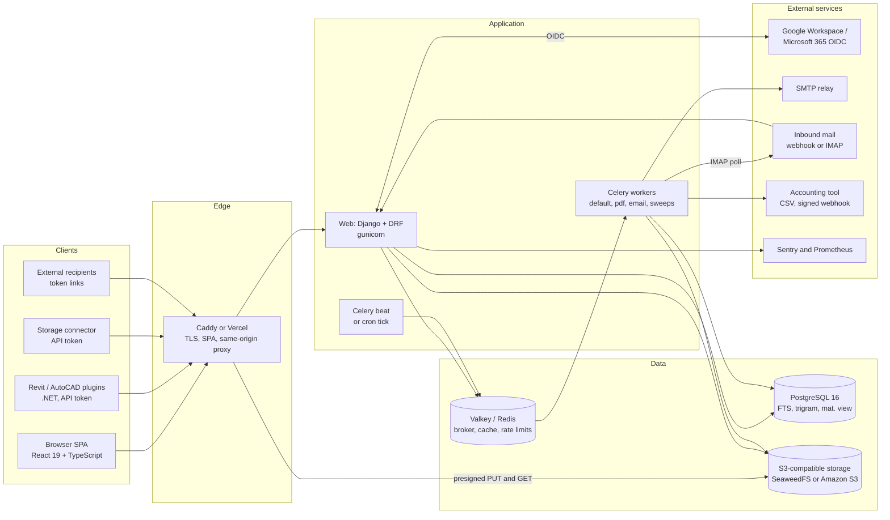

### 5.2 End-to-end workflow

The life of a project, from set-up to billing and construction. Split in two for readability.

**Set-up to issue**

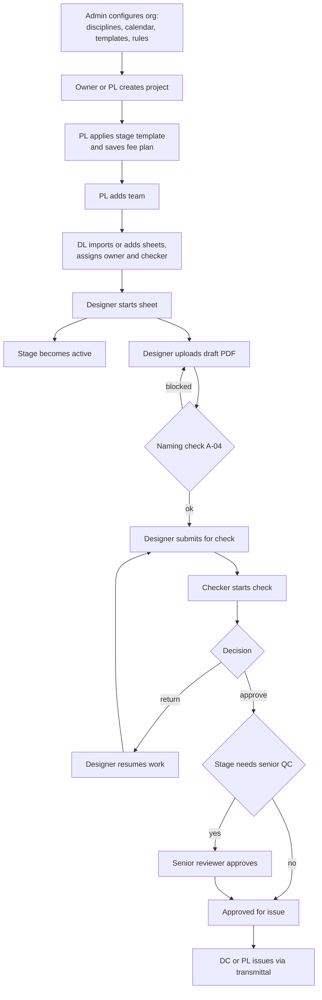

**Issue to billing and construction**

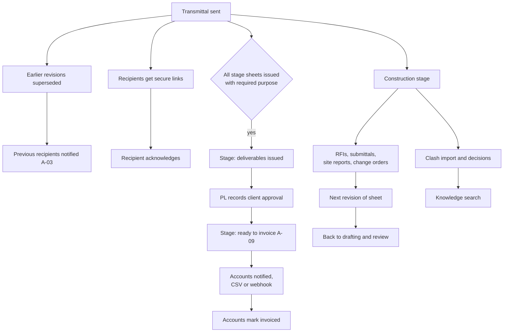

### 5.3 Workflow per role

**System admin**

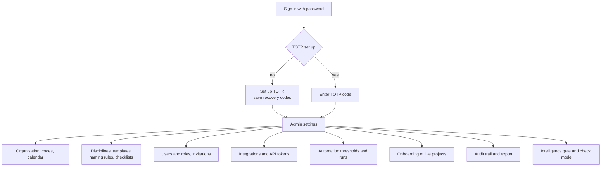

**Owner**

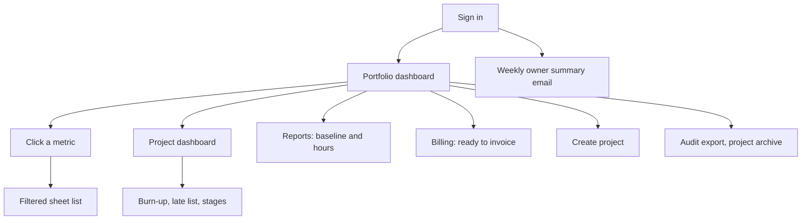

**Project lead**

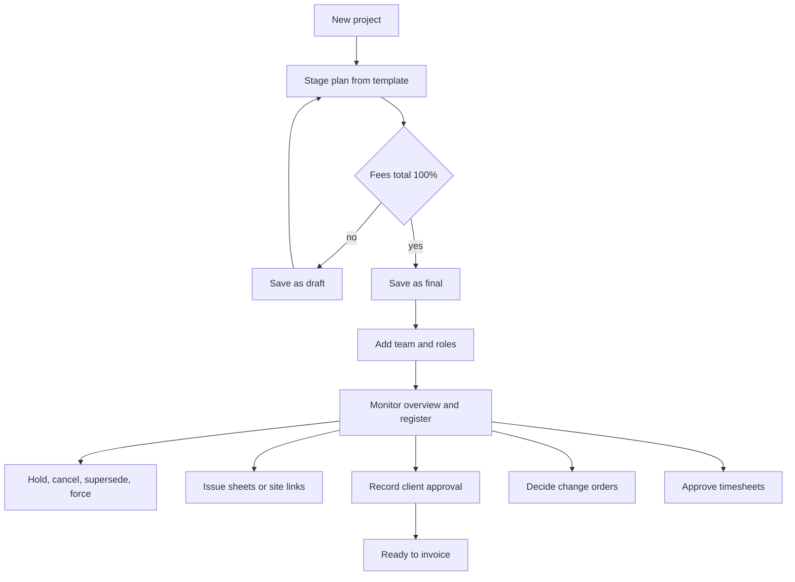

**Discipline lead**

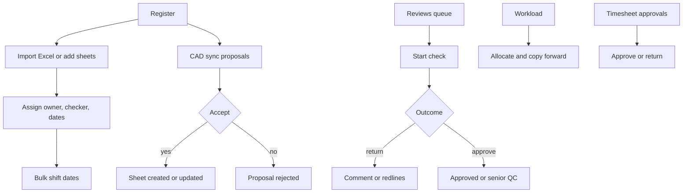

**Designer**

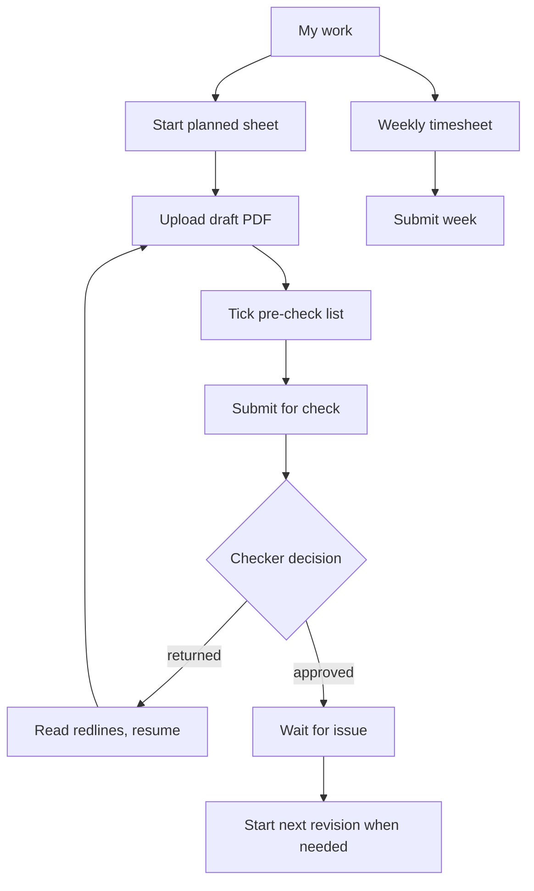

**Senior reviewer**

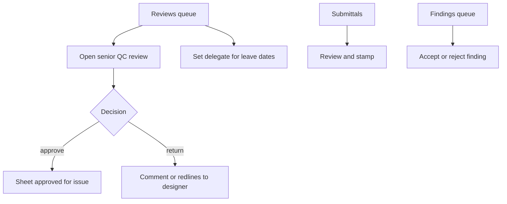

**Document controller**

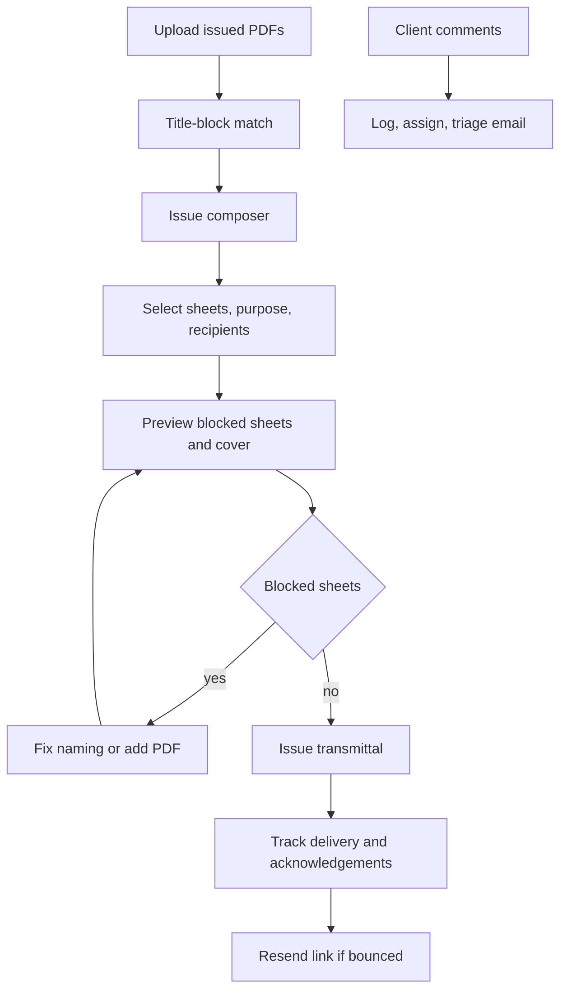

**Accounts**

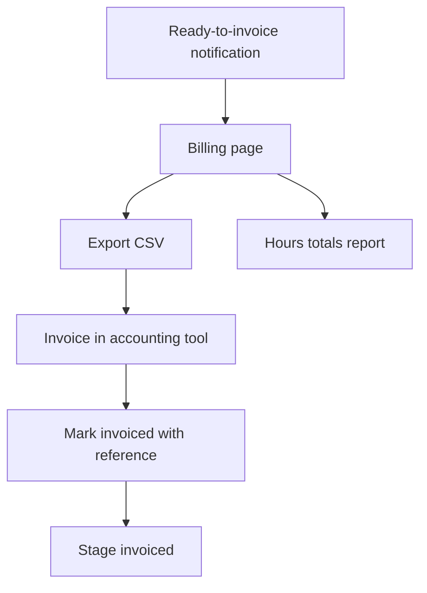

**External recipient and site user**

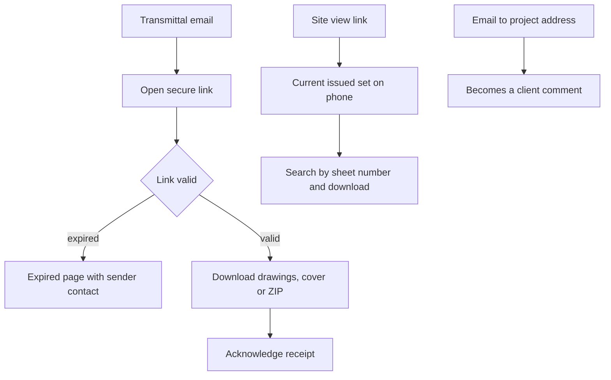

**Viewer**

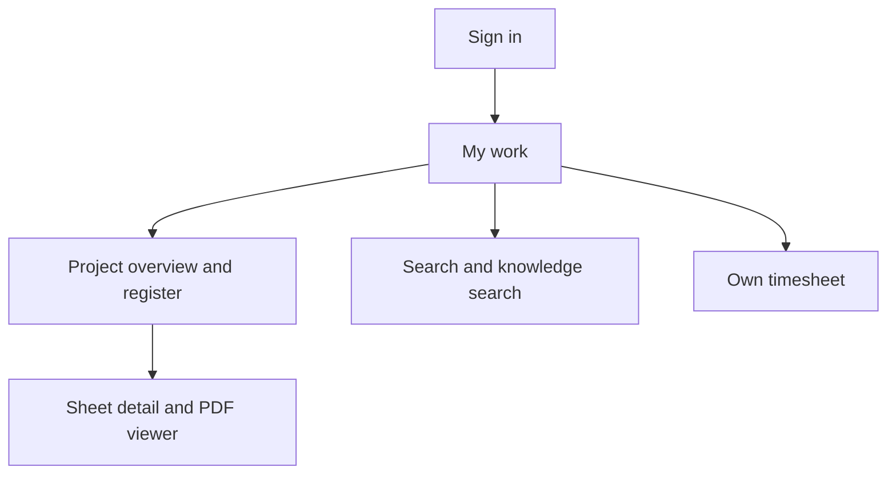

### 5.4 Authentication and authorization

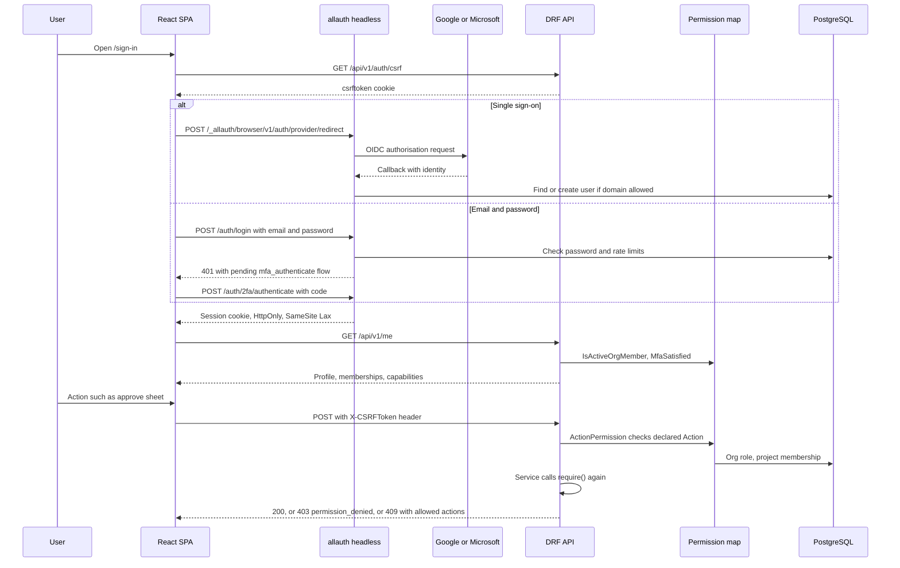

### 5.5 Key business processes

**Upload and verification pipeline (F-41, A-04)**

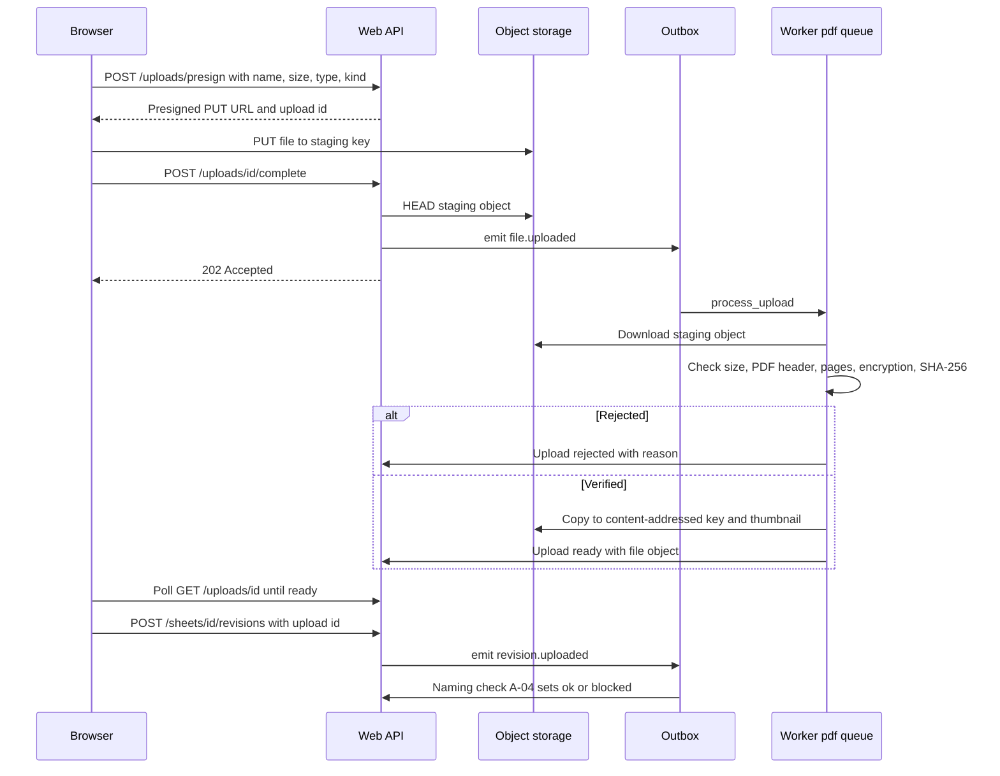

**Sheet review cycle with senior QC (F-10, F-11, F-13)**

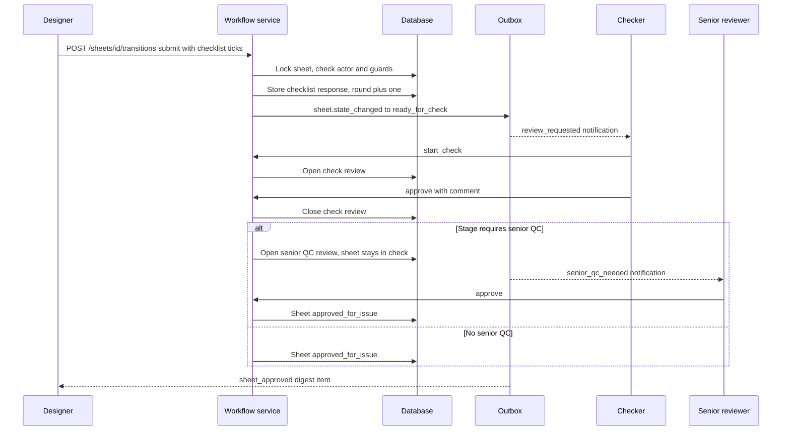

**Issue and transmittal (F-14, F-07, A-03)**

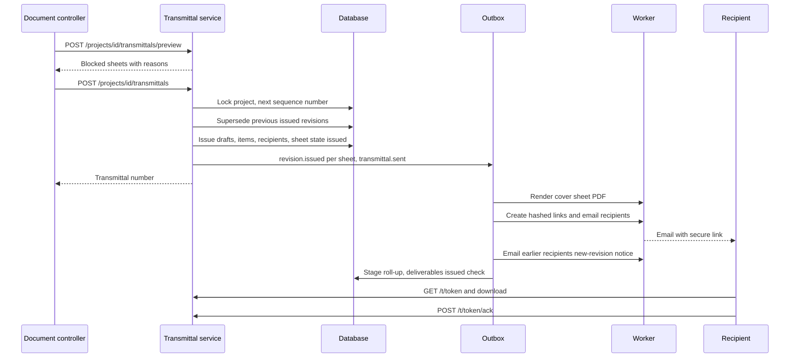

**Stage approval to billing (F-26, A-09, F-27, F-28)**

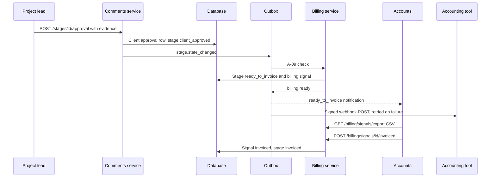

**Client email to comment (F-25, I-09)**

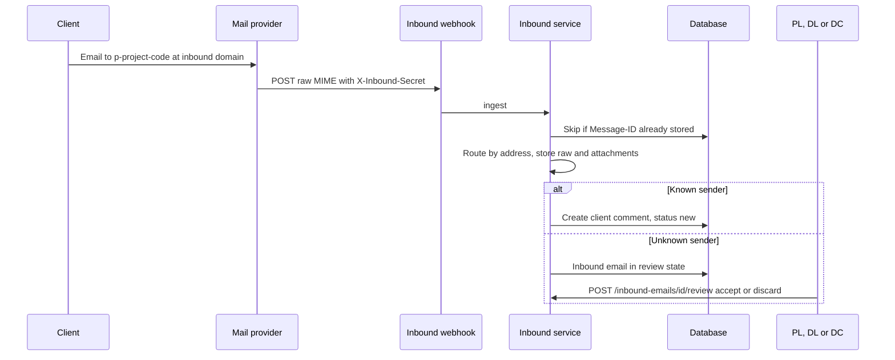

### 5.6 Database ERD

The schema has 74 domain tables, 73 tables and one materialised view (see [Appendix C](#appendix-c--database-table-inventory)). Every domain table carries `id` (UUID), `organisation_id`, `created_at`, `updated_at` and, where relevant, `created_by`; these are omitted below except where they are relationships.

**Organisation, access and reference data**

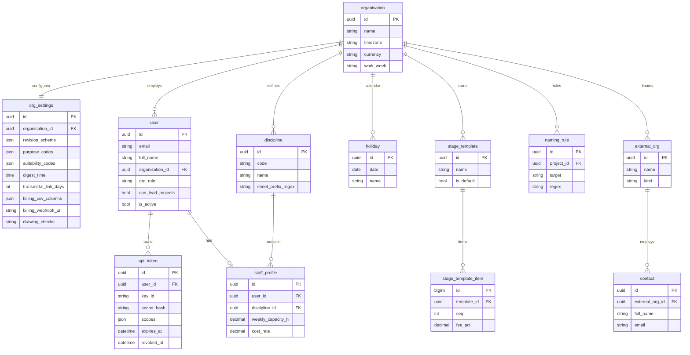

**Projects, register and workflow**

```mermaid
erDiagram
  project ||--o{ project_membership : team
  user ||--o{ project_membership : "has role"
  project ||--o{ stage : "fee stages"
  project ||--o{ package : groups
  project ||--o{ sheet : owes
  stage ||--o{ sheet : "deliverable of"
  package ||--o{ sheet : contains
  discipline ||--o{ sheet : classifies
  sheet ||--o{ sheet_revision : versions
  sheet_revision }o--o| file_object : pdf
  sheet ||--o{ status_transition : history
  sheet ||--o{ review : checks
  review }o--o{ file_object : redlines
  sheet ||--o{ checklist_response : "pre-check ticks"
  checklist ||--o{ checklist_item : items
  user ||--o{ delegation : delegates
  project ||--o{ saved_view : views
  project ||--o{ import_job : imports
  project {
    uuid id PK
    string code
    string name
    uuid client_id FK
    string type
    string status
    bool stage_plan_final
    uuid appointment_letter_id FK
  }
  project_membership {
    uuid id PK
    uuid project_id FK
    uuid user_id FK
    string role
    uuid discipline_id FK
  }
  stage {
    uuid id PK
    uuid project_id FK
    int seq
    decimal fee_pct
    decimal fee_amount
    string state
    bool requires_senior_qc
  }
  package {
    uuid id PK
    uuid project_id FK
    string name
    date planned_date
  }
  sheet {
    uuid id PK
    uuid project_id FK
    uuid stage_id FK
    uuid package_id FK
    uuid discipline_id FK
    string number
    string title
    uuid owner_id FK
    uuid checker_id FK
    date planned_issue_date
    string state
    uuid current_revision_id FK
    uuid replaced_by_id FK
  }
  sheet_revision {
    uuid id PK
    uuid sheet_id FK
    string code
    int seq
    string state
    string purpose
    uuid file_id FK
    uuid transmittal_id FK
    string naming_status
  }
  status_transition {
    uuid id PK
    uuid sheet_id FK
    string action
    string from_state
    string to_state
    uuid actor_id FK
    string reason
  }
  review {
    uuid id PK
    uuid sheet_id FK
    uuid revision_id FK
    string kind
    int round
    uuid reviewer_id FK
    string state
  }
  checklist {
    uuid id PK
    uuid discipline_id FK
    json stage_names
  }
  checklist_item {
    bigint id PK
    uuid checklist_id FK
    string text
    bool mandatory
  }
  checklist_response {
    uuid id PK
    uuid sheet_id FK
    int round
    json items
  }
  delegation {
    uuid id PK
    uuid user_id FK
    uuid delegate_id FK
    date start
    date end_date
  }
  saved_view {
    uuid id PK
    uuid user_id FK
    uuid project_id FK
    json config
  }
  import_job {
    uuid id PK
    uuid project_id FK
    json mapping
    string state
    datetime undo_until
  }
  file_object {
    uuid id PK
    string sha256
  }
```

**Transmittals and external access**

```mermaid
erDiagram
  project ||--o{ transmittal : issues
  transmittal ||--o{ transmittal_item : lists
  sheet_revision ||--o{ transmittal_item : "sent as"
  transmittal ||--o{ transmittal_recipient : "sent to"
  contact ||--o{ transmittal_recipient : receives
  transmittal ||--o{ external_link : links
  transmittal_recipient |o--o| external_link : uses
  external_link ||--o{ download_log : logs
  transmittal |o--o{ transmittal : corrects
  project ||--o{ site_link : "site view"
  contact ||--o{ site_link : holds
  site_link ||--o{ site_download : logs
  transmittal {
    uuid id PK
    uuid project_id FK
    int seq
    string number
    string purpose
    datetime sent_at
    uuid sent_by_id FK
    uuid cover_file_id FK
    uuid supersedes_id FK
  }
  transmittal_item {
    uuid id PK
    uuid transmittal_id FK
    uuid revision_id FK
  }
  transmittal_recipient {
    uuid id PK
    uuid transmittal_id FK
    uuid contact_id FK
    string delivery
    uuid link_id FK
    datetime bounced_at
    datetime acknowledged_at
  }
  external_link {
    uuid id PK
    string kind
    uuid contact_id FK
    uuid transmittal_id FK
    string token_hash
    datetime expires_at
  }
  download_log {
    uuid id PK
    uuid link_id FK
    uuid revision_id FK
    string what
    datetime at
  }
  site_link {
    uuid id PK
    uuid project_id FK
    uuid contact_id FK
    string token_hash
    datetime expires_at
    datetime revoked_at
  }
  site_download {
    uuid id PK
    uuid link_id FK
    uuid revision_id FK
  }
  sheet_revision {
    uuid id PK
    string code
  }
  contact {
    uuid id PK
    string email
  }
  project {
    uuid id PK
    string code
  }
```

**People, automation and notifications**

```mermaid
erDiagram
  user ||--o{ leave : takes
  user ||--o{ allocation : planned
  stage ||--o{ allocation : "for stage"
  user ||--o{ timesheet : submits
  timesheet ||--o{ time_entry : contains
  stage ||--o{ time_entry : "booked to"
  organisation ||--o{ automation_rule : tunes
  organisation ||--o{ automation_run : logs
  sheet ||--o{ flag : flagged
  user ||--o{ flag : "person-week"
  user ||--o{ notification : receives
  user ||--o{ notification_preference : sets
  user ||--o| notification_settings : "quiet hours"
  leave {
    uuid id PK
    uuid user_id FK
    date start
    date end_date
    string type
  }
  allocation {
    uuid id PK
    uuid user_id FK
    uuid project_id FK
    uuid stage_id FK
    date week
    decimal planned_h
  }
  timesheet {
    uuid id PK
    uuid user_id FK
    date week
    string state
    uuid approved_by_id FK
  }
  time_entry {
    uuid id PK
    uuid timesheet_id FK
    uuid project_id FK
    uuid stage_id FK
    uuid discipline_id FK
    date date
    decimal hours
  }
  automation_rule {
    uuid id PK
    string key
    bool enabled
    json params
  }
  automation_run {
    uuid id PK
    string rule
    date run_date
    int raised
    int cleared
    int notified
  }
  flag {
    uuid id PK
    string entity_type
    string entity_id
    string kind
    string rule
    uuid sheet_id FK
    uuid user_id FK
    datetime raised_at
    datetime cleared_at
  }
  notification {
    uuid id PK
    uuid user_id FK
    string event
    string title
    string dedupe_key
    datetime read_at
  }
  notification_preference {
    bigint id PK
    uuid user_id FK
    string event
    string mode
  }
  notification_settings {
    bigint id PK
    uuid user_id FK
    time quiet_from
    time quiet_to
  }
```

**Client comments, billing, construction administration, coordination and knowledge**

```mermaid
erDiagram
  project ||--o{ client_comment : logs
  client_comment }o--o{ sheet : "links"
  inbound_email |o--o| client_comment : creates
  stage ||--o{ client_approval : approved
  stage ||--o| billing_signal : bills
  project ||--o{ rfi : raises
  project ||--o{ submittal : receives
  project ||--o{ site_report : files
  site_report ||--o{ site_observation : contains
  project ||--o{ change_order : records
  rfi |o--o{ change_order : origin
  project ||--o{ clash_import : imports
  project ||--o{ clash_issue : tracks
  clash_import |o--o{ clash_issue : "last import"
  project ||--o{ decision : decides
  client_comment {
    uuid id PK
    uuid project_id FK
    string number
    string source
    string status
    uuid assignee_id FK
    string response
  }
  inbound_email {
    uuid id PK
    uuid project_id FK
    string message_id
    string from_address
    string state
    uuid comment_id FK
  }
  client_approval {
    uuid id PK
    uuid stage_id FK
    string approved_by
    date approved_on
    uuid evidence_id FK
  }
  billing_signal {
    uuid id PK
    uuid stage_id FK
    uuid project_id FK
    decimal fee_pct
    datetime ready_at
    datetime invoiced_at
  }
  rfi {
    uuid id PK
    uuid project_id FK
    string number
    date due_on
    string ball_in_court
    string status
  }
  submittal {
    uuid id PK
    uuid project_id FK
    string number
    int round
    string status
    uuid stamped_file_id FK
  }
  site_report {
    uuid id PK
    uuid project_id FK
    date visit_date
    string state
    uuid pdf_id FK
  }
  site_observation {
    uuid id PK
    uuid report_id FK
    uuid sheet_id FK
    string text
  }
  change_order {
    uuid id PK
    uuid project_id FK
    uuid rfi_id FK
    string origin
    string status
    bool revision_cycle_started
  }
  clash_import {
    uuid id PK
    uuid project_id FK
    string source
    uuid file_id FK
  }
  clash_issue {
    uuid id PK
    uuid project_id FK
    string guid
    string status
    uuid discipline_id FK
    uuid last_import_id FK
  }
  decision {
    uuid id PK
    uuid project_id FK
    string number
    date decided_on
    json tags
  }
```

**CAD sync and intelligence**

```mermaid
erDiagram
  project ||--o{ cad_sync_batch : receives
  cad_sync_batch ||--o{ cad_sync_proposal : proposes
  cad_sync_proposal }o--o| sheet : "matches"
  project ||--o{ cad_file_event : records
  cad_file_event }o--o| sheet : "matched to"
  sheet ||--o{ feature_snapshot : "weekly features"
  model_run ||--o{ prediction : produces
  prediction }o--|| sheet : scores
  prediction ||--o{ prediction_feedback : "lead feedback"
  model_run ||--o{ workload_forecast : forecasts
  discipline ||--o{ workload_forecast : "per discipline"
  sheet_revision ||--o{ finding : checked
  cad_sync_batch {
    uuid id PK
    uuid project_id FK
    string source
    string plugin_version
    json counts
  }
  cad_sync_proposal {
    uuid id PK
    uuid batch_id FK
    string kind
    string number
    uuid sheet_id FK
    string state
  }
  cad_file_event {
    uuid id PK
    uuid project_id FK
    uuid sheet_id FK
    string path
    string event
    datetime at
  }
  feature_snapshot {
    uuid id PK
    uuid sheet_id FK
    date as_of
    json features
    bool late
  }
  model_run {
    uuid id PK
    string kind
    string status
    json gate
    json metrics
  }
  prediction {
    uuid id PK
    uuid run_id FK
    uuid sheet_id FK
    float score
    json reasons
  }
  prediction_feedback {
    uuid id PK
    uuid prediction_id FK
    uuid user_id FK
    bool agree
  }
  workload_forecast {
    uuid id PK
    uuid run_id FK
    uuid discipline_id FK
    date week
    decimal hours
  }
  finding {
    uuid id PK
    uuid revision_id FK
    uuid sheet_id FK
    string rule
    string status
  }
  sheet {
    uuid id PK
    string number
  }
  sheet_revision {
    uuid id PK
    string code
  }
  discipline {
    uuid id PK
    string code
  }
  project {
    uuid id PK
    string code
  }
```

**Platform: files, events, audit, exports and onboarding**

```mermaid
erDiagram
  user ||--o{ upload : uploads
  upload }o--o| file_object : "verified as"
  outbox_event ||--o{ outbox_delivery : "delivered to handler"
  organisation ||--o{ audit_event : records
  user ||--o{ export_job : requests
  export_job }o--o| file_object : produces
  user ||--o{ onboarding_job : runs
  onboarding_job }o--o| project : loads
  organisation ||--o{ metric_snapshot : "daily metrics"
  upload {
    uuid id PK
    string kind
    string original_name
    bigint declared_size
    string staging_key
    string state
    uuid file_id FK
    uuid uploaded_by_id FK
  }
  file_object {
    uuid id PK
    string storage_key
    string sha256
    bigint size
    string mime
    int page_count
    string thumbnail_key
  }
  outbox_event {
    uuid id PK
    string name
    json payload
    datetime available_at
    datetime dispatched_at
    datetime failed_at
    int attempts
  }
  outbox_delivery {
    bigint id PK
    uuid event_id FK
    string handler
  }
  audit_event {
    uuid id PK
    uuid actor_id FK
    string verb
    string entity_type
    string entity_id
    json before
    json after
    string ip
    string request_id
    uuid project_id
  }
  export_job {
    uuid id PK
    uuid user_id FK
    string kind
    string format
    json filters
    string state
    uuid file_id FK
  }
  onboarding_job {
    uuid id PK
    json data
    json files
    json report
    string state
    uuid project_id FK
  }
  metric_snapshot {
    uuid id PK
    date date
    string key
    decimal value
  }
  heartbeat {
    string name PK
    datetime last_seen
  }
  dash_sheet_stats {
    uuid project_id PK
    uuid discipline_id PK
    int planned
    int issued
    int late
    int at_risk
    int in_check
  }
```

Notes: `delegation.end` and `leave.end` are shown as `end_date` because `end` is a reserved word in Mermaid; the database column is `end`. `dash_sheet_stats` is a materialised view refreshed every five minutes. `heartbeat` has no organisation column.

### 5.7 Data flow between modules

```mermaid
flowchart LR
  PROJ["Projects and stages"] --> REG["Register"]
  CAD["CAD sync and connector"] -->|proposals and file events| REG
  IMP["Imports and onboarding"] --> REG
  FILES["Files and uploads"] --> REG
  REG --> WF["Workflow and reviews"]
  WF -->|sheet.state_changed| OUTBOX["Outbox"]
  TR["Transmittals"] -->|revision.issued, transmittal.sent| OUTBOX
  WF --> TR
  OUTBOX --> NOTIF["Notifications and email"]
  OUTBOX --> PROJ
  OUTBOX --> AUTO["Automation flags"]
  OUTBOX --> DASH["Dashboard read model"]
  OUTBOX --> BILL["Billing signal"]
  OUTBOX --> INTEL["Intelligence checks"]
  CMT["Client comments and approvals"] -->|stage.state_changed| OUTBOX
  PEOPLE["People and timesheets"] -->|allocation.changed| OUTBOX
  CA["Construction admin"] --> OUTBOX
  CA --> WF
  AUTO --> NOTIF
  AUTO --> DASH
  BILL --> ACCT["Accounting tool"]
  ALLW["All services"] --> AUDIT["Audit trail"]
  AUDIT --> ACT["Activity feed"]
  REG --> SEARCH["Search and knowledge"]
  CMT --> SEARCH
  CA --> SEARCH
  DASH --> EXP["Exports and reports"]
```

---

## 6. Module-wise Technical Description

**Conventions for every module.** API paths below are relative to `/api/v1`. "Permission" is the `Action` declared on the view (`action_permissions`), checked by `ActionPermission` before the service runs; the service then calls `require()` again with the concrete project and ownership. Every list endpoint is organisation-scoped and, for project data, membership-scoped. Errors use one shape: `{"code": "...", "detail": "...", ...extra}` (validation errors add `errors: {field: [messages]}`); `DomainError` → 400, `ConflictError` → 409, `PermissionDeniedError` → 403, database integrity conflicts → 409 `conflict` (`backend/apps/core/exceptions.py`). Lists use cursor pagination (`{next, previous, results}`, 50 per page, `page_size` up to 200) unless noted "unpaginated".

### 6.1 Core and organisation settings

**Purpose.** The organisation, its settings and reference data (F-42), the working-day calendar used by every automation, and the base model every table inherits.

**Key files.** `backend/apps/core/models.py` (`TimeStampedModel`, `OrgScopedModel`, `Organisation`, `OrgSettings`, `Discipline`, `Holiday`, `Heartbeat`), `core/services.py`, `core/calendar.py`, `core/defaults.py`, `core/setup.py`, `core/api/views.py`, `core/api/serializers.py`, `core/management/commands/bootstrap_org.py`; front end `frontend/src/features/admin/OrganisationSettings.tsx`, `DisciplinesSettings.tsx`, `CalendarSettings.tsx`, `useOrgSettings.ts`.

**Internal logic.**
1. `bootstrap_org` creates the organisation and first Admin; `ensure_org_defaults()` (`core/setup.py`) idempotently creates settings, nine default disciplines with prefix regexes, the default stage template and the automation rules.
2. `update_org_settings()` locks the organisation row, applies organisation fields and settings fields, runs `full_clean()`, and writes one audit row per changed record. Changes apply to new records; existing records keep their values.
3. `WorkingCalendar.for_org()` loads the work week (Mon–Fri or Mon–Sat) and holidays. `add_working_days(start, n)` never counts `start`; `working_days_between(a, b)` is signed, exclusive of `a`, inclusive of `b`, and is the inverse of `add_working_days` (DD-017).
4. Discipline deletes are blocked by `PROTECT` foreign keys while referenced; deactivation is the alternative.

**APIs.**

| Method | Path | Permission | Request | Response |
|---|---|---|---|---|
| GET | `/org/settings` | `view_org_reference` | – | `{organisation:{id,name,timezone,currency,work_week}, revision_scheme:{digits,series[{prefix,label}]}, purpose_codes[{code,label,active}], suitability_codes[...], digest_time, transmittal_link_days, project_code_format, default_weekly_capacity_h, acknowledge_within_days, billing_csv_columns[{field,header}], billing_webhook_url, updated_at}` |
| PATCH | `/org/settings` | `manage_org_settings` | Any subset of the above, plus `billing_webhook_secret` (write-only) | Same as GET |
| GET, POST | `/disciplines` | read: `view_org_reference`; write: `manage_org_settings` | `{code,name,sheet_prefix_regex,sort_order,is_active}` | Discipline list (unpaginated) / object |
| GET, PATCH, DELETE | `/disciplines/{id}` | same | Partial discipline | Discipline / 204 |
| GET, POST | `/holidays?year=` | same | `{date,name}` | Holiday list (unpaginated) / object |
| GET, PATCH, DELETE | `/holidays/{id}` | same | Partial | Holiday / 204 |

**Tables.** `organisation`, `org_settings`, `discipline`, `holiday`, `heartbeat`.
**Roles.** Admin writes; every organisation role reads.
**Dependencies.** Audit (all writes), automation (calendar, rules), projects (stage templates in `ensure_org_defaults`).
**Edge cases.** Discipline code is upper-cased and unique per organisation; prefix regex is validated with `re.compile`; holiday date unique per organisation; the organisation timezone drives digest times, sweep times and every displayed date.

### 6.2 Accounts, authentication and authorization

**Purpose.** Users and organisation roles, sign-in (SSO, password, TOTP), API tokens, and the single permission map (F-38, F-40).

**Key files.** `backend/apps/accounts/models.py`, `roles.py`, `permissions.py`, `drf_permissions.py`, `authentication.py`, `adapters.py`, `services.py`, `request.py`, `api/views.py`, `api/serializers.py`; settings in `config/settings/base.py` (allauth, `REST_FRAMEWORK`); front end `frontend/src/lib/auth/allauth.ts`, `useMe.ts`, `app/RequireAuth.tsx`, `features/auth/SignInPage.tsx`, `MfaSetupPage.tsx`, `features/admin/UsersSettings.tsx`, `IntegrationsSettings.tsx`.

**Internal logic.**
1. **Sessions.** django-allauth in headless "browser" mode (`HEADLESS_ONLY`), session cookie HTTP-only, SameSite=Lax, 12-hour age; `__Host-sessionid` with Secure in production. The SPA fetches `/api/v1/auth/csrf` and sends `X-CSRFToken` on unsafe methods (`frontend/src/lib/api/client.ts`).
2. **Local sign-in.** `POST /_allauth/browser/v1/auth/login`; if the user has TOTP, allauth returns a pending `mfa_authenticate` flow and the SPA posts the code. Self-signup is closed (`AccountAdapter.is_open_for_signup → False`).
3. **SSO.** The SPA posts a top-level form to `/auth/provider/redirect`; `SocialAccountAdapter` allows sign-up only for `SSO_ALLOWED_DOMAINS`, lower-cases the email, sets the full name, attaches the user to the firm's organisation as Staff with no project memberships.
4. **Password reset.** Local accounts use the allauth headless password-reset flow; the emailed key lands on `/sign-in` (`HEADLESS_FRONTEND_URLS["account_reset_password_from_key"]`).
5. **Invitations.** An Admin creates a user record with email, name and organisation role through the users endpoint; the invitee receives an email with a set-password link (the same reset flow) or signs in with SSO; the audit trail records the invitation.
6. **MFA enforcement.** `MfaSatisfied` blocks every API call (except views marked `allow_without_mfa`, such as `/me`) for Admins whose session includes a password step and who have no TOTP authenticator; the SPA redirects them to `/setup-2fa`.
7. **API tokens.** `ApiTokenAuthentication` parses `Bearer dop_<key_id>_<secret>`, compares the SHA-256 hash in constant time, rejects expired, revoked or inactive-owner tokens, and updates `last_used_at` at most every 5 minutes. `TokenScopePermission` refuses any view without `token_scopes`.
8. **Authorization.** DRF default permission classes run in order: `IsActiveOrgMember` → `TokenScopePermission` → `MfaSatisfied` → `ActionPermission`. `can()` refuses cross-organisation projects first, then checks org role, user flags, project role (or own-role on own items), or `any_project_roles`.
9. **Rate limits.** allauth: 120 sign-ins/min and 20 failures/min per client IP, 5 failures per 5 min per account; the client IP is resolved from `TRUSTED_PROXY_COUNT` by `RequestContextMiddleware` and passed in `X-DrawingOps-Client-IP` (DD-038). DRF throttles in production: 600/min per user, 60/min anonymous.

**APIs.**

| Method | Path | Permission | Request | Response |
|---|---|---|---|---|
| GET | `/auth/csrf` | public | – | 204, sets `csrftoken` |
| GET | `/me` | `view_org_reference`; tokens allowed (no scope); MFA not required | – | `{id,email,full_name,short_name,org_role,organisation{id,name,timezone,work_week},memberships[{project_id,project_code,role}],capabilities{manage_org_settings,export_audit,manage_contacts,create_project,upload_files,log_own_timesheet,manage_staff,allocate_hours,view_portfolio,view_baseline,view_hours_report,view_billing,mark_invoiced,view_forecasts},mfa{totp_enabled,setup_required}}` |
| GET | `/directory?q=` | `view_org_reference` | – | Up to 50 `{id,full_name,short_name,email,org_role,can_lead_projects}` |
| GET | `/users` | `manage_org_settings` | – | Paginated `{id,email,full_name,short_name,org_role,is_active,can_lead_projects,date_joined,last_login}` |
| POST | `/users` | `manage_org_settings` | `{email,full_name,org_role,can_lead_projects}` | Created user; invitation email queued |
| GET, PATCH | `/users/{id}` | `manage_org_settings` | `{full_name,org_role,is_active,can_lead_projects}` | User; 409 `last_admin` when removing the last active Admin |
| GET, POST | `/api-tokens` | `manage_org_settings` | `{name,user,scopes[],expires_in_days}` | Token list / token with one-time `token` |
| POST | `/api-tokens/{id}/revoke` | `manage_org_settings` | – | Token |
| (allauth) | `/_allauth/browser/v1/config`, `/auth/session`, `/auth/login`, `/auth/2fa/authenticate`, `/auth/provider/redirect`, `/account/authenticators/totp`, `/account/authenticators/recovery-codes`, `/auth/password/request`, `/auth/password/reset` | allauth | allauth headless payloads | allauth responses |

**Tables.** `user`, `api_token`; allauth tables (`account_emailaddress`, `socialaccount_*`, `mfa_authenticator`) and `django_session`.
**Roles.** Everyone signs in; Admin manages users and tokens.
**Dependencies.** Projects (memberships for `can()`), audit, core (organisation).
**External services.** Google Workspace and Microsoft 365 OIDC (`SSO_GOOGLE_*`, `SSO_MICROSOFT_*`, `SSO_MICROSOFT_TENANT`).
**Edge cases.** A user without an organisation is refused by every API (`IsActiveOrgMember`); a token acting as an inactive user is refused; token expiry is 1–365 days; SSO for a non-allowed domain cannot sign up; the Django support admin login redirects to the SPA sign-in so TOTP always applies.

### 6.3 Contacts

**Purpose.** External organisations and people who receive transmittals, raise RFIs, approve stages and send comments (F-43).

**Key files.** `backend/apps/contacts/models.py`, `services.py`, `api/views.py`, `api/serializers.py`; `frontend/src/features/contacts/ContactsPage.tsx`.

**Internal logic.** Writes require `manage_contacts`. Emails are normalised to lower case; a contact with an email that already exists returns 409 `duplicate_email` with the existing contact unless the request sets `confirm_duplicate: true` (DD-012). An external organisation in use (contacts or projects reference it) cannot be deleted; deactivate it instead. A database trigger maintains `contact.search_vector` for global search.

**APIs.**

| Method | Path | Permission | Request | Response |
|---|---|---|---|---|
| GET, POST | `/external-orgs` | read `view_org_reference`; write `manage_contacts` | `{name,kind,email,phone,address,is_active}` | `{id,name,kind,email,phone,address,is_active,contact_count}` |
| GET, PATCH, DELETE | `/external-orgs/{id}` | same | Partial | Object / 204 / 409 in use |
| GET, POST | `/contacts` | same | `{full_name,email,phone,designation,external_org,is_active,confirm_duplicate}` | `{id,full_name,email,phone,designation,external_org,external_org_name,is_active}` |
| GET, PATCH, DELETE | `/contacts/{id}` | same | Partial | Object / 204 |

**Tables.** `external_org`, `contact`. **Dependencies.** Transmittals, comments, CA, site links, projects (client). **Edge cases.** Organisation names unique case-insensitively; contacts without email are recorded as "by hand" recipients at issue.

### 6.4 Projects and stages

**Purpose.** Projects, fee stages and their state machine, stage templates, packages and project teams (F-01, F-02, F-03, F-49).

**Key files.** `backend/apps/projects/models.py`, `services.py`, `stage_machine.py`, `events.py`, `selectors.py`, `people.py`, `api/views.py`, `api/serializers.py`, `api/mixins.py`; front end `features/projects/ProjectsPage.tsx`, `NewProjectForm.tsx`, `ProjectLayout.tsx`, `ProjectOverview.tsx`, `StagePlanEditor.tsx`, `TeamTab.tsx`, `ClientApprovals.tsx`, `ActivityTab.tsx`, `features/admin/StageTemplatesSettings.tsx`.

**Internal logic.**
1. `create_project()` checks the code against the organisation's format (`code_pattern("YYYY-NNN")`) and uniqueness, validates the client, creates the project and adds the named lead (or the creator) as PL; emits `project.created`.
2. `save_stage_plan()` locks the project, rejects duplicate sequence numbers and end-before-start, enforces 100% ± 0.01 for a final plan, moves existing stages to temporary sequence numbers to allow re-ordering, updates/creates/deletes stages (a stage with sheets cannot be deleted), and blocks fee % changes on invoiced or closed stages for non-Admins.
3. `apply_template()` refuses when stages already hold sheets and saves the template as a draft plan.
4. Stage states: planned → active → deliverables_issued → client_approved → ready_to_invoice → invoiced → closed, plus on_hold. `STAGE_TRANSITIONS` marks which moves a person may trigger (`start`, `close`, `hold`, `resume`) and which only the system or another service triggers.
5. Roll-up handlers: on `sheet.state_changed` to in progress → stage `start`; on `revision.issued` → stage `start` if still planned, then `deliverables_issued` when every non-cancelled, non-superseded sheet of the stage has an issued (or superseded) revision whose purpose is in the stage's required purposes (default FA and GFC).
6. Team: a project keeps at least one PL (`last_lead`); removing a member who owns or checks open sheets is refused until reassigned. `members_with_role()` returns notification audiences (DLs of a discipline first).
7. `visible_projects()` is the membership scope used by every project-owned list in the system.

**APIs.**

| Method | Path | Permission | Request | Response |
|---|---|---|---|---|
| GET | `/projects?q=&status=` | `view_org_reference` (scoped to visible projects) | – | Paginated `{id,code,name,client,client_name,type,location,status,start_date,end_date,cad_versions,stage_plan_final,appointment_letter,current_stage{id,seq,name,state,planned_end},lead,my_role,my_permissions{edit_project,edit_sheets,review,issue,hold_cancel,allocate,approve_timesheets,upload_draft,log_comments,record_approval,manage_ca,review_submittal,approve_change_order,file_site_report,manage_clashes,log_decisions,view_forecasts,review_findings},inbound_address,created_at}` |
| POST | `/projects` | `create_project` | `{code,name,client,type,location,status,start_date,end_date,cad_versions[],lead_id}` | 201 project |
| GET, PATCH | `/projects/{id}` | `view_project` / `edit_stages` | Partial project | Project |
| GET, PUT | `/projects/{project_pk}/stages` | `view_project` / `edit_stages` | PUT `{stages[{id?,seq,name,fee_pct,fee_amount,planned_start,planned_end,requires_senior_qc,required_purposes[]}], final}` | `[{id,seq,name,fee_pct,fee_amount,planned_start,planned_end,actual_start,actual_end,state,requires_senior_qc,required_purposes,allowed_actions[{action,label}],sheet_count}]`; 400 `fee_total` with `total` |
| POST | `/projects/{project_pk}/stages/apply-template` | `edit_stages` | `{template}` | Stages |
| POST | `/stages/{id}/transitions` | `edit_stages` | `{action,reason}` | Stage; 409 when not allowed |
| GET, POST | `/projects/{project_pk}/appointment-letter` | `view_project` / `edit_stages` | `{upload_id}` | `{url,filename}` |
| GET, POST | `/projects/{project_pk}/packages` | `view_project` / `edit_sheets` | `{name,discipline,planned_date}` | `{id,name,discipline,planned_date,sheet_count}` |
| GET, PATCH, DELETE | `/packages/{id}` | `view_project` / `edit_sheets` | Partial | Package / 204 |
| GET, POST | `/projects/{project_pk}/members` | `view_project` / `edit_stages` | `{user_id,role,discipline}` | `{id,user{id,full_name,short_name,email},user_id,role,discipline,created_at}` |
| PATCH, DELETE | `/members/{id}` | `edit_stages` | `{role,discipline}` | Membership / 204; 409 `last_lead`, `owns_sheets` |
| GET, POST | `/stage-templates` | read `view_org_reference`; write `manage_org_settings` | `{name,is_default,items[{seq,name,fee_pct,required_purposes,requires_senior_qc}]}` | `{id,name,is_default,items,fee_total}` |
| GET, PATCH, DELETE | `/stage-templates/{id}` | same | Partial | Template / 204 |

**Tables.** `project`, `project_membership`, `stage`, `stage_template`, `stage_template_item`, `package`.
**Roles.** Owner, Admin, PL edit; members read; PL-eligible staff create.
**Dependencies.** Register (sheets per stage), comments (client approval transition), billing (A-09), notifications (`project.member_added`), audit.
**Edge cases.** Project code duplicates → 409 with a clear message; stage planned end ≥ start (database check constraint); a project with no stages is allowed; package dates feed sheets without their own date; only one default stage template per organisation (partial unique constraint).

### 6.5 Files and uploads

**Purpose.** Verified, deduplicated storage of every file (sheet PDFs, documents, images, coordination data) with presigned uploads (F-41, N-03).

**Key files.** `backend/apps/files/models.py`, `services.py`, `storage.py`, `validators.py`, `events.py`, `tasks.py`, `api/views.py`, `management/commands/ensure_bucket.py`; `frontend/src/lib/upload.ts`.

**Internal logic.**
1. `presign_upload()` checks `upload_files`, cleans the file name, checks kind × content type × extension (sheet/document: PDF; image: JPEG/PNG; data: `.bcfzip` or XML), size > 0 and ≤ `UPLOAD_MAX_BYTES` (200 MB); creates an `Upload` (`pending`) with a staging key `staging/<org>/<upload id><ext>` and returns a 15-minute presigned PUT URL (signed for the app origin when `S3_PRESIGN_VIA_APP_ORIGIN`, else the public endpoint).
2. The browser PUTs directly to storage, then calls `complete`: only the uploader may complete; the staging object must exist; state becomes `uploaded` and `file.uploaded` is emitted.
3. The `pdf` worker (`process_upload`) downloads to a temp file and inspects: PDFs must start with `%PDF`, open with pikepdf, not be encrypted, and (kind `sheet`) have exactly one page; images must verify as JPEG/PNG; data must be a valid zip or XML. Rejected uploads store a user-facing reason.
4. Accepted content is hashed (SHA-256); if the organisation already has it, the existing `FileObject` is reused (`is_duplicate`); else it is copied to `files/<org>/<sha[:2]>/<sha><ext>` with server-side encryption when configured and a 320 px PNG thumbnail of page 1 is made. The staging object is deleted after commit.
5. `ready_upload()` lets other services attach only the actor's own verified upload of the expected kind. `download_url()` presigns a 5-minute GET (inline for PDFs).
6. A nightly task rejects uploads never completed within a day and deletes their staging objects.

**APIs.**

| Method | Path | Permission | Request | Response |
|---|---|---|---|---|
| POST | `/uploads/presign` | `upload_files` | `{filename,size,content_type,kind: sheet|document|image|data}` | 201 `{upload{id,kind,original_name,declared_size,state,reason,is_duplicate,file_id,sha256,created_at},url,method:"PUT",headers{Content-Type},expires_at}` |
| POST | `/uploads/{id}/complete` | `upload_files` (own upload) | – | 202 upload; 409 `not_uploaded` |
| GET | `/uploads/{id}` | `upload_files` (own upload) | – | Upload (poll until `ready` or `rejected`) |

**Tables.** `upload`, `file_object`. **Dependencies.** Outbox, storage. **External services.** S3-compatible object storage (`S3_*`).
**Edge cases.** A presigned PUT cannot enforce size or type, so the worker is the source of truth (DD-013); duplicate content within an organisation is stored once (`unique(organisation, sha256)`); thumbnails never block an upload.

### 6.6 Drawing register

**Purpose.** The list of every sheet the firm owes, revisions, naming rules, saved views, imports, title-block reading, superseded watermarks and onboarding (F-04…F-08, F-35, F-41, F-46…F-48, F-50, F-54).

**Key files.** `backend/apps/register/models.py`, `services.py`, `selectors.py`, `revisions.py`, `naming.py`, `imports.py`, `watermark.py`, `titleblock.py`, `onboarding.py`, `onboarding_template.py`, `events.py`, `api/views.py`, `api/serializers.py`, `api/onboarding.py`; front end `features/register/RegisterPage.tsx`, `SheetForm.tsx`, `BulkBar.tsx`, `ImportWizard.tsx`, `UploadPdfs.tsx`, `CadSyncPage.tsx`, `useSheets.ts`, `features/sheets/SheetDetailPage.tsx`, `ActionBar.tsx`, `features/admin/NamingRulesSettings.tsx`, `OnboardingSettings.tsx`.

**Internal logic.**
1. **Create/edit.** `create_sheet()` checks discipline, stage, package and users belong to the project, validates the CAD link, checks the number against discipline prefix and sheet-number naming rules (`sheet_number_problems`), and uniqueness; emits `sheet.created` and `sheet.assigned`. `editable_fields()` limits a designer to working fields of their own sheet. Date changes emit `sheet.dates_changed` so flags refresh.
2. **Delete** is allowed only for the PL and only for a sheet that was never issued (otherwise cancel).
3. **Revisions.** `next_code()` increments within the latest series (P01→P02) or a chosen series (DD-020); `upload_draft()` attaches a verified sheet PDF to the single draft (creating it with the next code), refuses the same PDF twice on one sheet, and refuses uploads while the sheet is approved, issued, superseded or cancelled; emits `revision.uploaded`. Database constraints guarantee one draft and one issued revision per sheet and unique codes.
4. **Naming check (A-04).** The `revision.uploaded` handler runs `check_naming()`: the file name must contain the sheet number (`contains_sheet_number`) and match active file-name rules (project rules replace organisation rules for that target). Blocked drafts carry the rule text and example; `revision.naming_blocked` notifies the uploader.
5. **Download.** Current revisions get a presigned inline URL; superseded revisions are watermarked on first download (`watermark.stamp_pdf`: WeasyPrint stamp page overlaid with pikepdf on every page, text "SUPERSEDED dd-Mon-yyyy" in the org timezone), cached under `watermarked_key`.
6. **Import.** `parse_file()` reads .xlsx (openpyxl, read-only) or .csv; `guess_mapping()` matches headers against synonyms; `validate()` builds a row-level preview (duplicate number in file or project, unknown discipline/stage/package/user, bad date, naming problems); `commit_import()` is all-or-nothing and records `created_sheet_ids` and `undo_until = now + 24 h`; `undo_import()` deletes the created sheets only if none moved state.
7. **Bulk.** `bulk_update()` applies one op per sheet inside its own savepoint; failures are reported as skipped with reasons.
8. **Title blocks (F-50).** `read_pdf()` extracts text with pypdfium2; pages with no text layer are rendered and read with the Tesseract binary; `match()` looks for the project's sheet numbers in the bottom-right title-block corner first, then the page, and returns a confidence plus title and revision found.
9. **Onboarding (F-54).** `parse_workbook()` reads the template's sheets; `validate()` reports errors per sheet/row and missing PDFs; `commit()` creates the project, stages, team, packages, sheets and historic revisions (issued/superseded with original dates at noon local time, `is_historic`) without emitting notifications.
10. **Saved views** belong to one user; another user's view reads as not found.

**APIs.**

| Method | Path | Permission | Request | Response |
|---|---|---|---|---|
| GET | `/projects/{project_pk}/sheets?discipline=&stage=&package=&owner=&checker=&state=&q=` | `view_project` | – | Paginated sheets `{id,project,number,title,aliases,discipline,discipline_code,stage,stage_name,package,package_name,owner,owner_detail,checker,checker_detail,planned_issue_date,effective_planned_date,state,current_revision,current_revision_code,cad_link,notes,replaced_by,state_changed_at,updated_at,flags[{kind,rule,raised_at,days,escalated}]}` |
| POST | `/projects/{project_pk}/sheets` | `edit_sheets` | `{number,title,aliases,discipline,stage,package,owner,checker,planned_issue_date,cad_link,notes}` | 201 sheet; 400 `invalid_number` with `problems`; 409 duplicate |
| GET, PATCH, DELETE | `/sheets/{id}` | `view_project` / `edit_sheets` (own fields for designers) / `hold_cancel_supersede` | Partial sheet | Sheet / 204; 409 `issued` |
| GET | `/sheets/{id}/detail` | `view_project` | – | Sheet + `{project_code,project_name,stage_requires_senior_qc,allowed_actions[{action,label,primary,needs_reason,hint,blocked_reason}],editable_fields,can_upload_draft}` |
| GET, POST | `/sheets/{id}/revisions` | `view_project` / `upload_draft` | `{upload_id,change_summary,series}` | `[{id,code,seq,state,purpose,suitability,original_name,naming_status,naming_message,change_summary,uploaded_by,issued_at,issued_by,superseded_at,is_historic,page_count,size,has_file,transmittal_number,created_at}]` |
| GET | `/revisions/{id}/download` | `view_project` | – | `{url,filename,watermarked}` |
| POST | `/projects/{project_pk}/sheets/bulk` | `view_project` (op-level checks in service) | `{sheet_ids[≤2000],op: assign_owner|set_checker|set_planned_date|shift_dates|move_package|transition,value,reason}` | `{updated[],skipped[{id,number,reason}]}` |
| POST | `/projects/{project_pk}/imports` | `edit_sheets` | multipart `file` | Import job `{id,project,original_name,headers,mapping,skip_rows,overrides,state,report{rows,counts},committed_at,undo_until,fields_available,created_at,created_sheet_ids}` |
| GET, PATCH | `/imports/{id}` | `edit_sheets` | `{mapping{field:col},skip_rows[],overrides{row:{field:value}}}` | Import job with re-validated report |
| POST | `/imports/{id}/commit` | `edit_sheets` | – | Job; 409 when rows have errors |
| POST | `/imports/{id}/undo` | `edit_sheets` | – | Job; 409 `undo_expired`, `sheets_moved` |
| GET | `/imports/template` | `view_org_reference` | – | .xlsx template (register and onboarding sheets) |
| GET, POST | `/saved-views?project=` | `view_org_reference` / own | `{name,project,config}` | `{id,name,project,config,created_at}` |
| PATCH, DELETE | `/saved-views/{id}` | own | Partial | View / 204 |
| GET, POST | `/naming-rules?project=` | read `view_org_reference`; write `manage_org_settings` (org) or `edit_stages` (project) | `{project,target: sheet_number|file_name,regex,example,message,is_active}` | Rule |
| GET, PATCH, DELETE | `/naming-rules/{id}` | same | Partial | Rule / 204 |
| POST | `/naming-rules/test` | `view_org_reference` | `{target,value,project}` | `{passes,problems[]}` |
| POST | `/projects/{project_pk}/title-blocks` | `upload_files` (project access checked) | `{upload_ids[]}` | `[{upload_id,file_name,method,sheet,sheet_number,confidence,title,revision}]` |
| GET, POST | `/onboarding` | `manage_org_settings` | multipart workbook | Jobs / `{id,original_name,state,report{errors[{sheet,row,message}],missing_files,counts,ready},project,project_code,project_name,created_at,committed_at}` |
| GET | `/onboarding/{id}` | `manage_org_settings` | – | Job |
| POST | `/onboarding/{id}/files` | `manage_org_settings` | `{uploads[]}` | Job with updated missing files |
| POST | `/onboarding/{id}/commit` | `manage_org_settings` | – | Job (committed, project linked) |

**Tables.** `sheet`, `sheet_revision`, `naming_rule`, `saved_view`, `import_job`, `onboarding_job`.
**Roles.** See matrix rows "Sheets", "Register import", "Draft PDF upload", "Onboarding".
**Dependencies.** Projects, files, workflow (transitions, reviews), transmittals (issue), automation (flags), search (triggers), audit.
**Edge cases.** Import files ≤ 5 MB and ≤ 10,000 rows; dates accepted in seven formats (`DATE_FORMATS`); an import or onboarding cannot be committed twice; renamed sheets keep old numbers as `aliases` (searchable); multi-page PDFs are rejected for sheets; a sheet's planned date falls back to its package date.

### 6.7 Workflow and reviews

**Purpose.** The sheet state machine, reviews and senior QC, redlines, review queue, delegation and pre-check checklists (F-10…F-13), plus A-07.

**Key files.** `backend/apps/workflow/state_machine.py`, `services.py`, `models.py`, `delegation.py`, `checklists.py`, `rules.py`, `selectors.py`, `timeline.py`, `api/views.py`, `api/precheck.py`, `api/serializers.py`; front end `features/sheets/ActionBar.tsx`, `features/reviews/ReviewQueuePage.tsx`, `Delegation.tsx`, `features/admin/ChecklistSettings.tsx`.

**Internal logic.**
1. `transition(sheet, action, actor, reason, comment, redline_upload_ids, checklist)` locks the sheet row, looks up the `Transition`, checks the source state, rejects system-only actions (issue) from users, computes actors, runs guards (`checker_assigned`, `not_own_sheet`, `comment_or_redline`), requires a reason where needed (and for a PL forcing a withdraw), applies side effects, sets the new state (remembering `state_before_hold` for hold/cancel/supersede), writes `status_transition`, an audit row and emits `sheet.state_changed`. A disallowed move raises 409 `transition_not_allowed` with `allowed_actions`.
2. Side effects: `submit` increments `review_round` and stores checklist ticks (mandatory items enforced); `start_check` opens a check review for the current draft; `return` closes open reviews as returned with comment and redlines; `approve` closes the check review and, when the stage requires senior QC and it is not done, opens a senior-QC review (assigned automatically when the project has exactly one senior reviewer) and keeps the sheet in check; `reopen`/`withdraw` close open reviews; `next_revision` creates an empty draft with the next code.
3. `allowed_actions(sheet, user)` returns every action the user may take now with labels, the primary flag and a `blocked_reason` (for example why Issue is blocked: no draft PDF, naming blocked, purpose missing).
4. Review queue: sheets waiting for the user (as checker, as delegate of a checker, or senior QC), with working days waiting.
5. Delegation: `set_delegation()` refuses self-delegation, overlaps, inactive or other-organisation delegates and chains (a delegate who has delegated in those dates); only the user, an Admin or a DL of the person may set it. Delegates act as checker only on projects where they hold PL, DL or senior-reviewer roles.
6. A-07 (`workflow/rules.py`): reviews open longer than N working days (default 3) escalate to the active delegate or the discipline's DL.

**APIs.**

| Method | Path | Permission | Request | Response |
|---|---|---|---|---|
| POST | `/sheets/{id}/transitions` | `view_project` (actor rules in service) | `{action,reason,comment,redline_upload_ids[],checklist[]}` | Sheet detail; 409 `{code:"transition_not_allowed",detail,allowed_actions}` |
| GET | `/sheets/{id}/timeline` | `view_project` | – | `[{at,kind,text,actor,detail}]` |
| GET | `/sheets/{id}/reviews` | `view_project` | – | `[{id,kind,round,state,reviewer,revision,revision_code,opened_at,closed_at,comment,redline_files}]` |
| GET | `/reviews` | `view_org_reference` | – | `[{kind,sheet,project_code,project_name,review_id,senior_qc_needed,waiting_since,working_days_waiting,delegated_from}]` (unpaginated) |
| POST | `/reviews/{id}/approve` | `review_sheet` | `{comment,redline_upload_ids}` | Sheet |
| POST | `/reviews/{id}/return` | `review_sheet` | `{comment,redline_upload_ids}` | Sheet |
| POST | `/reviews/{id}/redlines` | `review_sheet` (reviewer only) | `{upload_ids}` | Review |
| GET | `/sheets/{id}/precheck` | `view_project` | – | `{round,items[{id,checklist,text,mandatory,ticked}],submitted_at}` |
| GET, POST | `/checklists` | read `view_org_reference`; write `manage_org_settings` | `{name,discipline,stage_names[],is_active,items[{text,mandatory}]}` | Checklist with items |
| GET, PUT, PATCH, DELETE | `/checklists/{id}` | same | Checklist | Checklist / 204 |
| GET, POST | `/delegations` | `view_org_reference` (service rules) | `{user,delegate,start,end,note}` | `{id,user,user_detail,delegate,delegate_detail,start,end,note}` |
| DELETE | `/delegations/{id}` | `view_org_reference` (own, Admin, DL) | – | 204 |

**Tables.** `status_transition`, `review`, `review_redlines` (M2M), `delegation`, `checklist`, `checklist_item`, `checklist_response`.
**Dependencies.** Register, files (redlines), notifications, projects (stage roll-up via events), automation.
**Edge cases.** A designer cannot check their own sheet; Return without comment or redline is blocked; approval on a senior-QC stage by someone other than the senior reviewer or PL returns "Waiting for senior QC"; editing after approval requires Reopen, which clears the approval.

### 6.8 Transmittals and external access

**Purpose.** Issue revisions with numbered transmittals, cover sheets and secure links; acknowledgements; site view (F-07, F-14, F-15, F-51, A-03).

**Key files.** `backend/apps/transmittals/models.py`, `services.py`, `cover.py`, `events.py`, `public.py`, `site.py`, `site_api.py`, `api.py`, `tasks.py`; templates `backend/templates/transmittals/cover.html`, `public*.html`, `site.html`, `templates/email/transmittal.*`, `new_revision.*`, `site_link.*`; front end `features/transmittals/IssueComposer.tsx`, `TransmittalsTab.tsx`, `SiteLinks.tsx`.

**Internal logic.**
1. `plan()` (used by preview and issue) requires `issue_sheets`, a valid active purpose, at least one sheet and recipient, and classifies each sheet: blocked if not approved for issue (unless a PL gives an override reason), no draft revision or no PDF, or naming blocked; it counts previous recipients for A-03.
2. `issue()` locks the project, re-plans with row locks, assigns the next sequence and number `<code>-TR-<NNNN>`, creates recipients (hand delivery for contacts without email or chosen as by hand), supersedes the previous issued revision, issues the draft (purpose, suitability, issuer, transmittal, stage), writes items, sets the sheet to issued with the new current revision, records the system transition, and emits `revision.issued` per sheet, `sheet.state_changed` and `transmittal.sent` — all in one transaction.
3. Handlers on `transmittal.sent`: render and store the cover sheet PDF (`ensure_cover`), create hashed 32-byte token links valid for `transmittal_link_days` and email each recipient after commit, copy the PL. On `revision.issued`: email earlier recipients of the sheet a notice link to the new revision (A-03).
4. Public pages (`public.py`): rate-limited 60/min per IP; invalid → 404 page, expired → 410 page with the sender's contact; every response sets `Referrer-Policy: no-referrer`, `X-Robots-Tag: noindex, nofollow`, `Cache-Control: no-store`; downloads are logged with IP and user agent; the ZIP is streamed one drawing at a time; superseded revisions are served watermarked; acknowledgement is a POST only.
5. `resend()` issues a fresh link to a recipient (not for hand delivery). `distribution(sheet)` lists every recipient and revision they hold.
6. Site view: `create_link()` (PL or DC) emails a magic link to a contact with an email; `current_set()` returns one issued revision per sheet; links expire and can be revoked; downloads are logged.

**APIs.**

| Method | Path | Permission | Request | Response |
|---|---|---|---|---|
| GET | `/projects/{project_pk}/transmittals` | `view_project` | – | `[{id,project,number,purpose,purpose_label,suitability,note,sent_at,sent_by,sheet_count,recipient_count,has_cover,supersedes,supersedes_number,override_reason}]` |
| POST | `/projects/{project_pk}/transmittals` | `issue_sheets` | `{sheet_ids[],purpose,suitability,contact_ids[],hand_contact_ids[],note,supersedes,override_reason}` | 201 transmittal detail; 409 `issue_blocked` with `blocked[{sheet_id,number,reason}]` |
| POST | `/projects/{project_pk}/transmittals/preview` | `issue_sheets` | Same as issue | `{summary,issue_count,recipient_count,superseded_count,previous_recipient_count,blocked[],next_number}` |
| POST | `/projects/{project_pk}/transmittals/cover-preview` | `issue_sheets` | Same as issue | `application/pdf` cover preview |
| GET | `/transmittals/{id}` | `view_project` | – | Transmittal + `items[{revision_id,sheet_id,number,title,revision,revision_state}]`, `recipients[{id,contact,contact_name,contact_email,organisation,delivery,delivered_at,bounced_at,bounce_reason,last_downloaded_at,link_expires_at,acknowledged_at}]` |
| GET | `/transmittals/{id}/cover` | `view_project` | – | `{url,filename}` |
| POST | `/recipients/{id}/resend` | `issue_sheets` | – | Recipient |
| GET | `/sheets/{id}/distribution` | `view_project` | – | `[{contact,organisation,revision,revision_state,transmittal,sent_at,delivery,downloaded_at}]` |
| GET, POST | `/projects/{project_pk}/site-links` | `issue_sheets` | `{contact}` | `[{id,contact,contact_name,contact_email,expires_at,revoked_at,last_used_at,downloads,created_at}]` |
| POST | `/site-links/{id}/revoke` | `issue_sheets` | – | Site link |

Public (no `/api/v1` prefix, no login): `GET /t/<token>/`, `GET /t/<token>/r/<revision_id>`, `GET /t/<token>/zip`, `GET /t/<token>/cover`, `POST /t/<token>/ack`, `GET /site/<token>/?q=`, `GET /site/<token>/r/<revision_id>`.

**Tables.** `transmittal`, `transmittal_item`, `transmittal_recipient`, `external_link` (+ M2M `external_link_revisions`), `download_log`, `site_link`, `site_download`.
**Dependencies.** Register, workflow (system transition), contacts, files, notifications/email, projects (roll-up), intelligence (checks on issue), audit.
**External services.** SMTP.
**Edge cases.** Transmittals are never edited; a correction is a new transmittal with `supersedes`; numbers are unique per project and never reused; bounced recipients show the reason and can be resent; a revision from another project or a superseded revision is never served on the site view.

### 6.9 People and workload

**Purpose.** Staff directory, capacity and leave, allocations, workload heat map, timesheets and approvals (F-16…F-19), plus A-05 and A-06.

**Key files.** `backend/apps/people/models.py`, `services.py`, `rules.py`, `events.py`, `api.py`; front end `features/people/StaffPage.tsx`, `WorkloadPage.tsx`, `TimesheetPage.tsx`, `api.ts`.

**Internal logic.**
1. `Capacity` computes weekly capacity net of holidays and leave: capacity per working day × available days.
2. `set_allocations()` (PL/DL on the project; person must be a member) upserts hours (0 removes, ≤ 100 per week) for a list of ISO weeks; `copy_forward()` copies one week to the next 1–26 weeks. Changes emit `allocation.changed` to refresh A-05 flags for that person-week.
3. `visible_people()` implements hours privacy: Owner sees everyone; a DL sees people in the disciplines they lead; a PL sees people on their projects; everyone sees themselves. Nobody is ranked.
4. `workload()` returns people × weeks with `pct` and band (over > 110%, under < 50%, from the A-05 rule parameters).
5. Timesheets: `allowed_stages()` = stages the person is allocated to that week or a member of; `save_entries()` replaces the week (locked when submitted or approved; ≤ 24 h per day; entries inside the week); `submit()`; `can_approve()` = a DL leading the person's discipline on a shared project or a PL of a project the week has hours on, never the person; `approve()` locks; `return_sheet()` requires a reason.
6. `import_csv()` (Admin) parses `email,date,project,stage,hours,note`, validates every row, and creates submitted weeks (approved weeks untouched), all-or-nothing.
7. A-05 (weekly Monday 07:00) raises over/under flags per person-week and notifies DLs and PLs; A-06 (weekly Tuesday 12:00) flags missing previous-week timesheets, reminds the person and lists them to leads.

**APIs.**

| Method | Path | Permission | Request | Response |
|---|---|---|---|---|
| GET | `/staff` | `view_org_reference` | – | `[{user,org_role,discipline,discipline_code,team,weekly_capacity_h,cost_rate,can_manage}]` (cost rate only for Admin) |
| PATCH | `/staff/{id}` | service: `manage_staff` / Admin | `{discipline,team,weekly_capacity_h,cost_rate}` | Staff row |
| GET, POST | `/leave?user=` | service: `manage_staff` | `{user,start,end,type}` | `[{id,user,start,end,type}]` |
| DELETE | `/leave/{id}` | service: `manage_staff` | – | 204 |
| GET | `/allocations?user=&week=&project=` | visibility rules | – | `[{id,user,project,project_code,stage,stage_name,week,planned_h}]` |
| PUT | `/allocations` | service: `allocate_hours` | `{user,project,stage,weeks[],hours}` | Allocations |
| POST | `/allocations/copy-forward` | service: `allocate_hours` | `{user,week,count,project}` | `{copied}` |
| GET | `/workload?from=&to=&discipline=` | `view_org_reference` (visible people) | – | `{weeks[],people[{user,discipline,cells[{week,capacity_h,planned_h,pct,band}]}],over_pct,under_pct}` |
| GET | `/timesheets/me?week=` | `log_own_timesheet` | – | `{timesheet{id,user,week,state,submitted_at,approved_at,approved_by,return_reason,imported,entries[],total_h,can_approve},stages[{stage,stage_name,project,project_code,project_name}],allocations,working_days}` |
| PUT | `/timesheets/{id}/entries` | `log_own_timesheet` | `[{stage,date,hours,note}]` | Timesheet; 409 `locked`; 400 `day_over_24` |
| POST | `/timesheets/{id}/submit` | `log_own_timesheet` | – | Timesheet |
| POST | `/timesheets/{id}/approve` | service `can_approve` | – | Timesheet |
| POST | `/timesheets/{id}/return` | service `can_approve` | `{reason}` | Timesheet |
| GET | `/timesheets/approvals?week=` | `view_org_reference` | – | `{week,to_approve[],missing[]}` |
| POST | `/timesheets/import` | `manage_org_settings` | multipart CSV | `{rows,weeks,skipped}`; 409 `import_errors` with `errors` |

**Tables.** `staff_profile`, `leave`, `allocation`, `timesheet`, `time_entry`.
**Dependencies.** Core (calendar), projects, automation, notifications, dashboards, intelligence (hours history).
**Edge cases.** Time entries keep the discipline at the time of entry for reporting; part-time staff have their own capacity; allocations require positive hours (database check); a person moving discipline keeps existing allocations.

### 6.10 Automation engine

**Purpose.** Daily and weekly sweeps that raise and clear flags and send reminders and escalations idempotently (F-20, A-01…A-10, N-05).

**Key files.** `backend/apps/automation/engine.py`, `rules.py`, `defaults.py`, `models.py`, `events.py`, `tasks.py`, `api/views.py`; rules in other apps: `people/rules.py` (A-05, A-06), `workflow/rules.py` (A-07), `comments/rules.py` (A-08), `ca/rules.py` (A-10); A-09 is event-driven in `billing/`. Front end `features/admin/AutomationSettings.tsx`, `components/ui/FlagPill.tsx`.

**Internal logic.**
1. Each rule subclasses `Rule` with a `key`, `wanted(ctx, only)` returning the flags that should be open, and `act(ctx)` for escalations; rules register with `register()`.
2. `apply()` compares wanted flags with open flags: raises new ones (a partial unique index allows one open flag per entity and kind), clears ones whose condition ended (`cleared_at`), and returns raised/cleared/notified counts.
3. `run_rule()` always writes an `automation_run` row, including errors. `run_due_sweeps()` (every 15 min by beat or cron tick) runs each enabled rule once per organisation-local day when its time has come (`SCHEDULES`: daily 08:00 for A-01, A-02, A-07, A-08, A-10; Monday 07:00 for A-05; Tuesday 12:00 for A-06), then alerts Admins if a daily run is still missing after 09:00.
4. `refresh_flags()` runs after events (`sheet.state_changed`, `sheet.dates_changed`, `package.date_changed`) to clear or refresh flags for the touched entities immediately; new flags and their notifications wait for the scheduled sweep.
5. Escalation (A-02) uses `flag.raised_at` and `data.escalated_at` so the PL is told once.

**APIs.**

| Method | Path | Permission | Request | Response |
|---|---|---|---|---|
| GET | `/automation-rules` | `view_org_reference` | – | `[{id,key,label,enabled,params,schedule}]` |
| PATCH | `/automation-rules/{id}` | `manage_org_settings` | `{enabled,params}` | Rule |
| POST | `/automation-rules/{id}/run` | `manage_org_settings` | – | Run |
| GET | `/automation-runs` | `manage_org_settings` | – | Paginated `{id,rule,run_date,started_at,finished_at,raised,cleared,notified,error}` |

**Tables.** `automation_rule`, `automation_run`, `flag`.
**Dependencies.** Core calendar, notifications, every module that owns a rule, dashboards (refresh on `automation.flags_changed`).
**Edge cases.** Re-running a sweep the same day raises no duplicate flags or notifications (unique open flag + notification dedupe keys); a disabled rule does not run; working days exclude holidays and non-working weekdays.

### 6.11 Notifications and email

**Purpose.** In-app notifications, email per preference, daily digest, quiet hours, weekly owner summary (F-21, I-12).

**Key files.** `backend/apps/notifications/catalogue.py`, `services.py`, `email.py`, `events.py`, `tasks.py`, `models.py`, `api/views.py`; `backend/apps/dashboards/summary.py`; templates `backend/templates/email/*`; front end `features/notifications/NotificationsBell.tsx`, `PreferencesPage.tsx`.

**Internal logic.**
1. `EVENTS` lists 22 event types with default mode (instant or digest), whether mandatory, and phase. `mode_for(user, event)` returns the user's preference unless the event is mandatory.
2. `notify()` creates a notification with a `dedupe_key` (unique per user), so re-running a handler or sweep never duplicates; it emails immediately when the mode is instant and the user is not in quiet hours; "off" stops email only (the in-app item remains, DD-021).
3. `send_due_digests()` (every 15 min) sends each user at most one digest per day after the organisation's digest time, listing unread digest items and instant items held by quiet hours.
4. Email is rendered from `<template>.subject.txt`, `.txt` and `.html`, queued on the `email` queue after the transaction commits. Outside production, a system check and a runtime guard allow only a local catcher (`localhost`, `127.0.0.1`, `mailpit`).
5. `send_owner_summaries()` sends Owners a Monday 08:30 summary, one per owner per week.

**APIs.**

| Method | Path | Permission | Request | Response |
|---|---|---|---|---|
| GET | `/notifications` | `view_org_reference` (own) | – | Paginated `{id,event,title,body,link,project,created_at,read_at}` |
| POST | `/notifications/read` | own | `{ids[]}` (omit for all) | `{updated}` |
| GET, PUT | `/notification-preferences` | own | PUT `{modes{event:mode},quiet_from,quiet_to}` | `{events[{event,label,mode,default,mandatory,phase}],quiet_from,quiet_to,unread}` |
| POST | `/org/test-email` | `manage_org_settings` | – | Queued test email to the Admin |

**Tables.** `notification`, `notification_preference`, `notification_settings`.
**Dependencies.** Every module that emits events; outbox; dashboards (summary).
**External services.** SMTP relay (`EMAIL_*`, `DEFAULT_FROM_EMAIL`).
**Edge cases.** Mandatory events (assignment, review requested, returned, senior QC, ready to invoice, export ready, sweep missing) cannot be switched off; links in emails are absolute (`FRONTEND_URL`).

### 6.12 Dashboards and reports

**Purpose.** Portfolio, project, discipline and My-work dashboards, baseline metrics and hours reports, and the cross-project sheet list behind every number (D-01…D-05, F-22, F-23, F-53).

**Key files.** `backend/apps/dashboards/services.py`, `models.py`, `api.py`, `events.py`, `tasks.py`, `summary.py`, migration `0001_initial.py` (materialised view); front end `features/dashboards/PortfolioPage.tsx`, `ProjectDashboard.tsx`, `DisciplinePage.tsx`, `MyWorkPage.tsx`, `ReportsPage.tsx`, `SheetsPage.tsx`, `SheetRow.tsx`, `components/ui/MetricCard.tsx`, `BurnUpChart.tsx`.

**Internal logic.**
1. `dash_sheet_stats` is a materialised view of planned, issued, late, at-risk and in-check counts per project × discipline. `refresh()` runs it concurrently every 5 minutes and soon after `sheet.state_changed` or `automation.flags_changed`, and stores daily `metric_snapshot` rows for week-on-week deltas. Every dashboard shows `updated_at`.
2. `portfolio(user)`: Owner sees all active projects, a PL sees projects they lead; rows include current stage (lowest active, else first unfinished), counts, leads, next stage date; cards include late and at-risk with deltas, oldest waiting review (working days), over-allocated people; discipline load heat map for the next 4 weeks; ready-to-invoice totals.
3. `project_dashboard()`: per-discipline stats, weekly cumulative burn-up (planned vs issued per discipline), late list with working days late, stage timeline, team planned vs capacity this week, recent transmittals, unacknowledged recipients after `acknowledge_within_days`, construction summary (open comments, open and overdue RFIs, change orders).
4. `discipline_dashboard()`: assignments per owner by state with late/at-risk and next due, check queue with working days waiting, capacity this week and next for people in the discipline.
5. `my_work()`: sheets the user owns ordered by due date with the next action, sheets returned with comments, reviews waiting and oldest age, this week's timesheet status vs capacity and plan, disciplines the user can open.
6. `baseline()` (D-05) computes for a date range: share of sheets first issued after their planned date; average working days between start of check and decision; hours logged vs planned per project; days from deliverables issued to invoiced (from the audit trail of stage transitions); definitions are included in the payload and the PDF.
7. `hours_report()` groups planned, logged and available hours by project, stage, person or discipline; Accounts receive totals only.

**APIs.**

| Method | Path | Permission | Request | Response |
|---|---|---|---|---|
| GET | `/dashboards/portfolio` | `view_portfolio` | – | `{updated_at,active_projects,late,late_delta,at_risk,at_risk_delta,oldest_review_days,over_allocated_people,projects[{project,stage,planned,issued,late,at_risk,leads,next_stage_date}],discipline_load[{discipline,code,name,cells[{week,planned_h,capacity_h,pct}]}],ready_to_invoice{stages,amount,oldest_days}}` |
| GET | `/dashboards/projects/{id}` | `view_org_reference` + `view_project` in service | – | `{updated_at,unacknowledged[],construction{open_comments,open_rfis,overdue_rfis,change_orders[]},by_discipline[],burn_up{weeks,series[{discipline,planned,issued,total}]},late[{sheet,days,owner}],stages[],team_this_week[],transmittals[]}` |
| GET | `/dashboards/disciplines/{code}` | DL of that discipline or Owner (service) | – | `{discipline,projects,assignments[],check_queue[],capacity[]}` |
| GET | `/dashboards/me` | `view_org_reference` | – | `{week,due[{sheet,next_action}],returned[{sheet,by,at,reason}],reviews_waiting,oldest_review_days,timesheet{id,state,logged_h,capacity_h,planned_h,last_week_state},logs_hours,led_disciplines[]}` |
| GET | `/reports/baseline?from=&to=` | `view_baseline` | – | `{start,end,issued_late{sheets,late,pct},days_in_check{checks,average},hours_vs_planned[],invoice_lag{stages,average_days},definitions}` |
| GET | `/reports/hours?from=&to=&group=` | `view_hours_report` | – | `{start,end,group,rows[{label,planned_h,logged_h,available_h,pct}]}` |
| GET | `/sheets?flag=&state=&project=&discipline=&owner=` | `view_org_reference` (visible projects) | – | Paginated sheet briefs `{id,project,project_code,number,title,state,discipline_code,planned_issue_date,owner_name,current_revision_code,flags}` |

**Tables.** `dash_sheet_stats` (materialised view), `metric_snapshot`; reads across register, workflow, people, transmittals, billing, comments, CA.
**Dependencies.** Nearly every module (read-only). **Edge cases.** A user only ever sees projects they are a member of (Owner/Admin all); every card links to a filtered list that reproduces the same count; Indian digit grouping and DD-Mon-YYYY formatting happen in the SPA.

### 6.13 Global search

**Purpose.** The ⌘K / Ctrl+K command palette search across sheets, projects, transmittals and contacts (F-44).

**Key files.** `backend/apps/search/services.py`, `api.py`, `migrations/0001_triggers.py`; `frontend/src/features/search/CommandPalette.tsx`.

**Internal logic.** Database triggers maintain `search_vector` on `sheet` (number, title, aliases), `project` (code, name), `transmittal` (number) and `contact` (name, email) with GIN indexes, plus `pg_trgm` indexes on sheet numbers, project codes and transmittal numbers. `ts_query()` turns "OT duct" into prefix terms (`'ot':* & 'duct':*`, simple config, max 6 terms). Sheets rank exact number, then prefix, then text rank; all queries go through `visible_projects()`. Queries shorter than 2 characters return nothing.

**APIs.** `GET /search?q=&limit=` (`view_org_reference`; limit 1–25, default 8) → `{sheets[{id,project,project_code,number,title,state,discipline_code,current_revision_code}],projects[{id,code,name,status}],transmittals[{id,project,project_code,number,purpose,sent_at}],contacts[{id,full_name,email,organisation_name}]}`.

**Tables.** `sheet`, `project`, `transmittal`, `contact` (vectors and indexes). **Edge cases.** Results never include projects the user cannot see; contacts are organisation-wide reference data.

### 6.14 Exports

**Purpose.** Excel and PDF exports of every list with its current filters, background exports for large lists, and full project archives (F-52, N-06).

**Key files.** `backend/apps/exports/services.py`, `builders.py`, `archive.py`, `models.py`, `tasks.py`, `api.py`; `backend/templates/exports/table.html`; front end `features/exports/ExportButton.tsx`, `ExportJobPage.tsx`.

**Internal logic.** `start()` validates kind and format (lists → xlsx or pdf; project archive → zip), counts rows using the same builder the list uses (which re-checks permission), creates an `export_job`, audits the request, builds synchronously when rows ≤ `EXPORT_SYNC_MAX_ROWS` (5,000), else queues it and notifies `export_ready` with a link to `/exports/<id>`. Cells beginning with `=`, `+`, `-`, `@`, tab or carriage return are prefixed with `'` (formula injection). PDFs render through `core.pdf.render_pdf`. The project archive (Owner/Admin) writes every record as JSON plus every stored file into a zip streamed to storage. Downloads use a short-lived presigned URL, so no long-lived link is ever emailed.

**APIs.**

| Method | Path | Permission | Request | Response |
|---|---|---|---|---|
| GET, POST | `/exports` | `view_org_reference` (builder checks) | `{kind: register|transmittal_log|late_at_risk|workload|timesheets|project_archive, format: xlsx|pdf|zip, project, filters{}}` | `{id,kind,format,filters,project,state,row_count,error,created_at,finished_at,file_name,download_url}` |
| GET | `/exports/{id}` | own job | – | Job with fresh `download_url` when done |

**Tables.** `export_job`, `file_object`. **Dependencies.** Register, transmittals, people, automation, audit, files. **Edge cases.** An export never shows more than the screen did; failed jobs keep the error text.

### 6.15 Audit trail and activity feed

**Purpose.** Insert-only record of every change (F-39) and the project activity feed built on it (F-45).

**Key files.** `backend/apps/audit/models.py`, `services.py`, `selectors.py`, `activity.py`, `signals.py`, `api/views.py`, `api/activity.py`, migration `0002_insert_only_trigger.py`; front end `features/admin/AuditLog.tsx`, `features/projects/ActivityTab.tsx`.

**Internal logic.** Services call `record_change()` with before/after snapshots; only changed keys are stored; no row is written when nothing changed. Each row carries the actor and label (or "system"), verb, entity type/id/label, IP and request ID from the request context, plus `project_id` and `discipline_id` resolved by `placement()` so the feed filters cheaply. The model refuses updates and deletes and a PostgreSQL trigger blocks `UPDATE` and `DELETE`. The feed keeps significant verbs (state changes, revisions, transmittals, stage moves, imports, team changes), describes them in plain words and links each to its object. The CSV export is itself audited.

**APIs.**

| Method | Path | Permission | Request | Response |
|---|---|---|---|---|
| GET | `/audit?entity_type=&entity_id=&actor=&verb=&date_from=&date_to=` | `export_audit` | – | Paginated `{id,at,actor,actor_label,verb,entity_type,entity_id,entity_label,before,after,ip,request_id}` |
| GET | `/audit/export` (same filters) | `export_audit` | – | Streaming CSV `audit-YYYYMMDD-HHMM.csv` |
| GET | `/projects/{project_pk}/activity?actor=&discipline=&type=` | `view_project` | – | Paginated `{id,at,type,verb,actor,text,entity_type,entity_id,entity_label,link,discipline}` |

**Tables.** `audit_event`. **Edge cases.** Rows outlive deleted entities (no foreign keys to project or discipline); the activity feed respects project membership.

### 6.16 Outbox and domain events

**Purpose.** Durable side effects: services never call notifications or automations directly; they write an event in the same transaction (ADR-006, T-03).

**Key files.** `backend/apps/outbox/models.py`, `services.py`, `registry.py`, `tasks.py`; handlers in each app's `events.py`.

**Internal logic.** `emit(name, payload)` inserts an `outbox_event` and schedules `dispatch_pending` on commit; a 30-second beat sweep is the safety net if the broker was down. `dispatch_one()` locks the oldest due event (`SKIP LOCKED`), runs each registered handler that has no `outbox_delivery` row yet inside its own savepoint, records the delivery, and on failure increments attempts with exponential back-off (30 s doubling to 1 h) until `OUTBOX_MAX_ATTEMPTS` (8), after which the event is marked failed (dead letter).

**Event catalogue.**

| Event | Emitted by | Handlers |
|---|---|---|
| `file.uploaded` | files | Verify upload (pdf queue) |
| `revision.uploaded` | register | A-04 naming check |
| `revision.naming_blocked` | register | Notify uploader |
| `sheet.assigned` | register | Assignment notification |
| `sheet.dates_changed`, `package.date_changed` | register, projects | Flag refresh (A-01, A-02) |
| `sheet.state_changed` | workflow, transmittals | Notifications; stage start roll-up; flag refresh; dashboard refresh |
| `revision.issued` | transmittals | A-03 notices; stage roll-up; drawing checks |
| `transmittal.sent` | transmittals | Cover sheet; recipient emails; PL copy |
| `stage.state_changed` | projects | A-09; comment notifications |
| `billing.ready` | billing | Accounts/PL/Owner notification; webhook push |
| `comment.created`, `comment.changed`, `comment.assigned` | comments | Assignment notifications |
| `rfi.created`, `rfi.changed`, `submittal.created` | ca | RFI assignee and submittal reviewer notifications |
| `allocation.changed`, `capacity.changed`, `timesheet.submitted` | people | A-05 / A-06 flag refresh |
| `automation.flags_changed` | automation | Dashboard refresh |
| `project.member_added` | projects | Team notification |
| `project.created`, `sheet.created`, `import.committed`, `client_approval.recorded`, `submittal.reviewed`, `site_report.filed`, `change_order.*` | projects, register, comments, ca | Published for subscribers; no in-process handler (audit rows are written by the services directly) |

**Tables.** `outbox_event`, `outbox_delivery`. **Edge cases.** Handlers are idempotent per `(event, handler)`; a failing handler never blocks the other handlers of the same event.

### 6.17 Client comments, inbound email and approvals

**Purpose.** The client comment log, email capture and stage approval with evidence (F-24…F-26, I-09, A-08).

**Key files.** `backend/apps/comments/models.py`, `services.py`, `inbound.py`, `webhook.py`, `tasks.py`, `rules.py`, `events.py`, `api/views.py`; front end `features/comments/CommentsTab.tsx`, `features/projects/ClientApprovals.tsx`.

**Internal logic.**
1. `log_comment()` (PL/DL/DC, or the system for email) numbers comments `<project code>-CC-NNNN`, checks sheets, stage and assignee belong to the project, and emits events for notifications.
2. `update_comment()` handles assign, edit links, `respond` (response required), `close` (only with a response; also a database check constraint), `reject` (reason required) and `reopen`; the assignee may work on their own comment.
3. Inbound email: the address is `p-<project code>@INBOUND_EMAIL_DOMAIN`. The webhook checks `X-Inbound-Secret` in constant time, accepts raw MIME or JSON `{raw: base64}` up to 60 MB; the IMAP poller fetches unseen mail every minute when configured. `ingest()` is idempotent per Message-ID, routes by recipient address, stores the raw message and attachments as files, detects the original sender in forwarded mail, and creates a comment when the sender is a known active contact or user of the firm, or parks the email for review.
4. `record_approval()` (PL) requires the stage to be in deliverables issued, an approver name and an evidence file; it records the approval and runs the `client_approved` stage transition, which triggers A-09.
5. A-08 reminds the assignee and PL when an open comment has no response after N days (default 5).

**APIs.**

| Method | Path | Permission | Request | Response |
|---|---|---|---|---|
| GET | `/projects/{project_pk}/comments?status=&sheet=` | `view_project` | – | `[{id,number,source,received_on,from_name,from_contact,subject,body,sheets,sheet_refs,stage,stage_name,assignee,assignee_detail,status,response,responded_at,responded_by_detail,reject_reason,closed_at,attachment_links,email_id,created_at}]` |
| POST | `/projects/{project_pk}/comments` | `log_client_comments` | `{source,received_on,from_contact,from_name,subject,body,sheets[],stage,revision,assignee}` | 201 comment |
| GET, PATCH | `/comments/{id}` | `view_project` (service: PL/DL/DC or assignee) | `{action: respond|close|reject|reopen,assignee,sheets,stage,response,reject_reason,source,received_on,subject,body}` | Comment |
| POST | `/comments/{id}/attachments` | service | `{upload_ids[]}` | Comment |
| GET | `/projects/{project_pk}/inbound-emails?state=` | `log_client_comments` | – | `[{id,from_address,from_name,subject,text,received_at,state,comment,comment_number,attachment_links,raw_url}]` |
| POST | `/inbound-emails/{id}/review` | `log_client_comments` | `{accept}` | Inbound email |
| GET | `/projects/{project_pk}/approvals` | `view_stage_data` | – | `[{id,stage,stage_name,approved_by,approved_on,note,evidence_link,recorded_by_detail,created_at}]` |
| POST | `/stages/{id}/approval` | `record_client_approval` | `{approved_by,approved_on,evidence_upload_id,approved_contact,note}` | Approval; 409 when deliverables are not issued |

Non-API: `POST /integrations/inbound-email` (mail provider webhook, header `X-Inbound-Secret`) → 201 `{status,id}`, 202 ignored, 403, 413.

**Tables.** `client_comment` (+ M2M sheets, attachments), `inbound_email` (+ M2M attachments), `client_approval`.
**External services.** Mail provider webhook or IMAP mailbox (`INBOUND_*`).
**Edge cases.** Re-delivery of the same Message-ID is a no-op; mail to an unknown project address is stored as unrouted; closed comments always have a response.

### 6.18 Billing signal

**Purpose.** Tell Accounts the moment a stage is billable and hand it to the accounting tool (F-27, F-28, A-09, I-08). Invoicing, GST and the ledger stay in the firm's accounting tool.

**Key files.** `backend/apps/billing/models.py`, `services.py`, `events.py`, `api.py`; `backend/apps/core/net.py`; front end `features/billing/BillingPage.tsx`, `features/admin/AccountingIntegration.tsx`.

**Internal logic.** On `stage.state_changed` to client approved, `raise_signal()` checks deliverables are issued, moves the stage to ready to invoice and creates one `billing_signal` per stage (fee %, fee amount, ready time), then emits `billing.ready`. Handlers notify Accounts, PLs and Owners, and post the webhook: JSON payload `{event:"stage.ready_to_invoice",id,project{id,code,name},stage{id,seq,name},fee_pct,fee_amount,ready_at,mark_invoiced_url}` signed with HMAC-SHA256 (`X-DrawingOps-Signature: sha256=<hex>`), sent through `core.net.post` (http(s) only, https in production, public addresses only, pinned connection, no redirects); a non-2xx raises so the outbox retries. `export_csv()` writes ready, not-invoiced stages in the organisation's column layout with formula-safe cells. `mark_invoiced()` (Accounts or an `accounting:write` token) records the reference and moves the stage to invoiced.

**APIs.**

| Method | Path | Permission | Request | Response |
|---|---|---|---|---|
| GET | `/billing/signals?state=` | `view_billing`; token `accounting:read` | – | `[{id,project,project_code,project_name,client,stage,stage_seq,stage_name,stage_state,fee_pct,fee_amount,ready_at,days_waiting,invoiced_at,invoiced_by_detail,invoice_ref,exported_at,webhook_delivered_at}]` |
| GET | `/billing/signals/export` | `view_billing`; token `accounting:read` | – | CSV |
| POST | `/billing/signals/{id}/invoiced` | `mark_invoiced`; token `accounting:write` | `{invoice_ref}` | Signal; 409 `already_invoiced`, `not_ready` |

**Tables.** `billing_signal`; webhook settings in `org_settings`. **External services.** Accounting tool (CSV import or webhook receiver). **Edge cases.** One signal per stage; the webhook secret is write-only in the API; days waiting count from `ready_at`.

### 6.19 CAD sync and storage connector

**Purpose.** Sheet lists from Revit/AutoCAD become proposals a lead approves (F-09, I-03, I-04); CAD file activity per sheet from the storage connector (I-02).

**Key files.** `backend/apps/cadsync/models.py`, `services.py`, `api.py`; `backend/apps/core/idempotency.py`; front end `features/register/CadSyncPage.tsx`.

**Internal logic.**
1. `receive_sync()` resolves the project by code (the token's user must see it), accepts at most `MAX_SHEETS` sheets, normalises numbers, and compares with the register: unknown numbers → `new` proposals (discipline guessed from the number prefix), different titles → `title`, different title-block revision → `revision`; earlier open proposals for the same number are marked superseded. Nothing is created automatically.
2. `decide()` (PL/DL) accepts or rejects; accepting a `new` proposal creates the sheet in the chosen stage and discipline; accepting a `title` proposal updates the title.
3. `receive_file_events()` matches each path to a sheet by normalised CAD link, else by a sheet number found in the file name, and stores `cad_file_event` rows; unmatched paths are reported.
4. Both integration endpoints require an `Idempotency-Key` header for token callers; a replay returns the stored response with `Idempotent-Replayed: true`, a reused key with a different body returns 422.

**APIs.**

| Method | Path | Permission | Request | Response |
|---|---|---|---|---|
| POST | `/integrations/cad-sync` | token `cad_sync:write` (or session) + project access | `{project_code,source: revit|autocad,model_path,app_version,plugin_version,sheets[{number,title,revision}]}` | `{id,source,model_path,app_version,plugin_version,sent_by,counts,created_at}` |
| POST | `/integrations/file-events` | token `file_events:write` | `{project_code,connector,events[{path,event: created|modified|deleted|renamed,at,by}]}` | `{matched,unmatched}` |
| GET | `/projects/{project_pk}/cad-proposals` | `edit_sheets` | – | `[{id,kind,number,cad_title,cad_revision,sheet,register_title,register_revision,discipline,discipline_code,state,source,sent_by,created_at}]` |
| POST | `/cad-proposals/{id}/decide` | `edit_sheets` | `{accept,stage,discipline}` | Proposal |
| GET | `/sheets/{id}/cad-events` | `view_project` | – | `[{id,path,event,at,by,connector}]` |

**Tables.** `cad_sync_batch`, `cad_sync_proposal`, `cad_file_event`. **External services.** Revit, AutoCAD, the firm's file storage. **Edge cases.** CAD files are never copied; proposals are idempotent per sync batch.

### 6.20 Construction administration

**Purpose.** RFIs, submittals, site visit reports and change orders (F-30…F-33, A-10).

**Key files.** `backend/apps/ca/models.py`, `services.py`, `common.py`, `stamp.py`, `report_pdf.py`, `rules.py`, `events.py`, `api.py`; `backend/templates/ca/site_report.html`; front end `features/construction/ConstructionTab.tsx`, `RfiLog.tsx`, `SubmittalLog.tsx`, `SiteReports.tsx`, `ChangeOrders.tsx`, `common.tsx`.

**Internal logic.**
1. All four logs number per project under a project row lock (`next_number`), link sheets of the same project only, and store attachments as files.
2. RFIs: due date ≥ received date; `respond_rfi()` (assignee or PL/DL/DC) stores the answer, moves ball in court to the contractor and can start the next revision of linked issued sheets (`start_revisions`, which reports skipped sheets); `close_rfi()` requires an answer, or a reason to void.
3. Submittals: the reviewer must be able to review on the project; `ball_in_court()` derives who acts next; `review_submittal()` sets the status (a comment is required for approved-as-noted, revise-and-resubmit and rejected) and stamps the PDF with status, date and reviewer (`ca/stamp.py`); `resubmit()` keeps the number and increments the round.
4. Site reports: editable until filed; observations hold text, an optional sheet, an action and owner, and up to 12 photos re-encoded as JPEG ≤ 2 MB, oriented upright, with all EXIF removed (`compress_image`); `file_report()` requires at least one observation, locks the report and renders its PDF.
5. Change orders: origin (RFI, client, site, design, other), RFI from the same project, cost and schedule impact; `decide_change_order()` (PL) approves or rejects (reason required); `start_revision_cycle()` starts the next revision of linked issued sheets once approved.
6. A-10 reminds RFI assignees when the response is due within N working days (default 2).

**APIs.**

| Method | Path | Permission | Request | Response |
|---|---|---|---|---|
| GET, POST | `/projects/{project_pk}/rfis` | `view_project` / `manage_ca` | `{subject,question,raised_by,raised_by_name,received_on,due_on,ball_in_court,assignee,cost_impact,schedule_impact,sheets[],attachment_ids[]}` | `{id,number,subject,question,raised_by,raised_by_name,received_on,due_on,ball_in_court,assignee,assignee_detail,status,response,responded_at,responded_by_detail,cost_impact,schedule_impact,sheets,sheet_refs,attachment_ids,attachment_links,created_at}` |
| GET, PATCH | `/rfis/{id}` | `view_project` / `manage_ca` | Partial | RFI |
| POST | `/rfis/{id}/respond` | assignee or `manage_ca` | `{response,revise_sheets[]}` | RFI (next revision started on the listed issued sheets) |
| POST | `/rfis/{id}/close` | `manage_ca` | `{void,reason}` | RFI |
| GET, POST | `/projects/{project_pk}/submittals` | `view_project` / `manage_ca` | `{title,kind,spec_section,submitted_by,submitted_by_name,received_on,due_on,reviewer,sheets[],file_upload}` | `{id,number,title,kind,spec_section,submitted_by,submitted_by_name,received_on,due_on,round,reviewer,reviewer_detail,status,review_comment,reviewed_at,reviewed_by_detail,ball_in_court,sheets,sheet_refs,file_link,stamped_link,created_at}` |
| GET | `/submittals/{id}` | `view_project` | – | Submittal |
| POST | `/submittals/{id}/review` | `review_submittal` | `{status,comment}` | Submittal with stamped link |
| POST | `/submittals/{id}/resubmit` | `manage_ca` | `{file_upload}` | Submittal (next round) |
| GET, POST | `/projects/{project_pk}/site-reports` | `view_project` / `file_site_report` | `{visit_date,attendees,weather,summary}` | `{id,number,visit_date,attendees,weather,summary,state,filed_at,created_by_detail,observation_count,pdf_link,created_at}` |
| GET, PATCH | `/site-reports/{id}` | `view_project` / `file_site_report` | Partial | Report + `observations[{id,seq,text,sheet,sheet_number,action,action_owner,photo_links}]` |
| POST | `/site-reports/{id}/observations` | `file_site_report` | `{text,sheet,action,action_owner,photo_ids[≤12]}` | Report |
| DELETE | `/observations/{id}` | `file_site_report` | – | 204 (draft reports only) |
| POST | `/site-reports/{id}/file` | `file_site_report` | – | Filed report with PDF |
| GET, POST | `/projects/{project_pk}/change-orders` | `view_project` / `manage_ca` | `{title,description,origin,rfi,cost_impact,schedule_impact_days,sheets[]}` | `{id,number,title,description,origin,rfi,rfi_number,cost_impact,schedule_impact_days,status,decided_at,decided_by_detail,decision_note,revision_cycle_started,sheets,sheet_refs,created_at}` |
| GET | `/change-orders/{id}` | `view_project` | – | Change order |
| POST | `/change-orders/{id}/decide` | `approve_change_order` | `{approve,note}` | Change order |
| POST | `/change-orders/{id}/start-revisions` | `manage_ca` | – | `{revisions_started[],skipped[]}` |

**Tables.** `rfi`, `submittal`, `site_report`, `site_observation`, `change_order` (+ M2M sheets, attachments, photos).
**Dependencies.** Register and workflow (next revision), contacts, files, notifications, automation, knowledge search, project dashboard.
**Edge cases.** A filed report cannot change; a decided change order cannot be decided again; only returned submittals can be resubmitted; photos never carry GPS data.

### 6.21 Coordination (clash issues)

**Purpose.** Import BIM clash results as tracked issues linked to sheets and disciplines (F-34, I-07).

**Key files.** `backend/apps/coordination/models.py`, `services.py`, `api.py`; `frontend/src/features/construction/Clashes.tsx`.

**Internal logic.** `import_clashes()` (PL/DL) takes a verified `data` upload; BCF zips are checked for size once unpacked, entry count and unsafe paths (`_guard`), and every XML is parsed with defusedxml (no entities, no external DTDs). BCF: one topic per `<guid>/markup.bcf` with title, status, priority, type, labels, assignee text and the viewpoint snapshot (stored as a file). Navisworks XML: one issue per clash result. Issues are upserted by `(project, source, guid)`; a status changed in DrawingOps is locked against later imports (`status_locked`); disciplines are guessed from labels and names. `update_issue()` changes status, assignee (project member), discipline and linked sheets.

**APIs.**

| Method | Path | Permission | Request | Response |
|---|---|---|---|---|
| GET, POST | `/projects/{project_pk}/clash-imports` | `view_project` / `manage_clashes` | `{upload_id}` | `{id,source,original_name,counts,imported_by,created_at}` |
| GET | `/projects/{project_pk}/clashes?status=&discipline=` | `view_project` | – | `[{id,source,guid,title,description,source_status,status,priority,topic_type,labels,assigned_to_text,assignee,assignee_detail,discipline,discipline_code,sheets,sheet_refs,snapshot_link,source_modified,updated_at}]` |
| GET, PATCH | `/clashes/{id}` | `view_project` / `manage_clashes` | `{status,assignee,discipline,sheets[]}` | Clash issue |

**Tables.** `clash_import`, `clash_issue` (+ M2M sheets). **Edge cases.** Re-importing updates rather than duplicates; empty or invalid files return a clear error.

### 6.22 Knowledge base

**Purpose.** Decision log and cross-project knowledge search (F-58).

**Key files.** `backend/apps/knowledge/models.py`, `services.py`, `api.py`; front end `features/knowledge/KnowledgePage.tsx`, `DecisionsTab.tsx`.

**Internal logic.** `log_decision()` (PL/DL) numbers decisions per project and links sheets of the same project. `search()` builds an English-stemmed, every-word, prefix query and runs it over seven sources — decisions, client comments, RFIs, review comments, site observations, change orders and clash issues — restricted to visible projects, optionally filtered by project, discipline and kind; results carry a snippet around the match, linked sheets and a front-end link.

**APIs.**

| Method | Path | Permission | Request | Response |
|---|---|---|---|---|
| GET, POST | `/projects/{project_pk}/decisions` | `view_project` / `log_decisions` | `{title,text,decided_on,decided_by,tags[],discipline,sheets[]}` | `{id,number,title,text,decided_on,decided_by,tags,sheets,sheet_refs,discipline,logged_by_detail,created_at}` |
| GET | `/knowledge/search?q=&project=&discipline=&kind=` | `view_org_reference` | – | `[{kind,kind_label,id,project,project_code,title,snippet,sheets[{id,number}],link}]` |

**Tables.** `decision` (+ M2M sheets); reads comments, CA, workflow, coordination.

### 6.23 Intelligence

**Purpose.** Advisory late-risk prediction, workload forecast and rule-based drawing checks (F-55…F-57, T-09, T-10, G3). Nothing here changes a sheet, allocation or issue.

**Key files.** `backend/apps/intelligence/features.py`, `late_risk.py`, `workload.py`, `checks.py`, `services.py`, `events.py`, `tasks.py`, `models.py`, `api.py`; `core/management/commands/train_intelligence.py`; front end `features/intelligence/RiskCard.tsx`, `WorkloadForecastCard.tsx`, `FindingsPanel.tsx`, `FindingsQueuePage.tsx`, `features/admin/IntelligenceSettings.tsx`.

**Internal logic.**
1. **Gate G3** (`gate()`): months of history and completed sheet cycles; training runs only when ≥ 6 months and ≥ 2,000 issued revisions; `force` exists for evaluation on test data and refuses to run in production.
2. **Feature store** (T-09): features for any past Monday are rebuilt from the status-transition history (no leakage): discipline, stage, planned duration, revisions so far, time in each state, checker queue length, owner load; weekly snapshots are stored and labelled once the planned date passes.
3. **Late risk** (F-55): `train_and_predict()` trains gradient boosting on past Mondays (≥ 200 rows, ≥ 10 positives), back-tests on the latest month against the A-01 baseline (precision in the top 20%), predicts open sheets due within six weeks, and explains the top three reasons by replacing each feature with its typical value. Leads record agree/disagree feedback.
4. **Workload** (F-56): ridge regression on weekly hours per discipline (≥ 12 weeks) with planned hours and due counts, 8-week horizon, MAPE reported against a seasonal baseline; discipline level only.
5. **Drawing checks** (F-57): on `revision.issued`, when the mode is evaluation or on, `check_revision()` reads the issued PDF text and records findings (unreadable text layer; title block without the sheet number, revision, date or scale; title different from the register; references to sheets not in the register or never issued); reviewers accept or reject each; `evaluation()` computes precision per rule; mode "on" requires ≥ 200 labelled sheets.
6. The weekly job runs once per organisation per week (Monday 05:00) however often it is triggered; models are trained and applied in the same job and never persisted as objects.

**APIs.**

| Method | Path | Permission | Request | Response |
|---|---|---|---|---|
| GET | `/intelligence/status` | `view_org_reference` | – | `{gate{months,cycles,needs_months,needs_cycles,met},runs[{id,kind,status,metrics,training_rows,note,forced,created_at}]}` |
| POST | `/intelligence/run` | `manage_org_settings` | – | 202 (weekly job queued) |
| GET | `/projects/{project_pk}/risk` | `view_forecasts` | – | `[{id,sheet,sheet_number,sheet_title,planned_date,score,reasons[{feature,text,effect}],advisory,created_at}]` |
| POST | `/predictions/{id}/feedback` | `view_forecasts` | `{agree,note}` | Feedback |
| GET | `/intelligence/workload` | `view_forecasts` | – | `[{discipline,discipline_code,week,hours,baseline_hours}]` |
| GET | `/intelligence/findings` | `view_org_reference` (projects where the user may review findings) | – | `[{id,sheet,sheet_number,revision,revision_code,rule,message,status,reviewed_by_detail,reviewed_at,note,created_at}]` |
| GET | `/sheets/{id}/findings` | `review_findings` | – | Findings |
| POST | `/findings/{id}/review` | `review_findings` | `{accept,note}` | Finding |
| GET, PUT | `/intelligence/findings/evaluation` | `manage_org_settings` | PUT `{mode: off|evaluation|on}` | `{labelled_sheets,needed_sheets,precision,rules[{rule,accepted,rejected,open,precision}],mode}` |

**Tables.** `feature_snapshot`, `model_run`, `prediction`, `prediction_feedback`, `workload_forecast`, `finding`.
**Edge cases.** No individual performance ranking; forecasts are always labelled "Forecast" / advisory; no client data leaves the system.

### 6.24 CAD plugins (.NET)

**Purpose.** Send the model's sheet list from Revit or AutoCAD to DrawingOps (I-03, I-04).

**Key files.** `plugins/src/DrawingOps.Sync.Core/` (`DrawingOpsClient.cs`, `Models.cs`, `SheetCollector.cs`), `plugins/src/DrawingOps.Revit/` (`SyncSheetsCommand.cs`, `SettingsStore.cs`, `DrawingOps.addin`), `plugins/src/DrawingOps.AutoCAD/SyncSheetsCommand.cs`, tests in `plugins/tests/DrawingOps.Sync.Core.Tests/`.

**Internal logic.** The Revit command collects `ViewSheet` elements (number, name, current revision); the AutoCAD command reads Sheet Set title-block fields. `SheetCollector.Clean()` normalises and de-duplicates. `DrawingOpsClient` validates settings (server URL must be https except localhost, token must start with `dop_`, project code required), posts JSON to `api/v1/integrations/cad-sync` with the bearer token and a user agent `DrawingOps-CAD-Sync/1.0.0`, retries network failures and 5xx up to three times with back-off, and shows the summary of proposals in a dialog. Settings are stored per model. The shared core targets `netstandard2.0`; the host add-ins build against the firm's installed Revit/AutoCAD API assemblies (`net8.0-windows` for 2025+, `net48` for 2024 and older, DD-033).

### 6.25 Front-end application

**Purpose.** The single-page application every person uses.

**Key files.** `frontend/src/main.tsx`, `app/router.tsx`, `app/AppShell.tsx`, `app/nav.ts`, `app/RequireAuth.tsx`, `lib/api/client.ts`, `lib/api/queryClient.ts`, `lib/api/cursor.ts`, `lib/auth/*`, `lib/upload.ts`, `lib/format.ts`, `lib/theme.ts`, `components/ui/*`, `styles/tokens.css`, `styles/index.css`.

**Internal logic.**
1. **Routing.** `createBrowserRouter` with `/sign-in`, `/setup-2fa` and an authenticated shell (`RequireAuth` → `AppShell`) holding every screen; project screens nest under `/projects/:projectId`; admin screens nest under `/admin` and are lazy-loaded. See [Appendix A](#appendix-a--front-end-route-map).
2. **Auth guard.** `useMe()` calls `/api/v1/me` (401/403 → signed out → redirect to `/sign-in?next=`); Admins needing TOTP are redirected to `/setup-2fa`; the organisation timezone is set for all date formatting.
3. **Data.** TanStack Query caches server state; mutations invalidate the related query keys. `unwrap()` turns non-2xx responses into `ApiError` with `status`, `code`, field `errors` and the body; forms show `error.field(name)`.
4. **Uploads.** `uploadFile()` presigns, PUTs with progress via XHR, completes, then polls until the worker marks it ready or rejected.
5. **UI system.** Design tokens (light and dark) from `DESIGN.md` in `tokens.css`; status is always colour + icon + word (`StatusChip`, `StageChip`, `FlagPill`); loading, empty and error states (`States.tsx`); accessible dialogs, drawers and toasts on Radix; virtualised tables for 1,000+ sheets; PDF.js viewer; skip link and keyboard-reachable command palette.
6. **Formats.** Dates `DD-Mon-YYYY`, 24-hour IST times, INR with Indian digit grouping (`lib/format.ts`).
7. **Hosting.** Built by Vite; served by Caddy (`try_files {path} /index.html`) or by Vercel with `scripts/vercel-build.mjs` writing rewrites that proxy backend paths to `BACKEND_ORIGIN` so the browser sees one origin; in development Vite proxies `/api`, `/_allauth`, `/accounts`, `/django-admin`, `/django-static`, `/drawingops`, `/healthz` to the stack on port 8080.

---

## 7. Cross-Cutting Technical Details

### 7.1 Authentication and session handling

- **Browser sessions** come from django-allauth in headless mode (`/_allauth/browser/v1/...`). The session cookie is HTTP-only, SameSite=Lax, valid 12 hours (`SESSION_COOKIE_AGE`), named `__Host-sessionid` and Secure in production (`config/settings/prod.py`). CSRF uses the `csrftoken` cookie (readable by the SPA) echoed in `X-CSRFToken`; the SPA obtains it from `GET /api/v1/auth/csrf`.
- **Methods**: SSO (Google Workspace, Microsoft 365) for staff; local email + password for break-glass accounts; TOTP and recovery codes (`MFA_SUPPORTED_TYPES`); password reset by email for local accounts; invitations for new staff.
- **Admins** who signed in with a password must have TOTP before any API call (`MfaSatisfied`); SSO Admins rely on the identity provider's MFA.
- **Integrations** use bearer API tokens; the Django support console (`/django-admin/`) sends its login to the SPA sign-in so TOTP always applies.
- **Sign-in rate limits** are keyed by the real client IP resolved from `TRUSTED_PROXY_COUNT` (DD-038).

### 7.2 Authorization

- **One permission map** (`accounts/permissions.py`) of `Action → Rule`; services call `require()`, DRF views declare `action_permissions` checked by `ActionPermission` (fail-closed: an endpoint without a declared action is refused).
- **Default DRF permission chain:** `IsActiveOrgMember` → `TokenScopePermission` → `MfaSatisfied` → `ActionPermission`.
- **Data scoping:** `OrgScopedViewSet` filters by organisation; project data passes through `visible_projects()` / `scope_to_visible_projects()`; detail views resolve objects through membership-scoped querysets, so foreign objects read as 404.
- **Body-id scoping:** every writable relation uses `OrgPrimaryKeyRelatedField`, so another organisation's id reads as "does not exist" (DD-030); uploads attach only for the user who uploaded them.
- **Record-level rules:** sheet actors (owner, checker, delegate), "own fields" for designers, approver rules for timesheets, assignee rights on comments and RFIs, hours visibility (`visible_people`).
- **Tests:** `backend/tests/test_permission_map.py` (matrix cell by cell), `test_api_permissions.py` (every endpoint × role, with a coverage meta-test), `permission_matrix_extra.py`.

### 7.3 State management

- **Server:** state machines are tables, not scattered conditionals — `workflow/state_machine.py` (sheets), `projects/stage_machine.py` (stages); revision states draft → issued → superseded with partial unique indexes; comment, RFI, submittal, change-order, timesheet and clash statuses are enumerations with service-level transitions.
- **Client:** TanStack Query for all server state (`lib/api/queryClient.ts`), query keys per resource, invalidation after mutations; React local state for forms and dialogs; theme in `localStorage` (`lib/theme.ts`); no global client store.

### 7.4 API structure and conventions

- REST under `/api/v1`, JSON, OpenAPI 3 generated by drf-spectacular (`GET /api/v1/schema`, authenticated) and committed as `frontend/src/lib/api/schema.yaml`; the TypeScript types are generated with `openapi-typescript` (`make schema`); CI fails when either is stale.
- Cursor pagination (`next`, `previous`, `results`); filters as query parameters; nested project routes `/projects/{project_pk}/...`; actions as sub-resources (`/transitions`, `/approve`, `/commit`, `/undo`, `/resend`, `/revoke`).
- `Idempotency-Key` header for integration writes (required for API tokens on CAD sync and file events); stored responses for 24 hours in the cache.
- Uniform error body `{code, detail, ...}`; 409 responses carry machine-readable extras (`allowed_actions`, `blocked`, `total`).
- Every response carries `X-Request-ID` (accepted from the proxy when well-formed, else generated).

### 7.5 Error handling and logging

- Business errors are `DomainError` / `ConflictError` with stable codes and human messages (DESIGN.md tone: say what to do); `PermissionDeniedError` → 403; database integrity errors → 409 `conflict` (`core/exceptions.py`).
- Logs are JSON to stdout with `time`, `level`, `name`, `message`, `request_id`, `user_id` (`core/logging.py`), also in Celery workers (`CELERY_WORKER_HIJACK_ROOT_LOGGER = False`).
- Sentry (`SENTRY_DSN`, PII off), Prometheus metrics (`django-prometheus`; `/metrics` blocked at Caddy), `/healthz` (database, cache, scheduler heartbeat, missing sweeps) and `/livez`; Prometheus + Alertmanager rules in `deploy/monitoring/`.
- Outbox handler failures are retried with back-off and dead-lettered after 8 attempts with the error text kept; automation runs record their errors.
- The SPA shows loading, empty and error states with retry on every data view and toasts for mutation results.

### 7.6 File uploads and storage

- Presigned PUT to S3-compatible storage → `complete` → worker verification → content-addressed `FileObject` (SHA-256, one copy per organisation) → thumbnail. Limits: 200 MB, PDF magic bytes, one page for sheet PDFs, no encryption, JPEG/PNG verification, BCF/XML structure checks.
- Storage keys: `staging/<org>/<upload>.<ext>` (deleted after verification), `files/<org>/<sha[:2]>/<sha>.<ext>`, `thumbs/...`, derived watermarked copies and exports. Server-side encryption via `S3_SERVER_SIDE_ENCRYPTION`.
- Same-origin storage: Caddy proxies `/<bucket>/*` to SeaweedFS and URLs are signed for the app origin (`S3_PRESIGN_VIA_APP_ORIGIN`); with Amazon S3, presigned URLs point at the bucket with CORS from `deploy/aws/s3-cors.json`.
- Issued files are immutable; mistakes are corrected by issuing a new revision.
- Generated PDFs go through `core/pdf.render_pdf`, which only allows `data:` URIs (no network or file access from templates).

### 7.7 Email and notifications

- Templated email (`templates/email/<name>.subject.txt|.txt|.html`) sent on the `email` queue after commit; outside production only a local catcher is permitted (system check `drawingops.E001`).
- Notification catalogue, per-user modes, mandatory events, digest at the organisation's digest time, quiet hours, weekly owner summary — see §6.11.
- External emails: transmittal links, new-revision notices (A-03), site-view links; all links are tokenised and expiring.

### 7.8 Environment variables

Names and purposes only. Templates: `deploy/env.example` (self-hosted), `deploy/railway/env.example` (managed).

| Variable | Purpose |
|---|---|
| `DJANGO_ENVIRONMENT` | `development`, `test`, `staging` or `production`; real email only in production |
| `DJANGO_SETTINGS_MODULE` | Settings module (`config.settings.prod` etc.) |
| `DJANGO_SECRET_KEY` | Django signing key |
| `DJANGO_DEBUG` | Debug mode (off in production) |
| `DJANGO_ALLOWED_HOSTS`, `DJANGO_CSRF_TRUSTED_ORIGINS` | Host and origin allow-lists |
| `DJANGO_SECURE_COOKIES`, `DJANGO_SECURE_SSL_REDIRECT`, `DJANGO_HSTS_SECONDS`, `DJANGO_HSTS_PRELOAD` | Production transport security |
| `FRONTEND_URL` | Public SPA origin for SSO callbacks and email links |
| `DATABASE_URL`, `DATABASE_CONN_MAX_AGE` | PostgreSQL connection and persistent-connection age |
| `POSTGRES_DB`, `POSTGRES_USER`, `POSTGRES_PASSWORD` | Database container initialisation (Compose) |
| `CACHE_URL` | Valkey/Redis cache |
| `CELERY_BROKER_URL` | Celery broker (`redis://` or TLS `rediss://`) |
| `CELERY_CONCURRENCY`, `WEB_CONCURRENCY`, `WEB_WORKERS` | Worker and gunicorn process counts |
| `BEAT_STALE_AFTER_MINUTES` | When `/healthz` reports the scheduler as stale |
| `CRON_SECRET` | Bearer secret for `/integrations/cron/tick` |
| `TRUSTED_PROXY_COUNT` | Number of trusted proxies for client-IP resolution |
| `CONTENT_SECURITY_POLICY` | CSP sent by Django when no edge sets one |
| `SSO_ALLOWED_DOMAINS` | Email domains allowed to sign in with SSO |
| `SSO_GOOGLE_CLIENT_ID`, `SSO_GOOGLE_CLIENT_SECRET` | Google Workspace OIDC client |
| `SSO_MICROSOFT_CLIENT_ID`, `SSO_MICROSOFT_CLIENT_SECRET`, `SSO_MICROSOFT_TENANT` | Microsoft 365 OIDC client and tenant |
| `S3_BUCKET`, `S3_REGION`, `S3_ENDPOINT_URL`, `S3_PUBLIC_ENDPOINT_URL`, `S3_PRESIGN_VIA_APP_ORIGIN` | Object storage location and presigning mode |
| `S3_ACCESS_KEY_ID`, `S3_SECRET_ACCESS_KEY` | Object storage credentials |
| `S3_SERVER_SIDE_ENCRYPTION` | Server-side encryption mode for stored objects |
| `UPLOAD_MAX_BYTES` | Upload size limit (default 200 MB) |
| `EMAIL_BACKEND`, `EMAIL_HOST`, `EMAIL_PORT`, `EMAIL_HOST_USER`, `EMAIL_HOST_PASSWORD`, `EMAIL_USE_TLS`, `EMAIL_USE_SSL`, `EMAIL_TIMEOUT` | Outbound SMTP |
| `DEFAULT_FROM_EMAIL`, `SERVER_EMAIL` | Sender addresses |
| `INBOUND_EMAIL_DOMAIN`, `INBOUND_EMAIL_SECRET` | Project addresses and webhook shared secret |
| `INBOUND_IMAP_HOST`, `INBOUND_IMAP_PORT`, `INBOUND_IMAP_USER`, `INBOUND_IMAP_PASSWORD`, `INBOUND_IMAP_FOLDER` | Optional IMAP mailbox for comment capture |
| `OUTBOUND_ALLOW_PRIVATE` | Allows webhooks to private addresses (local development only; ignored in production) |
| `EXPORT_SYNC_MAX_ROWS` | Row limit for synchronous exports (default 5,000) |
| `LOG_LEVEL` | Log level |
| `SENTRY_DSN`, `SENTRY_TRACES_SAMPLE_RATE` | Error tracking and tracing sample rate |
| `HTTP_PORT`, `SITE_ADDRESS` | Caddy listen port and site address |
| `DRAWINGOPS_IMAGE`, `DRAWINGOPS_WEB_IMAGE`, `DRAWINGOPS_VERSION` | Images and version for the production Compose stack |
| `BACKEND_ORIGIN` | Vercel build: backend origin the SPA host proxies to |
| `VITE_BACKEND_URL` | Vite development proxy target |

### 7.9 Deployment and build

- **Self-hosted (Compose).** `deploy/docker-compose.yml`: `postgres`, `valkey`, `seaweedfs`, `mailpit`, `migrate` (migrations + bucket), `web` (gunicorn), `worker` (queues default, email, sweeps, pdf), `beat`, `caddy`, and a `tests` profile. `deploy/docker-compose.prod.yml` adds pinned images, 6 gunicorn processes × 4 threads, WAL archiving, a nightly `backup` job, `prometheus` and `alertmanager`, and runs `check --deploy` before start. `make up`, `make migrate`, `make seed` (development users), `bootstrap_org` for a real installation.
- **Managed.** Railway services `web`, `worker`, `beat` (and an optional cron `tick`) from one backend image (`backend/railway/*.json`, `backend/bin/*`); Vercel hosts the SPA and proxies backend paths for a single origin; Upstash Redis over TLS; Amazon S3 with bucket policy, IAM policy, lifecycle and CORS in `deploy/aws/`; SMTP. Runbook: `docs/runbooks/deploy-railway-vercel.md`.
- **Scheduling.** Celery beat with the database scheduler, or `POST /integrations/cron/tick` every 5 minutes; every periodic task is idempotent and decides itself whether work is due.
- **CI** (`.github/workflows/ci.yml`): backend (ruff, format, mypy, migrations complete, pytest with ≥ 85% services coverage, licences, vulnerabilities), frontend (lint, types, Vitest, build), contract (schema and TypeScript client current), end-to-end with Playwright + axe, security (Semgrep, gitleaks, Trivy). `deploy-staging.yml` deploys `main` to staging.
- **Operations.** Backups and point-in-time recovery (`docs/runbooks/backup-restore.md`), monthly restore drill (`scripts/restore_drill.sh`, `docs/runbooks/restore-drills.md`), load test (`make loadtest`, 200 users), privacy notes (`docs/privacy.md`).

---

## 8. Technical Observations and Recommendations

Engineering recommendations from reading the code. Severity: **H** high, **M** medium, **L** low.

### 8.1 Security

| # | Sev. | Observation | Evidence | Recommendation |
|---|---|---|---|---|
| S1 | M | Every SSO user is attached to the oldest organisation in the database. Correct for today's single-tenant deployment, but it would place users in the wrong firm if a second organisation is ever added (ADR-010 anticipates multi-tenancy). | `accounts/adapters.py:SocialAccountAdapter.populate_user` | Map allowed email domains to organisations explicitly and fail closed when no mapping exists. |
| S2 | M | Several views declare a broad action (`view_org_reference` or `view_project`) and rely on the service for the precise check (sheet transitions, bulk actions, staff, leave, allocations, delegations, comment PATCH, RFI respond, project and discipline dashboards). The services do check, and tests cover endpoints × roles, but the view layer is not defence in depth there. | `workflow/api/views.py`, `people/api.py`, `register/api/views.py:SheetBulkView`, `dashboards/api.py` | Where a single action applies, declare it at the view; keep the endpoint × role tests mandatory for new endpoints. |
| S3 | M | The accounting webhook secret is stored in plain text in `org_settings` (it must be readable to sign). It is write-only in the API. | `core/models.py:OrgSettings.billing_webhook_secret`, `core/api/serializers.py` | Encrypt at rest (application-level key from the environment or a secret manager) and support rotation with two active secrets. |
| S4 | L | Django's default CSP (used where Django serves responses directly, e.g. Railway) allows `img-src https:` and `connect-src https:`, broader than the Caddy CSP. | `config/settings/base.py:CONTENT_SECURITY_POLICY`, `deploy/caddy/Caddyfile` | Align the defaults with the edge CSP (`'self'`, `data:`, `blob:` and the storage origin). |
| S5 | L | Sessions last 12 hours with no idle timeout, including Admin sessions. | `SESSION_COOKIE_AGE` | Add an idle timeout for Admin sessions and re-authentication for sensitive Admin actions (token creation, role changes). |
| S6 | L | The README shows the development seed password in plain text. It is for local seeds only, but it is easy to reuse. | `README.md` | Keep seed credentials in `seed_e2e.py`/`.env` only and reference them from the README. |
| S7 | L | `ACCOUNT_EMAIL_VERIFICATION = "none"` is safe only while self-signup stays closed. | `config/settings/base.py`, `accounts/adapters.py` | Keep sign-up closed; invitation acceptance should prove control of the address (it does via the emailed link). |

### 8.2 Performance and scalability

| # | Sev. | Observation | Evidence | Recommendation |
|---|---|---|---|---|
| P1 | M | Watermarking a superseded revision runs inside the download request and loads the whole PDF into memory (up to 200 MB) before stamping. | `register/revisions.py:download`, `register/watermark.py:watermarked_key` | Generate the stamped copy on the `pdf` queue when a revision is superseded, or stream with a temp file; return 202 while it is prepared. |
| P2 | M | `can()` and `actors_for()` query project membership on every call; bulk transitions of up to 2,000 sheets repeat these queries per sheet. | `accounts/permissions.py:project_role`, `workflow/services.py:actors_for`, `register/services.py:bulk_update` | Cache the user's memberships per request (or pass them into bulk loops). |
| P3 | L | The thumbnail step downloads the just-copied PDF from storage again. | `files/services.py:_thumbnail` | Render the thumbnail from the temp file already on disk. |
| P4 | L | `/healthz` computes missing daily runs for every organisation on each probe. | `core/health.py` | Cache the result for a minute, especially if multi-tenancy is introduced. |

### 8.3 Data growth and retention

| # | Sev. | Observation | Evidence | Recommendation |
|---|---|---|---|---|
| D1 | M | No purge exists for dispatched `outbox_event`/`outbox_delivery`, read `notification`, `download_log`, `site_download`, or committed `import_job.rows` (raw rows up to 10,000 per import). Only stale uploads are purged. | `files/services.py:purge_stale_uploads` is the only purge | Add idempotent retention tasks (e.g. dispatched outbox > 30 days, read notifications > 180 days, import rows cleared after the undo window) consistent with `docs/privacy.md`. |
| D2 | M | `audit_event` is insert-only and unbounded by design (F-39). | `audit/models.py`, trigger migration | Partition by month (PostgreSQL declarative partitioning) so retention and exports stay fast at N-09 scale. |
| D3 | L | Several events are emitted without an in-process handler (`project.created`, `sheet.created`, `import.committed`, `client_approval.recorded`, `submittal.reviewed`, `site_report.filed`, `change_order.*`); each still creates an outbox row. | `grep emit(` vs `@handles(` | Either document them as integration hooks or stop emitting until a subscriber exists. |

### 8.4 Validation and correctness

| # | Sev. | Observation | Evidence | Recommendation |
|---|---|---|---|---|
| V1 | L | `TRUSTED_PROXY_COUNT` must match the real proxy chain; a wrong value either trusts a forged `X-Forwarded-For` (too high) or rate-limits the proxy (too low). | `core/middleware.py:_client_ip` | Add a start-up log line with the resolved client IP of the first request, and document per deployment in the runbooks. |
| V2 | L | Upload `content_type` is client-declared at presign time; verification happens in the worker, which is correct, but rejected staging objects can sit in the bucket until processed. | `files/services.py` | Add a bucket lifecycle rule for `staging/` (the AWS lifecycle file exists; mirror it for SeaweedFS). |

### 8.5 Maintainability

| # | Sev. | Observation | Evidence | Recommendation |
|---|---|---|---|---|
| M1 | L | Legacy hooks kept for migration history (`default_thresholds()` in `core/models.py`, `ImportKind` with one value). | `core/models.py`, `register/models.py` | Squash migrations at a release boundary and drop the shims. |
| M2 | L | The not-found screen lives in `features/home/HomePage.tsx` and is exported as `NotFoundPage`. | `frontend/src/features/home/HomePage.tsx` | Rename the file to match its export. |
| M3 | L | Feature permissions are mirrored in three places: the permission map, `MeView.capabilities`, and `ProjectSerializer.my_permissions`. | `accounts/api/views.py`, `projects/api/serializers.py` | Generate both capability payloads from the permission map to avoid drift. |

---

## Appendix A · Front-end route map

Source: `frontend/src/app/router.tsx`. All routes except `/sign-in` require a signed-in user.

| Route | Screen | Component |
|---|---|---|
| `/sign-in` | S-01 Sign in (SSO, password, TOTP) | `features/auth/SignInPage.tsx` |
| `/setup-2fa` | Two-factor set-up | `features/auth/MfaSetupPage.tsx` |
| `/` | S-02 My work (D-04) | `features/dashboards/MyWorkPage.tsx` |
| `/home` | Redirect to `/` | – |
| `/portfolio` | S-03 Portfolio (D-01) | `features/dashboards/PortfolioPage.tsx` |
| `/sheets` | Cross-project sheet list | `features/dashboards/SheetsPage.tsx` |
| `/disciplines/:code` | Discipline dashboard (D-03) | `features/dashboards/DisciplinePage.tsx` |
| `/reports` | Baseline metrics (D-05) and hours | `features/dashboards/ReportsPage.tsx` |
| `/exports/:exportId` | Background export status | `features/exports/ExportJobPage.tsx` |
| `/knowledge` | S-22 Knowledge search | `features/knowledge/KnowledgePage.tsx` |
| `/intelligence/findings` | Drawing-check findings queue | `features/intelligence/FindingsQueuePage.tsx` |
| `/billing`, `/billing/invoiced` | S-17 Billing signals | `features/billing/BillingPage.tsx` |
| `/projects` | Project list and new project | `features/projects/ProjectsPage.tsx` |
| `/projects/:projectId` | S-04 Project overview (D-02) | `features/projects/ProjectLayout.tsx`, `ProjectOverview.tsx` |
| `/projects/:projectId/register` | S-05 Register | `features/register/RegisterPage.tsx` |
| `/projects/:projectId/import` | S-12 Import wizard | `features/register/ImportWizard.tsx` |
| `/projects/:projectId/sheets/:sheetId` | S-06 Sheet detail | `features/sheets/SheetDetailPage.tsx` |
| `/projects/:projectId/stages` | S-11 Stage plan editor and client approvals | `features/projects/StagePlanEditor.tsx` |
| `/projects/:projectId/team` | Team | `features/projects/TeamTab.tsx` |
| `/projects/:projectId/issue` | S-07 Issue composer | `features/transmittals/IssueComposer.tsx` |
| `/projects/:projectId/transmittals` | Transmittal log and site links | `features/transmittals/TransmittalsTab.tsx` |
| `/projects/:projectId/transmittals/:transmittalId` | Transmittal detail | `TransmittalsTab.tsx` (`TransmittalDetail`) |
| `/projects/:projectId/activity` | Activity feed (F-45) | `features/projects/ActivityTab.tsx` |
| `/projects/:projectId/comments` | S-16 Client comments | `features/comments/CommentsTab.tsx` |
| `/projects/:projectId/cad-sync` | CAD sync proposals | `features/register/CadSyncPage.tsx` |
| `/projects/:projectId/decisions` | Decision log | `features/knowledge/DecisionsTab.tsx` |
| `/projects/:projectId/construction` | S-20 Construction (redirects to `rfis`) | `features/construction/ConstructionTab.tsx` |
| `/projects/:projectId/construction/rfis` | RFI log | `RfiLog.tsx` |
| `/projects/:projectId/construction/submittals` | Submittals | `SubmittalLog.tsx` |
| `/projects/:projectId/construction/site` | Site reports | `SiteReports.tsx` |
| `/projects/:projectId/construction/changes` | Change orders | `ChangeOrders.tsx` |
| `/projects/:projectId/construction/clashes` | S-21 Clash issues | `Clashes.tsx` |
| `/reviews` | S-08 Review queue and delegation | `features/reviews/ReviewQueuePage.tsx` |
| `/workload` | S-09 Workload heat map and allocations | `features/people/WorkloadPage.tsx` |
| `/workload/staff` | Staff directory | `features/people/StaffPage.tsx` |
| `/timesheets` | S-10 Timesheet | `features/people/TimesheetPage.tsx` |
| `/timesheets/approvals` | Timesheet approvals | `TimesheetPage.tsx` (`ApprovalsPage`) |
| `/settings/notifications` | S-13 Notification preferences | `features/notifications/PreferencesPage.tsx` |
| `/contacts` | Contacts | `features/contacts/ContactsPage.tsx` |
| `/admin` | S-14 Admin index | `features/admin/AdminLayout.tsx` |
| `/admin/organisation` | Organisation and codes | `OrganisationSettings.tsx` |
| `/admin/disciplines` | Disciplines | `DisciplinesSettings.tsx` |
| `/admin/stage-templates` | Stage templates | `StageTemplatesSettings.tsx` |
| `/admin/naming-rules` | Naming rules and tester | `NamingRulesSettings.tsx` |
| `/admin/automation` | Automation rules and runs | `AutomationSettings.tsx` |
| `/admin/calendar` | Working calendar | `CalendarSettings.tsx` |
| `/admin/users` | Users and roles | `UsersSettings.tsx` |
| `/admin/integrations` | SSO, email, API tokens, accounting | `IntegrationsSettings.tsx`, `AccountingIntegration.tsx` |
| `/admin/audit` | Audit trail | `AuditLog.tsx` |
| `/admin/onboarding` | Onboarding | `OnboardingSettings.tsx` |
| `/admin/checklists` | S-19 Checklists | `ChecklistSettings.tsx` |
| `/admin/intelligence` | Intelligence gate and check mode | `IntelligenceSettings.tsx` |
| `*` | Not found | `features/home/HomePage.tsx` (`NotFoundPage`) |

Shell components on every page: navigation (`app/nav.ts`), ⌘K command palette (`features/search/CommandPalette.tsx`), notification bell (`features/notifications/NotificationsBell.tsx`), account menu with theme and sign-out (`app/AppShell.tsx`).

## Appendix B · Non-API HTTP routes

Source: `backend/config/urls.py`.

| Method | Path | Purpose | Auth |
|---|---|---|---|
| GET | `/t/<token>/` | S-15 external transmittal page | Token link |
| GET | `/t/<token>/r/<revision_id>` | Download one revision (watermarked if superseded) | Token link |
| GET | `/t/<token>/zip` | Download all as ZIP (streamed) | Token link |
| GET | `/t/<token>/cover` | Download the cover sheet | Token link |
| POST | `/t/<token>/ack` | Acknowledge receipt (F-15) | Token link |
| GET | `/site/<token>/` | S-18 site view (current issued set) | Magic link |
| GET | `/site/<token>/r/<revision_id>` | Site download | Magic link |
| POST | `/integrations/inbound-email` | Mail provider webhook (F-25) | `X-Inbound-Secret` |
| GET, POST | `/integrations/cron/tick` | Enqueue periodic tasks | `Bearer CRON_SECRET` |
| * | `/_allauth/...` | allauth headless API | Session / public |
| * | `/accounts/...` | allauth provider callbacks | Public |
| * | `/django-admin/` | Support console | Staff session (login via SPA) |
| GET | `/api/v1/schema` | OpenAPI schema | Authenticated |
| GET | `/healthz`, `/livez` | Readiness and liveness | Public |
| GET | `/metrics` | Prometheus metrics | Internal only (blocked at Caddy) |

## Appendix C · Database table inventory

74 domain tables and views (`db_table` in each app's `models.py`: 73 tables and the `dash_sheet_stats` materialised view), plus framework tables (Django auth/sessions/admin, allauth, django-celery-beat).

| Module | Tables |
|---|---|
| Core | `organisation`, `org_settings`, `discipline`, `holiday`, `heartbeat` |
| Accounts | `user`, `api_token` |
| Contacts | `external_org`, `contact` |
| Projects | `project`, `project_membership`, `stage`, `stage_template`, `stage_template_item`, `package` |
| Files | `upload`, `file_object` |
| Register | `sheet`, `sheet_revision`, `naming_rule`, `saved_view`, `import_job`, `onboarding_job` |
| Workflow | `status_transition`, `review`, `delegation`, `checklist`, `checklist_item`, `checklist_response` |
| Transmittals | `transmittal`, `transmittal_item`, `transmittal_recipient`, `external_link`, `download_log`, `site_link`, `site_download` |
| People | `staff_profile`, `leave`, `allocation`, `timesheet`, `time_entry` |
| Automation | `automation_rule`, `automation_run`, `flag` |
| Notifications | `notification`, `notification_preference`, `notification_settings` |
| Dashboards | `dash_sheet_stats` (materialised view), `metric_snapshot` |
| Exports | `export_job` |
| Audit | `audit_event` |
| Outbox | `outbox_event`, `outbox_delivery` |
| Comments | `client_comment`, `inbound_email`, `client_approval` |
| Billing | `billing_signal` |
| CAD sync | `cad_sync_batch`, `cad_sync_proposal`, `cad_file_event` |
| Construction administration | `rfi`, `submittal`, `site_report`, `site_observation`, `change_order` |
| Coordination | `clash_import`, `clash_issue` |
| Knowledge | `decision` |
| Intelligence | `feature_snapshot`, `model_run`, `prediction`, `prediction_feedback`, `workload_forecast`, `finding` |

Database-level objects: insert-only trigger on `audit_event`; `search_vector` triggers and GIN indexes on `sheet`, `project`, `transmittal`, `contact`; trigram indexes on `sheet.number`, `project.code`, `transmittal.number`; partial unique indexes for one issued and one draft revision per sheet, one open flag per entity and kind, one default stage template per organisation; check constraints on dates, hours and closed comments.
