# How DrawingOps works

A plain-language guide to the whole system: who uses it, what each person can do, how a drawing travels from "planned" to "on site", how clients and contractors are connected, and what the system does on its own in the background.

> **Reading the diagrams.** The diagrams are written in Mermaid. They draw themselves on GitHub, and in VS Code with the *Markdown Preview Mermaid Support* extension. Boxes are people, things or steps; arrows show what moves next; dotted arrows are optional or background links.

---

## Contents

1. [The big picture](#1-the-big-picture)
2. [Who uses DrawingOps](#2-who-uses-drawingops)
3. [What DrawingOps keeps track of](#3-what-drawingops-keeps-track-of)
4. [The life of a project, start to finish](#4-the-life-of-a-project-start-to-finish)
5. [The life of a drawing sheet](#5-the-life-of-a-drawing-sheet)
6. [Checking and reviewing a sheet](#6-checking-and-reviewing-a-sheet)
7. [Uploading and issuing drawings](#7-uploading-and-issuing-drawings)
8. [How clients and other outside parties are connected](#8-how-clients-and-other-outside-parties-are-connected)
9. [Fee stages and billing](#9-fee-stages-and-billing)
10. [People, workload and timesheets](#10-people-workload-and-timesheets)
11. [The automatic watchers](#11-the-automatic-watchers)
12. [Notifications: who is told what](#12-notifications-who-is-told-what)
13. [Dashboards and reports](#13-dashboards-and-reports)
14. [The construction stage](#14-the-construction-stage)
15. [Connections to other tools](#15-connections-to-other-tools)
16. [Smart forecasts (the prediction models)](#16-smart-forecasts-the-prediction-models)
17. [Role-by-role guide](#17-role-by-role-guide)
18. [Who can do what](#18-who-can-do-what)
19. [Promises the system keeps](#19-promises-the-system-keeps)
20. [How it was rolled out](#20-how-it-was-rolled-out)
21. [Glossary](#21-glossary)

---

## 1. The big picture

DrawingOps gives an architecture and MEP design firm **one live view** of every project: which drawing sheets are owed, where each one is in its checks, what has been sent to whom, who is too busy, which deadlines are slipping, and which fee stages are ready to bill.

It does **not** replace AutoCAD or Revit. Designers keep drawing where they always have. DrawingOps keeps track of everything *around* the drawing.

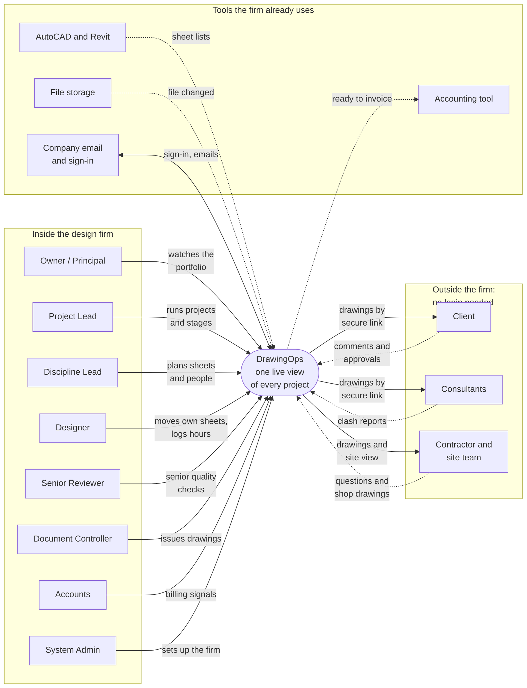

---

## 2. Who uses DrawingOps

### The roles

| Role | Who they are | What they mainly do in DrawingOps |
|---|---|---|
| **Owner / Principal** | Firm owner, directors | Watch every project on one screen; weekly review; see what is ready to bill |
| **Project Lead (PL)** | Architect leading a project | Create the project, set fee stages, build the team, approve the sheet plan, issue, record client approval |
| **Discipline Lead (DL)** | Lead of Architecture, HVAC, Electrical, Plumbing, Fire, Civil, ELV or Medical gas | Plan sheets and dates, assign designers and checkers, do the first check, allocate hours |
| **Designer** | Architect or engineer drafting in CAD | Move their own sheets through the steps, upload check prints, log hours |
| **Senior Reviewer** | Principal or senior architect | Second, milestone quality check; redlines |
| **Document Controller (DC)** | Document control staff (or the PL on small projects) | Upload final PDFs, create and send transmittals |
| **Accounts** | Finance team | Get told when a stage can be invoiced; mark it invoiced |
| **External** (Client, Consultant, Contractor) | People outside the firm | Receive drawings by email link, acknowledge them, view the current set on site |
| **System Admin** | IT or LatentIQ support | Users, sign-in, settings, integrations, onboarding old projects |

### Two layers of role

Each person has **one firm-wide role** and **a role on each project they belong to**. Together these decide what they can see and do. The same architect can be Project Lead on one project and a Designer on another.

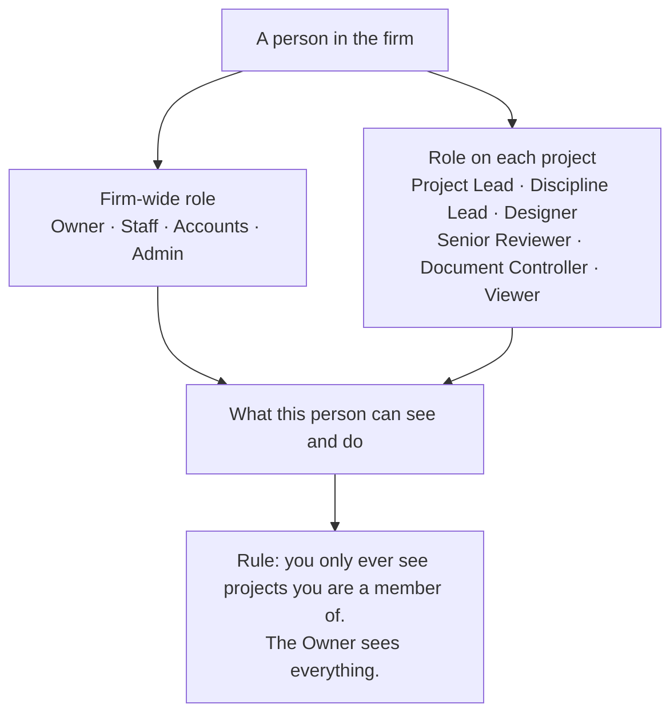

---

## 3. What DrawingOps keeps track of

These are the "things" (the data models) the system stores, in plain words. The key idea: **a sheet exists from the day it is planned, before any drawing file exists.** That is what lets the system show what is still owed, not just what has already been sent.

**Projects and drawings**

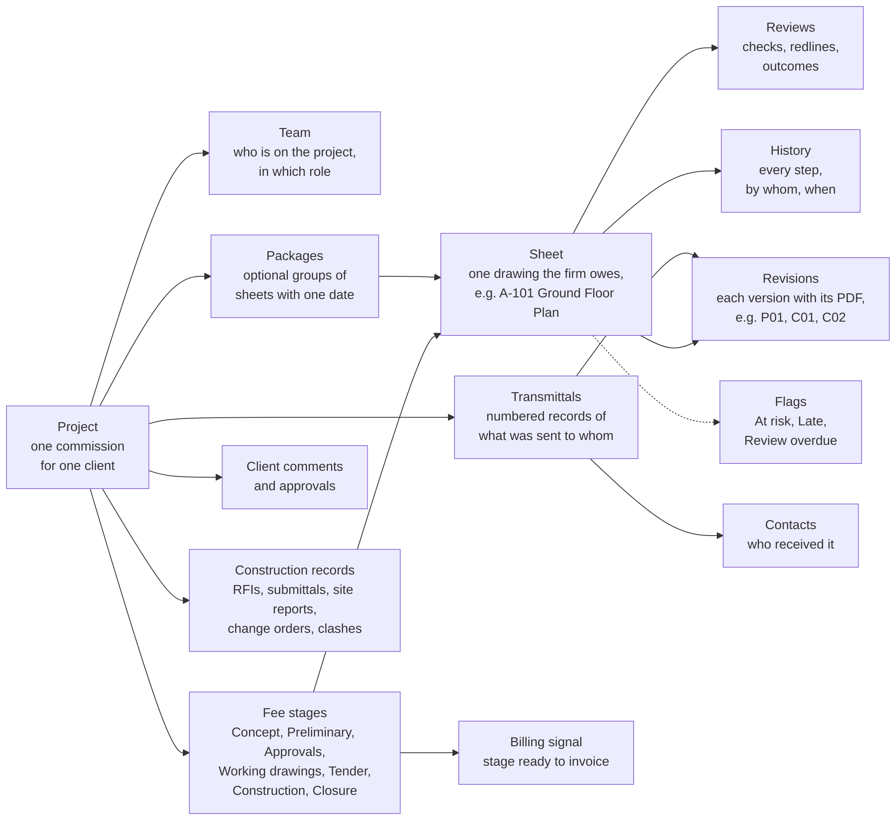

**The firm, its people and their hours**

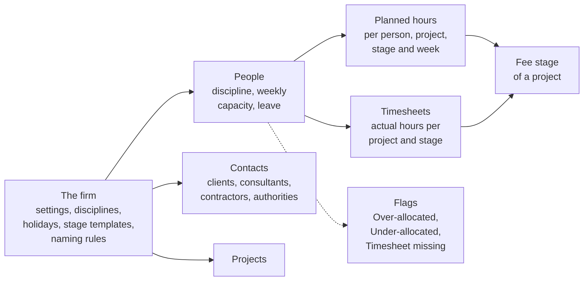

| Thing | What it is |
|---|---|
| **Project** | One commission for one client, e.g. "Hospital Block B, HSR" |
| **Stage** | A fee stage from the appointment letter, with a fee % and dates. Percentages must add up to 100% before the plan is final |
| **Package** | An optional group of sheets sharing one date, e.g. "HVAC GFC set". Leads can plan by package before planning sheet by sheet |
| **Sheet** | One drawing sheet the firm owes, e.g. `A-101 Ground Floor Plan` |
| **Revision** | One version of a sheet with its PDF, revision code (P01, C02…), purpose and date |
| **Transmittal** | The numbered record of sending revisions to people, with a PDF cover sheet |
| **Review** | A check of a sheet by a checker or senior reviewer, with outcome and redlines |
| **Allocation** | Planned hours for a person on a project stage in a week |
| **Time entry** | Actual hours a person logged on a project stage |
| **Flag** | A warning the system raises by itself: At risk, Late, Over-allocated, Under-allocated, Timesheet missing, Review overdue, Comment overdue, Ready to invoice |
| **Contact** | A person outside the firm, entered once and reused across projects |
| **Audit record** | A permanent note of every change: who, what, when, before and after |

---

## 4. The life of a project, start to finish

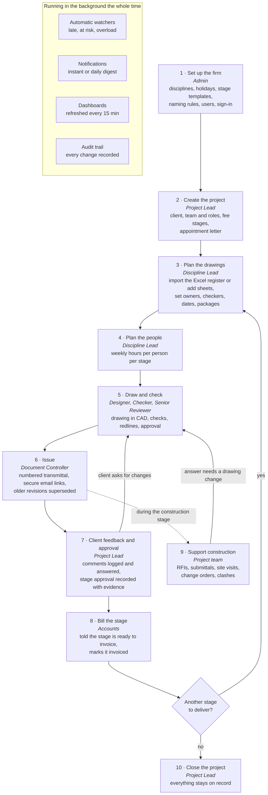

---

## 5. The life of a drawing sheet

Every sheet moves through a fixed set of steps. Each step is **one click** at a real moment ("Start", "Submit for check", "Approve"…), so the status is always current without anyone writing a status report. The system only allows the moves shown below, and only for the right people.

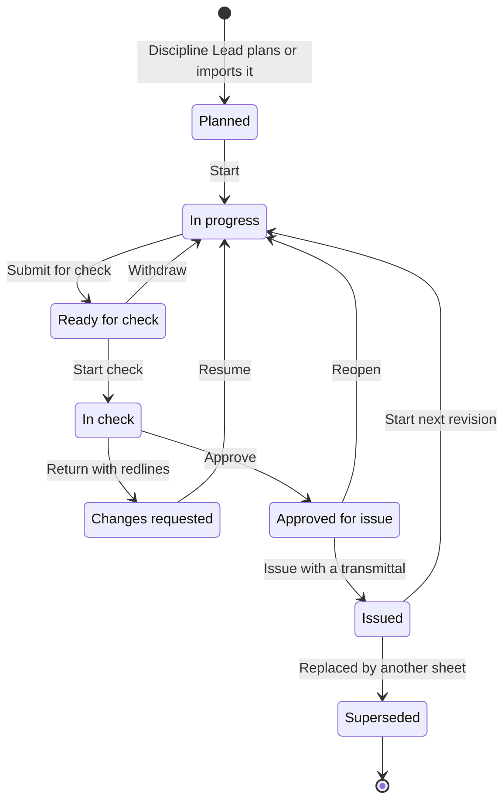

| Step | What it means | Who moves it here |
|---|---|---|
| **Planned** | On the list, not started | Discipline Lead (creates or imports) |
| **In progress** | Being drafted in CAD | Designer or Discipline Lead ("Start") |
| **Ready for check** | Designer says it is done | Designer ("Submit for check") |
| **In check** | Being reviewed | Checker ("Start check") |
| **Changes requested** | Redlines returned to the designer | Checker ("Return") |
| **Approved for issue** | Passed review (and senior QC, if the stage needs it) | Checker, then Senior Reviewer |
| **Issued** | PDF sent with a transmittal | Document Controller or Project Lead ("Issue") |
| **Superseded** | The sheet itself was replaced by a different sheet number, or withdrawn | Project Lead |
| **On hold** | Paused | Project Lead |
| **Cancelled** | Dropped from scope, with a reason | Project Lead |

**Pausing and cancelling** can happen from any active step:

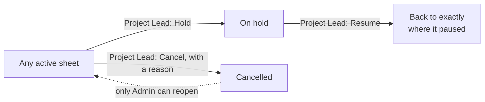

**Revisions have their own simple life.** Issuing a new revision automatically retires the old one:

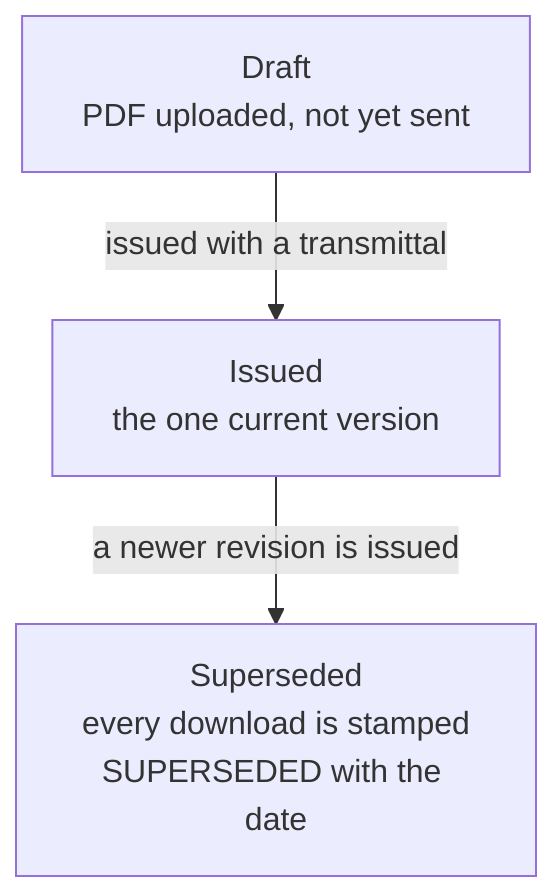

> **Status flags are not steps.** "At risk" and "Late" are warnings the system adds on top of the step, so a sheet can be *In progress* **and** *Late* at the same time.

---

## 6. Checking and reviewing a sheet

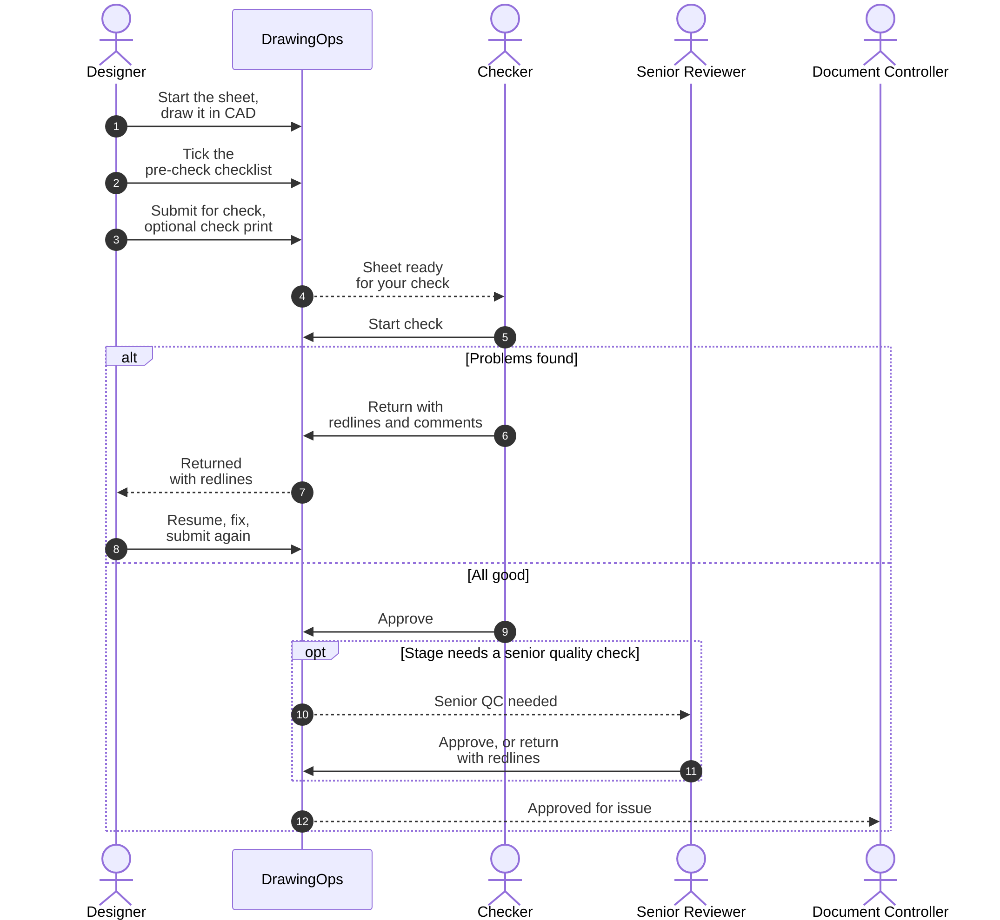

**Rules that keep reviews honest**

- A designer can never check their own sheet.
- "Return" is blocked unless the checker adds a comment or a redline file.
- On stages marked "senior QC required", the sheet stays *In check* until **both** the checker and the senior reviewer approve.
- Each reviewer has a **review queue**, oldest first, showing how many working days each sheet has waited.
- A reviewer going on leave can set a **delegate**; new reviews go to the delegate between two dates.
- A review open for more than 3 working days is escalated to the delegate or the Discipline Lead.
- If a sheet is changed after approval, the designer must "Reopen" it, which clears the approval.

---

## 7. Uploading and issuing drawings

### Step 1: every uploaded PDF is checked

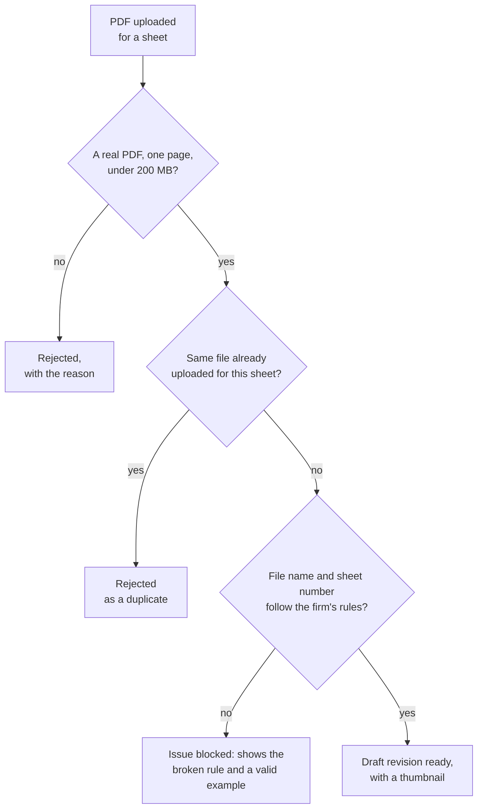

### Step 2: the transmittal sends it out

A **transmittal** is the official, numbered record of "we sent these revisions to these people for this purpose". Its number looks like `2026-014-TR-0007` and is never reused. Once sent, it can't be edited; a correction is a new transmittal that refers to the old one.

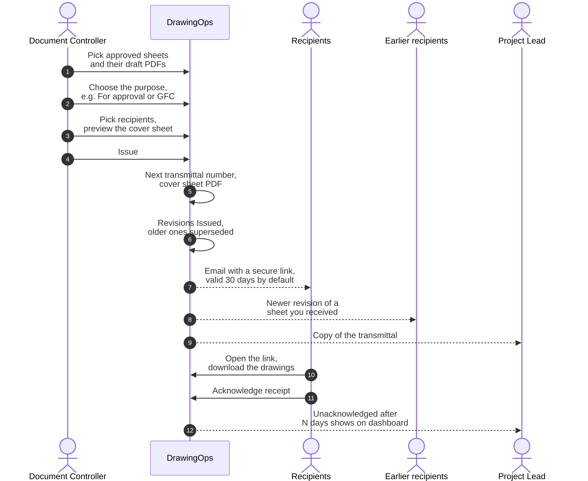

**Purposes** an issue can have: For information · For comment · For approval · For authority submission · For tender · Good for Construction (GFC) · Record / as-built.

**Edge cases handled:** a bounced email shows on the transmittal with a **Resend** button; drawings handed over on paper are recorded as "issued by hand" with a date.

---

## 8. How clients and other outside parties are connected

People outside the firm **never need an account or password**. They get secure, expiring links by email, and the firm logs everything they send back.

**What goes out to them**

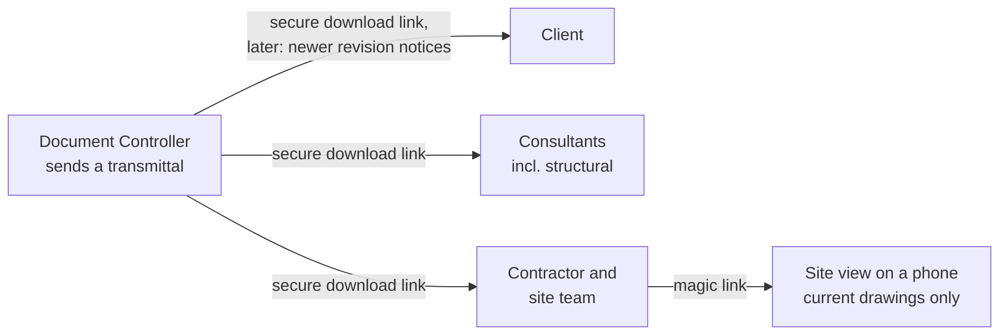

**What comes back from them**

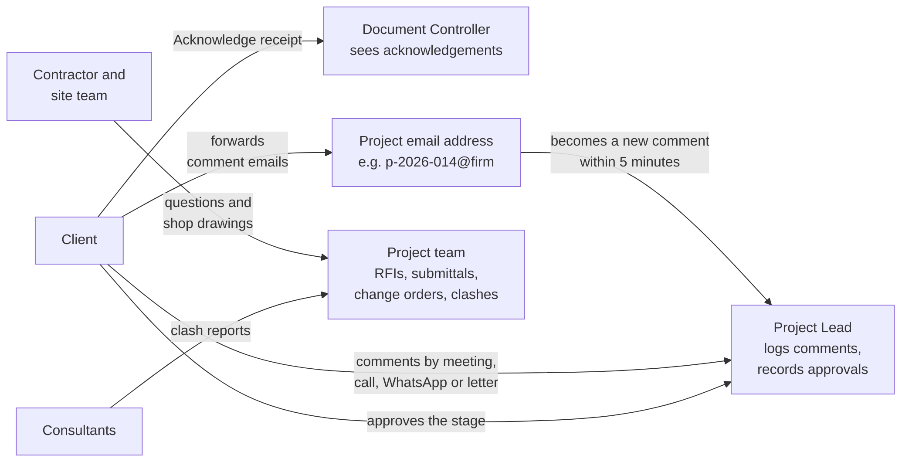

### The client's journey

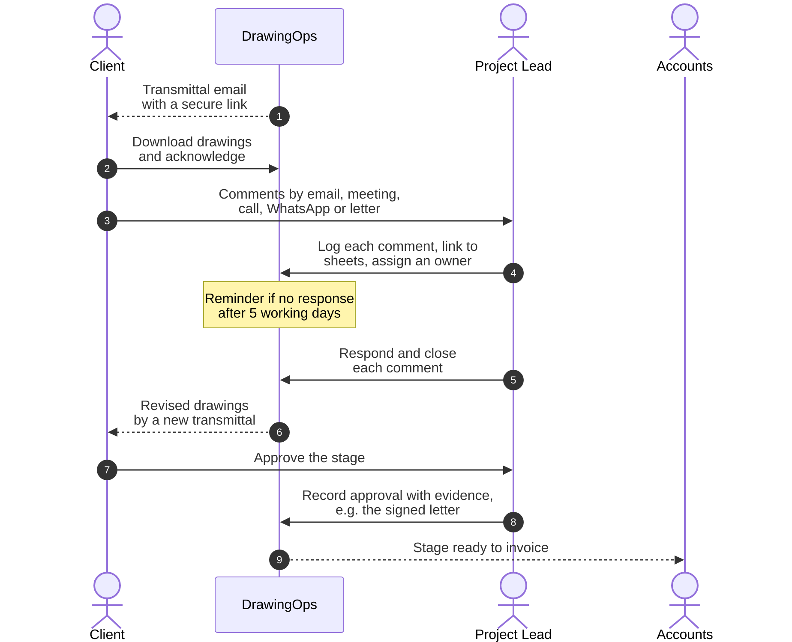

| Outside party | What they receive | What they can do | What the firm records about them |
|---|---|---|---|
| **Client** | Transmittal emails; "newer revision" emails | Download, acknowledge receipt | Comments, stage approvals with evidence, acknowledgements, downloads |
| **Consultant** | Transmittal emails | Download, acknowledge receipt | Clash reports imported as tracked issues |
| **Contractor / site** | Transmittal emails; site-view magic link | See **only the current** issued drawings on a phone, download | RFIs, submittals, change orders |

Comments from unknown email senders go to a review queue instead of straight into the project.

---

## 9. Fee stages and billing

A project is split into **fee stages** taken from the appointment letter. Stages move forward largely **on their own**, driven by what happens to the sheets.

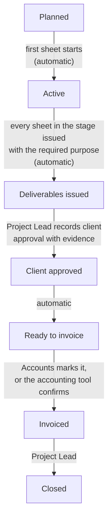

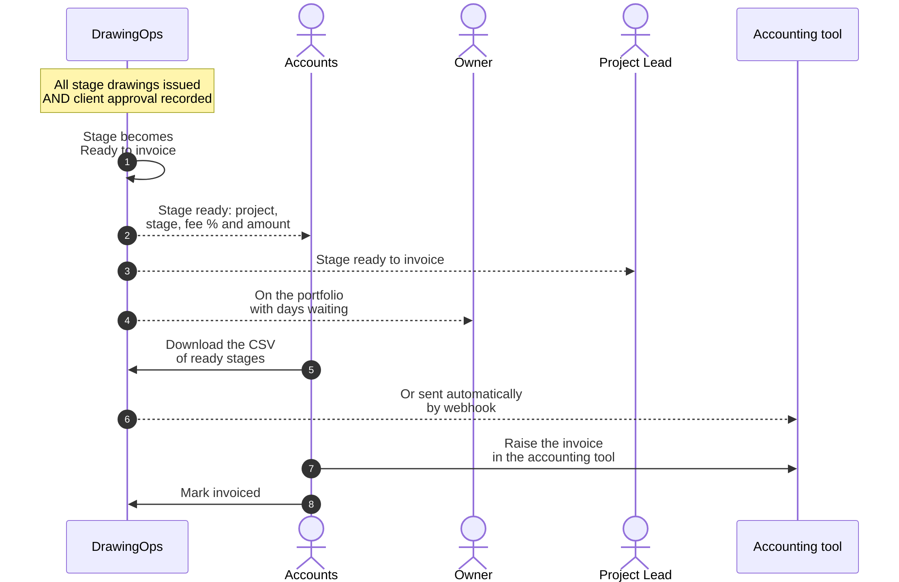

- Fee percentages must total 100% before a stage plan is saved as final; a draft can be saved anytime.
- Changing a stage's fee % after it is invoiced is blocked unless an Admin does it.
- **DrawingOps does not raise invoices, handle GST or keep a ledger.** That stays in the firm's accounting tool; DrawingOps only says "this is ready to bill".

---

## 10. People, workload and timesheets

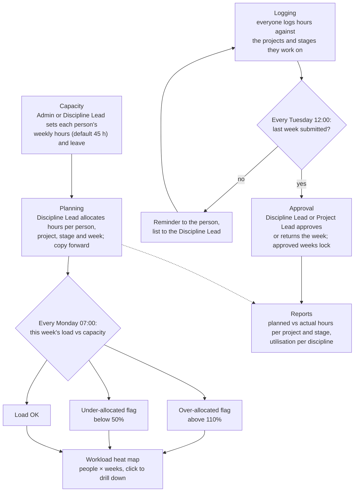

**Who sees whose hours.** Nobody's hourly productivity is ranked anywhere.

| Person | Sees |
|---|---|
| Everyone | Their own hours |
| Discipline Lead | Their discipline |
| Project Lead | Their project's totals |
| Accounts | Totals only |
| Owner | Everything |

Nobody approves their own timesheet. If the firm already uses a timesheet tool, hours can be imported from a CSV instead of typed in.

---

## 11. The automatic watchers

DrawingOps checks deadlines, reviews and workloads **by itself**, so nobody has to chase. All day counts use **working days** from the firm's calendar, skipping weekends and holidays. The thresholds can be changed in settings, and running a check twice never creates duplicate warnings.

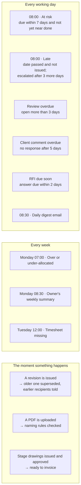

| Watcher | When | What it looks for | What it does | Who is told |
|---|---|---|---|---|
| **At risk** | Daily 08:00 | Sheet due within 7 working days, still planned or in progress | Adds an "At risk" flag; removes it when no longer true | Designer, Discipline Lead; Project Lead in digest |
| **Late** | Daily 08:00 | Planned date passed, no issued revision | Adds a "Late" flag; escalates if still late 3 working days later | Discipline Lead, Project Lead; Owner in weekly summary |
| **Supersede** | When a revision is issued | The sheet had an earlier issued revision | Marks the old one superseded; emails everyone who received it | Document Controller; earlier recipients |
| **Naming check** | When a PDF is uploaded | File name or sheet number breaks the firm's rule | Blocks issue and shows the exact rule | Uploader |
| **Workload** | Monday 07:00 | Load above 110% or below 50% of capacity | Over/Under-allocated flag | Discipline Lead, Project Lead |
| **Timesheet** | Tuesday 12:00 | Last week's timesheet not submitted | Reminder | The person; list to Discipline Lead |
| **Review overdue** | Daily | Review open more than 3 working days | Escalates | Reviewer's delegate or Discipline Lead |
| **Comment overdue** | Daily | Client comment with no response for 5 working days | Reminder | Assignee, Project Lead |
| **Ready to invoice** | When drawings are issued or approval recorded | All stage drawings issued **and** client approval recorded | Stage becomes Ready to invoice | Accounts, Project Lead, Owner |
| **RFI due** | Daily | RFI answer due within 2 working days | Reminder | RFI assignee |

If a scheduled check fails to run, the support team is alerted.

---

## 12. Notifications: who is told what

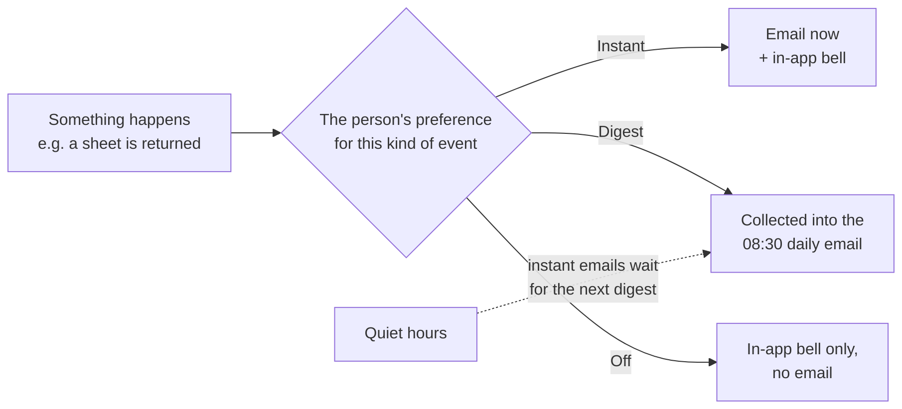

Every notification always shows up in the in-app notification centre. "Off" only stops the email. Some are **mandatory** and can't be turned off.

| Event | Goes to | Default | Can be turned off? |
|---|---|---|---|
| Sheet assigned to you | Designer | Instant | No |
| Sheet ready for your check | Checker | Instant | No |
| Sheet returned with redlines | Designer | Instant | No |
| Senior QC needed | Senior Reviewer | Instant | No |
| Sheet approved for issue | Designer, Document Controller | Digest | Yes |
| Sheet at risk | Designer, Discipline Lead | Digest | Yes |
| Sheet late / escalated | Discipline Lead, Project Lead | Instant | Yes |
| Transmittal received | External recipients | Email | No |
| Newer revision of a sheet you received | Earlier recipients | Email | No |
| Over/under-allocated | Discipline Lead, Project Lead | Digest | Yes |
| Timesheet missing | The person; list to Discipline Lead | Instant | Yes |
| Weekly owner summary | Owner | Monday 08:30 | Yes |
| Review overdue | Reviewer, Discipline Lead | Instant | Yes |
| Client comment assigned / overdue | Assignee, Project Lead | Instant | Yes |
| Stage ready to invoice | Accounts, Project Lead, Owner | Instant | No |
| RFI due | Assignee | Instant | Yes |
| Added to a project team | New team member | Instant | Yes |

---

## 13. Dashboards and reports

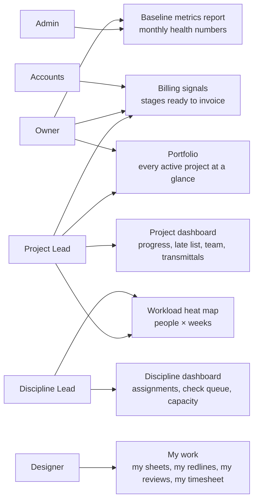

| Dashboard | For | Shows |
|---|---|---|
| **Portfolio** | Owner (all projects); Project Leads (their projects) | Every active project's stage, sheets planned vs issued, late and at-risk counts, oldest waiting review, discipline workload heat map, stages ready to invoice and days waiting |
| **Project** | Project Lead | Sheets issued over time per discipline, late list, team allocation, open transmittals, open client comments |
| **Discipline** | Discipline Lead | Assignments, check queue, capacity this week and next |
| **My work** | Everyone, especially Designers | My sheets by due date, sheets returned with redlines, reviews waiting for me, timesheet status |
| **Baseline metrics** | Owner, Admin | % of sheets issued late, average working days in check, hours logged vs planned, days from "drawings issued" to "invoiced" |
| **Billing signals** | Accounts, Owner, Project Leads | Stages ready to invoice, fee %, amount in ₹, days waiting, export, mark invoiced |
| **Workload** | Discipline Leads, Project Leads | Who is over or under-loaded this week and next |

Every number on a dashboard is **clickable** and opens the list behind it. Dashboards show "updated hh:mm" and are never more than 15 minutes old.

**Also available everywhere**

- **Search**: type "A-101" to find matching sheets across all your projects, plus projects, transmittals, contacts, client comments and text inside PDFs. Results only show what you are allowed to see.
- **Activity feed**: a newest-first list of everything important on a project (step changes, issues, transmittals, stage changes, imports), filterable by person, discipline and event type.
- **Exports**: every list has an Export button (Excel or PDF) that keeps your filters. Very large exports (over 5,000 rows) are prepared in the background and emailed as a link.

**Where things live on screen.** The left menu shows items by role (Portfolio for Owners and PLs, Admin for Admins, Reviews with a count of what is waiting for you). Inside a project, the tabs are: **Overview · Register · Stages · Transmittals · Team & hours · Activity · Comments · Construction**.

---

## 14. The construction stage

Once building starts, the questions and paperwork from site live in DrawingOps too, **linked to the sheets they concern**. If an answer needs a drawing change, the sheet simply goes back into its normal workflow.

**Where the records come from**

```mermaid
%%{init: {"themeVariables": {"fontSize": "16px"}, "flowchart": {"useMaxWidth": false}, "sequence": {"useMaxWidth": false}, "state": {"useMaxWidth": false}, "mindmap": {"useMaxWidth": false}}}%%
flowchart LR
  CT["Contractor /<br/>site team"] -->|"asks a question"| RFI["RFI log<br/>question, due date,<br/>linked sheets, whose turn,<br/>cost or time impact"]
  CT2["Contractor /<br/>site team"] -->|"sends shop drawings,<br/>product data, samples"| SUB["Submittal log<br/>stamped: Approved ·<br/>Approved as noted ·<br/>Revise and resubmit · Rejected"]
  CLI["Client"] -->|"requests a change"| CO["Change-order log<br/>description, impact,<br/>approval status"]
  CON["Consultants"] -->|"clash report"| CL["Clash issues<br/>one per clash, with a<br/>picture and assignee"]
  VIS["Site architect<br/>on a phone"] -->|"files with photos"| SR["Site visit reports<br/>observations, actions,<br/>PDF export"]
```

**What happens next**

```mermaid
%%{init: {"themeVariables": {"fontSize": "16px"}, "flowchart": {"useMaxWidth": false}, "sequence": {"useMaxWidth": false}, "state": {"useMaxWidth": false}, "mindmap": {"useMaxWidth": false}}}%%
flowchart LR
  RFI["RFI"] -->|"may lead to"| CO["Change order"]
  RFI -->|"needs a<br/>drawing change"| REV["New revision<br/>of the sheet, back into<br/>the normal workflow"]
  CO -->|"Project Lead<br/>approves"| REV
  CL["Clash issue"] -->|"fix needs a<br/>drawing change"| REV
  SUB["Submittal"] -.-> SHEETS["Linked sheets"]
  SR["Site visit report"] -.-> SHEETS

  RFI --> KB["Knowledge search<br/>past decisions, comments,<br/>RFIs and reviews<br/>across projects"]
  CO --> KB
  CL --> KB
```

- **RFI due reminder:** the person whose turn it is gets a reminder 2 working days before the answer is due.
- **Re-importing a clash report** updates the existing issues instead of creating duplicates.
- **Site photos** are compressed to 2 MB each so reports work on a phone.
- **Knowledge search** example: searching "OT ceiling HEPA" returns past comments, RFIs and decisions from any project you can see.

---

## 15. Connections to other tools

```mermaid
%%{init: {"themeVariables": {"fontSize": "16px"}, "flowchart": {"useMaxWidth": false}, "sequence": {"useMaxWidth": false}, "state": {"useMaxWidth": false}, "mindmap": {"useMaxWidth": false}}}%%
flowchart LR
  subgraph IN["Into DrawingOps"]
    direction TB
    XL["Excel / CSV registers<br/>import with column mapping,<br/>preview and 24 h undo"]
    REVIT["Revit add-in and AutoCAD plugin<br/>Sync sheets button"]
    PDFS["Folder of old PDFs<br/>title blocks read automatically"]
    STORE["File storage connector<br/>CAD file changed activity"]
    MAILIN["Inbound email<br/>client comments"]
    BCF["Navisworks / BCF<br/>clash results"]
  end

  DO(["DrawingOps"])

  subgraph OUTS["Out of DrawingOps"]
    direction TB
    MAILOUT["Outbound email<br/>notifications and transmittals"]
    ACC["Accounting tool<br/>CSV or webhook of ready stages"]
  end

  SSO["Google Workspace or<br/>Microsoft 365 sign-in"]

  XL --> DO
  REVIT -->|"proposed sheets, approved by<br/>a Project or Discipline Lead"| DO
  PDFS --> DO
  STORE -.-> DO
  MAILIN --> DO
  BCF --> DO
  DO --> MAILOUT
  DO --> ACC
  SSO <--> DO
```

| Connection | What it does | Status |
|---|---|---|
| Excel / CSV import | Bring in an existing sheet register. Bad rows are listed with reasons; the import is all-or-nothing and can be undone within 24 hours if nothing has moved | Built |
| Onboarding live projects | Load projects, stages, sheets and past revisions from a template workbook and a PDF folder in under an hour, without sending notifications | Built |
| Title-block reading | Reads sheet number, title and revision from PDFs to match them to sheets; unmatched files go to a manual list | Built |
| Revit add-in / AutoCAD plugin | Designer clicks "Sync sheets". New sheets are **proposed**, not created, until a lead approves; title mismatches are shown side by side | Built (needs the firm's CAD versions installed) |
| File-storage connector | Records "CAD file changed" against a sheet; never copies DWG/RVT files | Partly built (the receiving side) |
| Inbound email | Comments forwarded to the project address become new comments | Built |
| Outbound email | Notifications and transmittals. Outside production, every email goes to a test mailbox, never to real people | Built |
| Company sign-in | Google Workspace or Microsoft 365 sign-in; first sign-in creates the user with no project access until they are added | Built, waiting for the firm's credentials |
| Accounting export | CSV of ready-to-invoice stages, or an automatic webhook | Built |
| Navisworks / BCF | Clash results as tracked issues | Built |
| Autodesk Forma, Bluebeam, Paperless-ngx archive, WhatsApp Business | Only if the firm confirms it uses them or decides to | Not built |

CAD files themselves are **linked, not copied**: each sheet can hold a path or URL shown as "Open in CAD location". The PDFs are the legal record and are stored securely.

---

## 16. Smart forecasts (the prediction models)

Once the firm has at least **6 months of clean history** (and at least 2,000 issued revisions), DrawingOps can learn from its own past to give early warnings. These models are **advisory only**: they never change any data, never block an issue, and a person always decides.

```mermaid
%%{init: {"themeVariables": {"fontSize": "16px"}, "flowchart": {"useMaxWidth": false}, "sequence": {"useMaxWidth": false}, "state": {"useMaxWidth": false}, "mindmap": {"useMaxWidth": false}}}%%
flowchart TB
  HIST["The firm's own history<br/>sheets, steps, review times,<br/>hours, revisions"]
  PDF["Issued PDFs"]

  HIST --> M1["Late-risk prediction<br/>chance each open sheet<br/>misses its date,<br/>with the top reasons"]
  HIST --> M2["Workload forecast<br/>hours needed per discipline<br/>for the next 8 weeks"]
  PDF --> M3["Drawing checks<br/>missing title-block fields,<br/>broken references"]

  M1 --> SHOW["Shown labelled 'Forecast'<br/>on portfolio, project<br/>and sheet pages"]
  M2 --> SHOW2["Shown beside planned<br/>allocations, never<br/>replacing them"]
  M3 --> FIND["Findings list"]

  SHOW --> HUMAN["Leads decide what to do;<br/>overrides are recorded"]
  SHOW2 --> HUMAN
  FIND --> REVIEWER["A reviewer accepts or<br/>rejects every finding"]
```

| Model | Who sees it | How it is judged |
|---|---|---|
| Late-risk prediction | Owner; Project and Discipline Leads | Each month, compared with the simple "At risk" rule to prove it spots late sheets earlier |
| Workload forecast | Owner; Project and Discipline Leads | Forecast error per discipline and week, reported monthly |
| Drawing checks | Project Leads, Discipline Leads, Senior Reviewers, Document Controllers | Tested on at least 200 labelled sheets before switching on; can be off, in trial or on |

**Guardrails:** forecasts are at discipline level, with no ranking of individual people, and no client data is sent to an outside AI service without written consent.

---

## 17. Role-by-role guide

### Owner / Principal

```mermaid
%%{init: {"themeVariables": {"fontSize": "16px"}, "flowchart": {"useMaxWidth": false}, "sequence": {"useMaxWidth": false}, "state": {"useMaxWidth": false}, "mindmap": {"useMaxWidth": false}}}%%
mindmap
  root((Owner))
    Does
      Reviews the portfolio every week
      Creates projects and edits stages if needed
      Exports the audit trail
      Logs own timesheet
    Sees
      Every project in the firm
      Portfolio dashboard
      Baseline metrics report
      Billing signals and days waiting
      Everyone's hours
      Forecasts
    Is told about
      Weekly summary every Monday
      Sheets still late after escalation
      Stages ready to invoice
```

### Project Lead

```mermaid
%%{init: {"themeVariables": {"fontSize": "16px"}, "flowchart": {"useMaxWidth": false}, "sequence": {"useMaxWidth": false}, "state": {"useMaxWidth": false}, "mindmap": {"useMaxWidth": false}}}%%
mindmap
  root((Project Lead))
    Sets up
      Creates the project
      Applies the fee stage template
      Attaches the appointment letter
      Builds the team and roles
    Runs
      Approves the sheet plan
      Issues drawings and transmittals
      Holds, cancels, supersedes
      Overrides a step with a reason
      Logs client comments
      Records client approval
      Approves change orders
      Closes the project
    People
      Allocates hours
      Approves timesheets
    Sees
      Project dashboard
      Portfolio for own projects
      Project hour totals
      Billing signals
      Forecasts
    Is told about
      Late sheets and escalations
      Over or under-allocated people
      Overdue client comments
      Stage ready to invoice
```

### Discipline Lead

```mermaid
%%{init: {"themeVariables": {"fontSize": "16px"}, "flowchart": {"useMaxWidth": false}, "sequence": {"useMaxWidth": false}, "state": {"useMaxWidth": false}, "mindmap": {"useMaxWidth": false}}}%%
mindmap
  root((Discipline Lead))
    Plans
      Imports the Excel register
      Adds sheets, numbers and dates
      Creates packages
      Assigns designers and checkers
      Bulk updates dates and owners
      Accepts sheets proposed by CAD sync
    Checks
      First check of every sheet
      Returns with redlines or approves
    People
      Sets capacity and leave
      Allocates weekly hours
      Approves timesheets
    Sees
      Discipline dashboard
      Check queue
      Workload heat map
      Hours for the discipline
      Forecasts
    Is told about
      Sheets ready for check
      At risk and late sheets
      Overdue reviews
      Missing timesheets
```

### Designer

```mermaid
%%{init: {"themeVariables": {"fontSize": "16px"}, "flowchart": {"useMaxWidth": false}, "sequence": {"useMaxWidth": false}, "state": {"useMaxWidth": false}, "mindmap": {"useMaxWidth": false}}}%%
mindmap
  root((Designer))
    Does
      Starts work on own sheets
      Ticks the pre-check checklist
      Submits sheets for check
      Uploads check prints
      Fixes redlines and resubmits
      Syncs sheets from Revit or AutoCAD
      Files site visit reports
      Logs weekly hours
    Sees
      My work page
      Own sheets and deadlines
      Redlines from checkers
      Own hours only
    Is told about
      Sheet assigned
      Sheet returned with redlines
      Sheet approved
      Sheet at risk
      Timesheet missing
```

### Senior Reviewer

```mermaid
%%{init: {"themeVariables": {"fontSize": "16px"}, "flowchart": {"useMaxWidth": false}, "sequence": {"useMaxWidth": false}, "state": {"useMaxWidth": false}, "mindmap": {"useMaxWidth": false}}}%%
mindmap
  root((Senior Reviewer))
    Does
      Senior quality check on milestone stages
      Approves or returns with redlines
      Sets a delegate while on leave
      Reviews AI drawing check findings
      Reviews submittals
      Logs own timesheet
    Sees
      Review queue oldest first
      Days each sheet has waited
    Is told about
      Senior QC needed
      Overdue reviews
```

### Document Controller

```mermaid
%%{init: {"themeVariables": {"fontSize": "16px"}, "flowchart": {"useMaxWidth": false}, "sequence": {"useMaxWidth": false}, "state": {"useMaxWidth": false}, "mindmap": {"useMaxWidth": false}}}%%
mindmap
  root((Document Controller))
    Does
      Uploads final PDFs
      Builds and sends transmittals
      Picks the purpose of each issue
      Resends bounced emails
      Records issues by hand
      Logs client comments
      Manages RFIs and submittals
      Reviews AI drawing check findings
    Sees
      Transmittal log
      Who has which revision
      Acknowledgements
    Is told about
      Sheets approved for issue
      Bounced emails
```

### Accounts

```mermaid
%%{init: {"themeVariables": {"fontSize": "16px"}, "flowchart": {"useMaxWidth": false}, "sequence": {"useMaxWidth": false}, "state": {"useMaxWidth": false}, "mindmap": {"useMaxWidth": false}}}%%
mindmap
  root((Accounts))
    Does
      Downloads ready stages as CSV
      Marks stages invoiced
      Logs own timesheet
    Sees
      Billing signals screen
      Fee percent and amount
      Days each stage has waited
      Hour totals only
    Is told about
      Stage ready to invoice
```

### System Admin

```mermaid
%%{init: {"themeVariables": {"fontSize": "16px"}, "flowchart": {"useMaxWidth": false}, "sequence": {"useMaxWidth": false}, "state": {"useMaxWidth": false}, "mindmap": {"useMaxWidth": false}}}%%
mindmap
  root((System Admin))
    Sets up
      Disciplines and sheet number prefixes
      Holidays and working week
      Stage templates
      Revision codes and purposes
      Naming rules
      Watcher thresholds
    Manages
      Users and company sign-in
      Two-factor login for admins
      Tokens for CAD plugins and integrations
      Checklists
    Onboards
      Loads live projects from spreadsheets and PDFs
    Can
      Reopen cancelled or superseded sheets
      Export the audit trail
      See baseline metrics
```

### External: client, consultant, contractor

```mermaid
%%{init: {"themeVariables": {"fontSize": "16px"}, "flowchart": {"useMaxWidth": false}, "sequence": {"useMaxWidth": false}, "state": {"useMaxWidth": false}, "mindmap": {"useMaxWidth": false}}}%%
mindmap
  root((Outside parties))
    Receive
      Transmittal emails with secure links
      Newer revision emails
    Can
      Download drawings
      Acknowledge receipt
      See the current set on site by phone
      Forward comment emails to the project address
    Never
      Need a login or password
      See superseded drawings on the site view
      See other recipients' transmittals
```

---

## 18. Who can do what

✔ = allowed · own = only their own items · — = not allowed

| Action | Owner | Project Lead | Discipline Lead | Designer | Senior Reviewer | Doc. Controller | Accounts | External | Admin |
|---|---|---|---|---|---|---|---|---|---|
| View a project | ✔ | ✔ | ✔ | ✔ | ✔ | ✔ | stage data only | own transmittals; site view | ✔ |
| Create project / edit stages | ✔ | ✔ | — | — | — | — | — | — | ✔ |
| Create, import, edit sheets | — | ✔ | ✔ | own notes | — | — | — | — | — |
| Start / submit a sheet | — | ✔ | ✔ | own | — | — | — | — | — |
| Check, return, approve | — | ✔ | ✔ | — | ✔ | — | — | — | — |
| Upload final PDF, send transmittal | — | ✔ | — | — | — | ✔ | — | — | — |
| Hold, cancel, supersede a sheet | — | ✔ | — | — | — | — | — | — | — |
| Allocate hours | — | ✔ | ✔ | — | — | — | — | — | — |
| Log own timesheet | ✔ | ✔ | ✔ | ✔ | ✔ | ✔ | ✔ | — | — |
| Approve timesheets | — | ✔ | ✔ | — | — | — | — | — | — |
| See others' hours | all | project | discipline | — | — | — | totals | — | — |
| Log client comments, manage RFIs and submittals | — | ✔ | ✔ | — | — | ✔ | — | — | — |
| Review submittals | — | ✔ | ✔ | — | ✔ | — | — | — | — |
| Record client approval, approve change orders | — | ✔ | — | — | — | — | — | — | — |
| File site visit reports | — | ✔ | ✔ | ✔ | ✔ | ✔ | — | — | — |
| See billing signals | ✔ | ✔ | — | — | — | — | ✔ | — | — |
| Mark invoiced | — | — | — | — | — | — | ✔ | — | — |
| See forecasts | ✔ | ✔ | ✔ | — | — | — | — | — | — |
| Firm settings, users, integrations | — | — | — | — | — | — | — | — | ✔ |
| Export audit trail | ✔ | — | — | — | — | — | — | — | ✔ |

Project roles (Project Lead, Discipline Lead, Designer and so on) apply **only on the projects where the person holds that role**. These rules are enforced by the server, so the same limits apply in search and exports as on screen.

---

## 19. Promises the system keeps

```mermaid
%%{init: {"themeVariables": {"fontSize": "16px"}, "flowchart": {"useMaxWidth": false}, "sequence": {"useMaxWidth": false}, "state": {"useMaxWidth": false}, "mindmap": {"useMaxWidth": false}}}%%
flowchart TB
  subgraph TRUST["What you can rely on"]
    direction TB
    T1["One current drawing<br/>Each sheet has exactly one current issued revision.<br/>Older ones are stamped SUPERSEDED on every download."]
    T2["Issued files never change<br/>A mistake is fixed by issuing a new revision,<br/>never by swapping a file."]
    T3["History can't be erased<br/>Every change is recorded with who, when,<br/>before and after. Nobody can edit or delete it."]
    T4["You only see your projects<br/>On screen, in search and in exports alike."]
    T5["Outside links are safe<br/>They expire, and every download is logged per recipient."]
    T6["No surprise emails<br/>Outside production, email goes only to a test mailbox."]
    T7["Warnings are fair<br/>Working days only, no duplicates, and nobody's<br/>productivity is ranked."]
    T1 ~~~ T2 ~~~ T3 ~~~ T4 ~~~ T5 ~~~ T6 ~~~ T7
  end
```

Also built in: company sign-in (no new password), two-factor login for admins, nightly backups with 7-day point-in-time recovery, and web pages that meet WCAG 2.2 AA accessibility. Status is always shown with **colour, an icon and a word**, never colour alone. Dates are shown as `23-Oct-2026`, money in ₹ with Indian grouping (1,00,000), times in IST.

---

## 20. How it was rolled out

```mermaid
%%{init: {"themeVariables": {"fontSize": "16px"}, "flowchart": {"useMaxWidth": false}, "sequence": {"useMaxWidth": false}, "state": {"useMaxWidth": false}, "mindmap": {"useMaxWidth": false}}}%%
flowchart TD
  P0["Phase 0 · Discovery<br/>interviews, baseline numbers,<br/>pilot projects chosen"]
  P1["Phase 1 · Visibility<br/>register, review steps, transmittals,<br/>alerts, workload, timesheets, dashboards, search"]
  P2["Phase 2 · Flow and billing<br/>review queue and delegation, checklists,<br/>client comments and approvals, billing signal,<br/>CAD plugins, site view"]
  P3["Phase 3 · Construction<br/>RFIs, submittals, site reports,<br/>change orders, clashes, knowledge search"]
  P4["Phase 4 · Intelligence<br/>late-risk and workload forecasts,<br/>AI drawing checks"]
  P0 --> P1 --> P2 --> P3 --> P4
```

Phases 1 to 4 are built and in review. Each phase has a sign-off gate before the next one goes live with the firm.

---

## 21. Glossary

| Term | Meaning |
|---|---|
| **Sheet** | One drawing sheet, e.g. `A-101 Ground Floor Plan` |
| **Revision** | A version of a sheet. `P01, P02…` are usually preliminary, `C01, C02…` construction; the uploader picks the series |
| **Register** | The list of every sheet on a project with its step, owner, date and current revision |
| **Discipline** | A design specialism: Architecture, HVAC, Electrical, Plumbing (PHE), Fire, Civil, ELV, Medical gas |
| **Check print** | A draft print attached for the checker |
| **Redline** | A marked-up drawing showing corrections |
| **Senior QC** | A second, senior quality check on milestone stages |
| **Transmittal** | The numbered record of drawings sent to people, with a cover sheet |
| **GFC** | Good for Construction: drawings the contractor can build from |
| **Superseded** | Replaced by a newer revision; still kept, but stamped |
| **Fee stage** | A billable phase of the commission from the appointment letter |
| **Package** | A group of sheets that share one due date |
| **Flag** | A warning the system adds by itself, such as At risk or Late |
| **Digest** | One daily email (08:30) collecting non-urgent notifications |
| **Working day** | A day the office works, skipping weekends and the firm's holidays |
| **RFI** | Request for Information: a question from the contractor |
| **Submittal** | Shop drawings, product data or samples sent by the contractor for approval |
| **Change order** | An agreed change to scope, cost or time |
| **Clash** | A place where two disciplines' designs collide, found by coordination software |
| **BCF** | A standard file format for sharing clash issues |
| **Ball in court** | Whose turn it is to act next |
| **Magic link** | A secure link that opens a limited view without a password |
